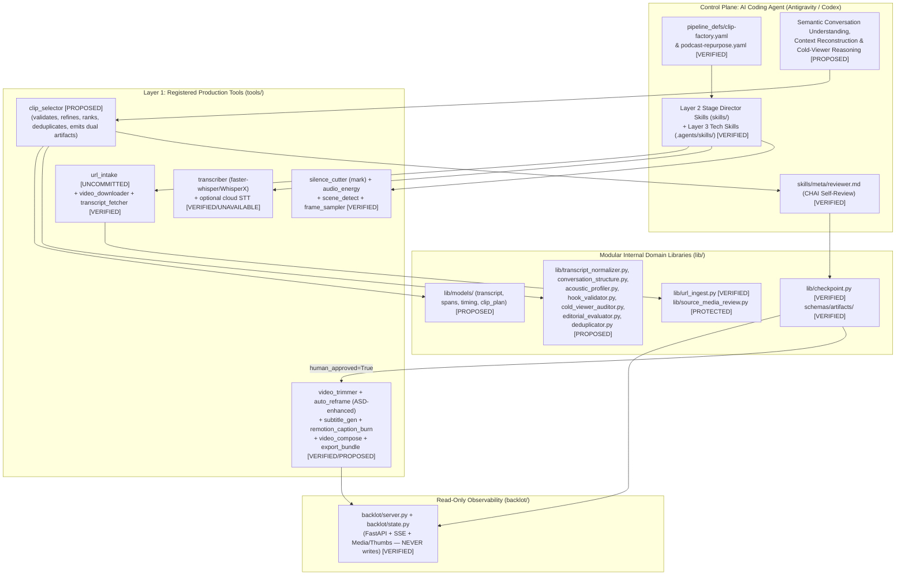
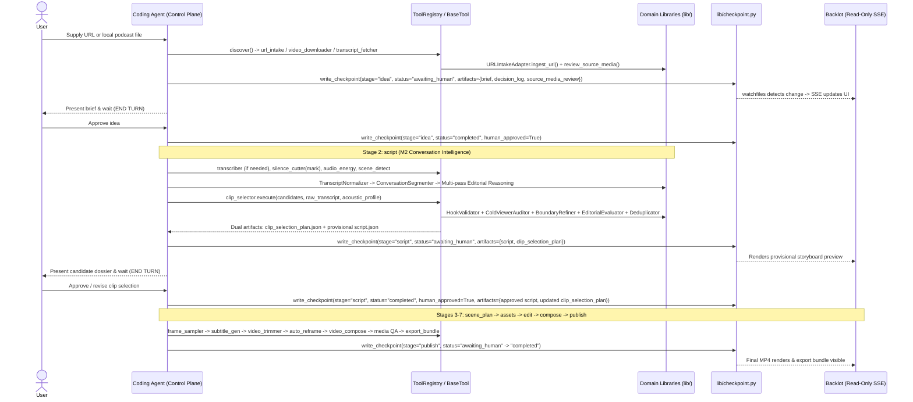
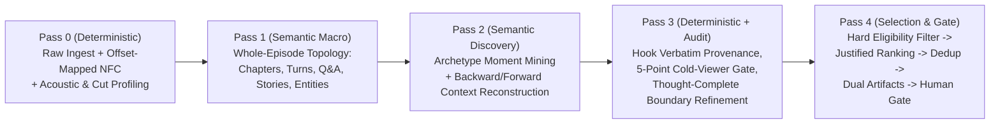

# AI Video Lab — Complete System Architecture and Technical Design

**Document Path:** `architecture/01_SYSTEM_ARCHITECTURE.md`  
**Repository:** `https://github.com/Unstocks/AI-video-Lab.git` (`C:\AI-Video-Lab`)  
**Upstream Base:** `https://github.com/OpenMontageInc/OpenMontage.git` (`upstream/main` @ `2e003e6`)  
**Accepted Working Branches:** Local `main` tracking `origin/main`; remote review branch `origin/openmontage`. Both names are accepted; do not propose branch renames. `[VERIFIED]`  
**Current Verified HEAD:** `216a604` (evolved from baseline `7cf6b52f` across M1–M6a, Phases 1–5, Adversarial Backend Hardening `f9796d8`, and Broadcast Obsidian Pro Studio `216a604`) `[VERIFIED]`  
**Architecture Status:** Permanent Reference Layer 1 of 3 (`01_SYSTEM_ARCHITECTURE.md`, `02_EXECUTION_PLAN_AND_ENGINEERING_GOVERNANCE.md`, `03_ENGINEERING_BRAIN_AND_DECISION_PLAYBOOK.md`)  
**Last Updated:** November 18, 2026

> **Evidence Classification Key Used Throughout All Three Architecture Documents:**
> - `[VERIFIED]` Directly confirmed in repository source code, test execution, or authoritative documentation.
> - `[CODEX FINDING]` Reported by Codex in a milestone report, pending independent verification and acceptance.
> - `[INFERRED]` Conclusion strongly supported by repository evidence, not directly implemented.
> - `[PROPOSED]` Recommended target architecture or future implementation.
> - `[UNVERIFIED]` Requires additional evidence or live testing.
> - `[OPEN DECISION]` Requires explicit approval from the project owner.
> - `[DEPRECATED]` Earlier design/decision superseded and no longer authorized to guide implementation.
>
> **Permanent Dual-Agent Governance Anchor:** This document is paired with `architecture/02_EXECUTION_PLAN_AND_ENGINEERING_GOVERNANCE.md` (Section D — Permanent Principal Architect Reaction Loop & 9-Part Codex Prompt Standard) and `architecture/03_ENGINEERING_BRAIN_AND_DECISION_PLAYBOOK.md` (Section I — Co-Development & Prompt Engineering Playbook). Every review and every implementation prompt MUST consult all three files and verify live repository state before acting.
>
> **Missing External Input Notice (Part 13 Honesty):** No standalone external Codex architectural investigation reports (e.g., `planning/30_*`–`32_*`) were present on disk or supplied as input for this transfer. All repository findings below were independently verified directly against `C:\AI-Video-Lab`, including live inspection of all uncommitted working-tree milestones. `[VERIFIED]`

---

## 1. Product Definition

**AI Video Lab** is a personal, local-first, AI-powered podcast and long-form video intelligence and short-form video production studio built by **evolving** the open-source **OpenMontage** platform — not replacing it. `[VERIFIED]`

AI Video Lab is **not** a generic video cutter. It is an **editorial intelligence system coupled to a deterministic video production engine**: it understands complete long-form conversations, identifies moments that stand on their own for a cold viewer, reconstructs missing context without fabricating speech, establishes natural boundaries with honest timing provenance, preserves human editorial approval, and renders validated vertical (9:16) or aspect-appropriate MP4 videos for manual publishing. `[PROPOSED]`

---

## 2. Product Requirements

### 2.1 Core Editorial Philosophy
> **Three genuinely excellent, contextually complete, independently understandable clips are far more valuable than ten mediocre or confusing clips.** `[VERIFIED — Product Mandate]`

### 2.2 Functional Workflow Requirements (23-Step Intended Lifecycle + Pro Studio Layer)
| # | Capability | Current Status (`HEAD 216a604`) |
|---|---|---|
| 1–2 | Public video URL input (YouTube/Vimeo) and local video file input | `[VERIFIED — COMMITTED 0699621, a3bff47, f9796d8, 216a604]` URL via `lib/url_ingest.py` + `tools/analysis/url_intake.py` + connect-time `lib/ssrf_guard.py`; local upload (`POST /api/studio/upload`, 2 GiB streaming) & local FS browser (`GET /api/studio/fs/browse`) + `lib/source_media_review.py` |
| 3–4 | Source media acquisition & technical inspection | `[VERIFIED — COMMITTED 0699621, a3bff47]` Transactional rollback, preflight resolution/duration cap, PCM WAV extraction, H.264 proxy |
| 5 | Caption retrieval (multilingual, manual prioritized over auto) | `[VERIFIED — COMMITTED 0699621]` `transcript_fetcher.py` `ytt.list()` + `include_auto_generated` |
| 6 | Timestamped ASR transcription when captions absent/insufficient | `[OPTIONAL / DEGRADED ON PY3.14]` `tools/analysis/transcriber.py` (`faster-whisper`) optional in `clip-factory.yaml`; native captions prioritized on Python 3.14 |
| 7–8 | Complete conversation understanding & topic/semantic segmentation | `[VERIFIED — COMMITTED 4196087]` Stateless `TranscriptNormalizer` + `ConversationStructureAnalyzer` (multilingual/Devanagari/Hinglish/HTML-entity offset mapping + Q&A topology) |
| 9–10 | Candidate moment discovery & context reconstruction | `[VERIFIED — COMMITTED 4196087, b443b3c]` Semantic Pass 1–2 in `script-director.md` + deterministic `ColdViewerAuditor` context-window & episodic-ceiling enforcement |
| 11 | Cold-viewer comprehension validation | `[VERIFIED — COMMITTED 4196087]` `lib/cold_viewer_auditor.py` (5-point gate + EN/Hinglish/Devanagari dangling-pronoun & mid-answer checks) |
| 12 | Authentic spoken-hook discovery & verbatim provenance validation | `[VERIFIED — COMMITTED 4196087]` `lib/hook_validator.py` (zero-tolerance verbatim single-speaker multi-segment `SpokenHookEvidence`, case-insensitive auto-caption support) |
| 13 | Natural clip boundary determination with honest timing uncertainty | `[VERIFIED — COMMITTED 4196087]` `lib/acoustic_profiler.py` wrapping `SilenceCutter(mode="mark")`, `AudioEnergy`, `SceneDetect` + non-destructive `thought_complete`-gated snapping |
| 14–16 | Editorial eligibility, quality ranking, semantic deduplication & portfolio diversity | `[VERIFIED — COMMITTED 4196087, b443b3c]` `lib/editorial_evaluator.py`, `lib/deduplicator.py`, `tools/analysis/clip_selector.py` (zero quota padding, SHA-256 dual-artifact sync) |
| 17 | Human review & approval via OpenMontage checkpoint gate | `[VERIFIED — COMMITTED b443b3c, 03ac66d, 216a604]` Proven against `lib/checkpoint.py`, read-only `backlot/state.py`, and Pro Studio Universal Gate Bar (`POST /api/studio/sessions/{id}/gate`) |
| 18–19 | Vertical 9:16 composition & Smart Reframe v2 cinematography | `[VERIFIED — COMMITTED c935bab, a3bff47, 8027c36, f9796d8]` RTX 3050 `h264_nvenc` + single-pass `-14 LUFS` `lib/ffmpeg_profiles.py`; YuNet ONNX `lib/face_detector.py`, `SmoothedCameraman` (`lib/camera_tracker.py`), `lib/split_layout.py`, `lib/active_speaker.py`, `lib/punch_in.py`, zero-drift multi-scene `auto_reframe`, `tools/video/vertical_clip_composer.py` |
| 20 | Synchronized, readable subtitles with 8 presets & `Style: Seam` | `[VERIFIED — COMMITTED cdfc094, b0ed975, f9796d8]` 8 DirectWrite-verified bundled OFL fonts in `assets/fonts/`, `lib/layout_ranges.py`, `Style: Seam` (`Alignment=5`) for 2-speaker split, continuation-word merging (negative-number/`.NET` safe), Devanagari/Hinglish safe |
| 21–23 | Audio/visual QA, final rendering & validated MP4 export | `[VERIFIED — COMMITTED fb82380, 080f19a, 03ac66d, f9796d8]` Registered `tools/analysis/media_qa.py` (`integrated_lufs`, `true_peak_dbtp`, strict loudnorm window, freeze/black frame checks) + hard-gated batch `export_bundle` -> `publish_log.json` |
| 24 | Interactive Top-Supervisor Pro Studio Workstation (`127.0.0.1:4760`) | `[VERIFIED — COMMITTED 03ac66d, f9796d8, 216a604]` Loopback + CSRF hardened FastAPI BFF (`studio/`) + React 19 / TS / Tailwind v4 **Broadcast Obsidian Pro** SPA (`studio/web/` → `studio/ui/`): Command Hub (all 13 pipelines), NLE Studio (PCM waveform, filmstrip, on-canvas Single/Split crop, word-snapped recut), Universal Pipeline Board, Broadcast QA, 169-Tool Matrix, and persistent `fcc-claude` Executive Producer Dock. *Live `fcc-claude` runtime (`BU-0.1`) & live podcast walkthrough (`BU-6.1`) pending.* |

### 2.3 Explicit Product Anti-Goals
AI Video Lab must NEVER: slice at fixed time intervals; extract isolated punchlines without setup; select clips solely by audio energy or keyword triggers; fabricate or splice spoken hooks; hide missing context behind misleading titles; produce redundant clips covering the same insight; claim word-level precision from coarse captions; or pad weak clips to hit a count quota. `[VERIFIED — Product Mandate]`

---

## 3. Non-Functional Requirements

1. **Source Fidelity:** Raw source video, raw audio, and immutable raw transcripts are never overwritten or altered in place. `[PROPOSED]`
2. **Determinism & Auditability:** Every mechanical media, indexing, validation, and boundary adjustment step is deterministic and logs provenance. `[PROPOSED]`
3. **Human Sovereignty:** No gated stage may advance without explicit human approval recorded in `checkpoint_<stage>.json` (`human_approved: true`). `[VERIFIED: lib/checkpoint.py:487-515]`
4. **Local-First, Hardware-Unconstrained Intelligence:** Workspace, artifacts, media, and deterministic tools run locally on Windows (`C:\AI-Video-Lab`, RTX 3050 6GB, ~15.7GB RAM), while demanding editorial reasoning is NOT capped to local VRAM and supports frontier APIs / coding-agent reasoning / hybrid execution. `[VERIFIED — Product Mandate]`
5. **Backward Compatibility:** All 13 existing OpenMontage pipelines, 20 existing artifact schemas, `lib/checkpoint.py`, `lib/source_media_review.py`, and `backlot/` remain functional without regressions. `[VERIFIED]`
6. **Clean-Install Reproducibility:** Every required runtime import must be declared in `requirements.txt` and `setup.py`; optional ML/CV/GPU packages must be explicitly documented and gracefully degraded when absent. `[VERIFIED]`
7. **Windows & Multilingual Reliability:** All paths, subprocess invocations, temp directories (`.pytest_cache/tmp` for sandboxed tests), UTF-8 I/O, and Unicode text processing must work reliably on Windows across English, Hindi (Devanagari), Hinglish (Romanized code-switching), accented Latin, combining marks, and emoji. `[VERIFIED]`

---

## 4. System Architecture Overview

AI Video Lab evolves OpenMontage's **3-tier system** (Agent Control Plane → Deterministic Python Tool/Library Runtime → Read-Only Backlot Observability) by inserting a clean, modular **Editorial Intelligence Layer** inside `lib/` and exposing a narrow set of registered `BaseTool` entry points in `tools/`. `[PROPOSED]`



---

## 5. Existing OpenMontage Foundation (Verified Inventory)

Inspected directly in `C:\AI-Video-Lab` at HEAD `7cf6b52f0b279f50d193f6aab7c25be5f3b8f95f` (plus uncommitted Phase 1 working-tree state):

- **Control Plane (`AGENT_GUIDE.md`, `PROJECT_CONTEXT.md`, `docs/ARCHITECTURE.md`):** Instruction-driven, agent-first orchestration. Zero Python orchestrator and zero runtime general-purpose LLM calls (`docs/ARCHITECTURE.md:90-102`). `lib/providers/` contains only an empty `__init__.py`; `config.yaml`'s `llm:` block has zero active callers in `lib/` or `tools/`. `[VERIFIED]`
- **3-Layer Knowledge Model:** Layer 1 `tools/` + `pipeline_defs/`; Layer 2 `skills/` (stage directors + meta skills); Layer 3 `.agents/skills/` (**93** vendor/tech skill directories linked via `BaseTool.agent_skills`). `[VERIFIED]`
- **Tool System (`tools/base_tool.py`, `tools/tool_registry.py`):** `ToolRegistry.discover()` walks `tools/` via `pkgutil.walk_packages()`, registering **164** committed tools (**165** including uncommitted `tools/analysis/url_intake.py`). `BaseTool.__init_subclass__` wraps every concrete `execute()` in `_cache_execute(_instrument_execute(impl))` (cache outermost; `_instrument_execute` logs to `projects/<id>/events.jsonl`). `BaseTool` does **NOT** automatically run JSON Schema validation on tool inputs/outputs. `[VERIFIED]`
- **Budget Governance (`tools/cost_tracker.py`):** Standalone class `CostTracker` (`estimate -> reserve -> reconcile -> refund`, `cost_snapshot()`). **NOT** a `BaseTool` and **NOT** in `ToolRegistry`. `[VERIFIED]`
- **Pipeline Manifests (`pipeline_defs/`):** **13** declarative YAML manifests including `clip-factory.yaml` (v2.0, beta, 7 stages: `idea -> script -> scene_plan -> assets -> edit -> compose -> publish`) and `podcast-repurpose.yaml` (v2.0, beta, 7 stages). `[VERIFIED]`
- **Schemas (`schemas/artifacts/`):** **20** committed Draft 2020-12 JSON schemas + **1** uncommitted (`clip_selection_plan.schema.json`, **21** total in working tree) registered in `schemas/artifacts/__init__.py:ARTIFACT_NAMES`. `[VERIFIED]`
- **Checkpoint Governance (`lib/checkpoint.py`):** Atomic checkpoint write (`*.tmp -> os.replace`), automatic history archival (`projects/<id>/history/`), cumulative `decision_log.json` merging, mandatory `CANONICAL_STAGE_ARTIFACTS[stage]` presence on both `awaiting_human` and `completed` (`lines 134-143`), `GATE VIOLATION` exception if a gated stage is written `completed` without `human_approved=True` (`lines 487-515`), and `_enforce_stage_prerequisites` (`lines 304-366`). `[VERIFIED]`
- **Backlot (`backlot/server.py`, `backlot/state.py`, `backlot/ui/`):** FastAPI + SSE local storyboard server. Strictly read-only (`server.py:5`), `TrustedHostMiddleware(["127.0.0.1", "localhost"])`, path-escape guards, `load_board_state()` -> `_build_storyboard()` joining `scene_plan.scenes × script.sections × asset_manifest.assets`. `[VERIFIED]`
- **Remotion (`remotion-composer/`):** React/TS composer (`remotion ^4.0.484`, `@remotion/captions`), including `TalkingHead.tsx` (`OffthreadVideo`, `CaptionOverlay`, 9:16 `1080x1920` `POSITION_STYLES` with `lower_third bottom: 320` above `~1600px` captions). **Not installed locally (`node_modules` missing); local fonts in `src/fonts/` are Latin-only.** `[VERIFIED]`

---

## 6. Current vs. Proposed Architecture (Honest Gap & Working-Tree Reconciliation)

### 6.1 Live Milestone Status (Independently Audited Baseline — Milestones 1–5 Complete)
All five core local studio milestones (**M1–M5**) have been independently audited line by line, verified with real FFmpeg & contract tests, and locked into clean local Git commits on `main` (on top of base `7cf6b52f0b279f50d193f6aab7c25be5f3b8f95f`, without pushing): `[VERIFIED]`

1. **Milestone 1 (Phase 1 — URL Intake Hardening): `[VERIFIED — ACCEPTED]`**
   - Hardened `lib/url_ingest.py`, caller-scoped `allowed_extractors` in `tools/analysis/video_downloader.py` (`ADR-008`), `tools/analysis/transcript_fetcher.py`, and compliant `tools/analysis/url_intake.py` (`ToolTier.SOURCE`).
2. **Milestone 2A (Layer 0 Domain Models & `clip_selection_plan.schema.json`): `[VERIFIED — ACCEPTED]`**
   - `lib/models/{__init__,transcript,clip_plan}.py` + `schemas/artifacts/clip_selection_plan.schema.json` (21st schema registered).
3. **Milestone 2B (Transcript Intelligence & Conversation Topology): `[VERIFIED — ACCEPTED]`**
   - Stateless `lib/transcript_normalizer.py` (2-stage HTML-entity + whitespace + NFC cluster offset alignment, UTF-8 BOM stripping, non-speech isolation, `segment_order` gap fidelity) + `lib/conversation_structure.py` (EN/Hinglish/Devanagari Q&A + max-overlap block lookup).
4. **Milestone 2C (Acoustic Profiling & Non-Destructive Boundary Refinement): `[VERIFIED — ACCEPTED]`**
   - `lib/acoustic_profiler.py` wrapping `SilenceCutter(mode="mark")`, `AudioEnergy`, optional `SceneDetect`, and pluggable `VoiceActivityDetector` Protocol with `thought_complete=False` dramatic-pause protection.
5. **Milestone 2D (Editorial Safety, Evaluation, Dedup & `clip_selector` `BaseTool`): `[VERIFIED — ACCEPTED]`**
   - `lib/hook_validator.py`, `lib/cold_viewer_auditor.py`, `lib/editorial_evaluator.py`, `lib/deduplicator.py`, `tools/analysis/clip_selector.py` (`TOTAL: 166` tools discovered).
6. **Milestone 3 (Human Review Gate, Checkpoint Compatibility, Dual-Artifact Sync & Backlot Wiring): `[VERIFIED — ACCEPTED]`**
   - Unified `build_script_from_plan()`, `finalize_approved_selection()`, `verify_script_plan_sync()`; wired `clip-factory.yaml`, `podcast-repurpose.yaml`, skills, and 1-line read-only `backlot/state.py`; `0` diffs on `lib/checkpoint.py`, `lib/source_media_review.py`, `backlot/server.py`.
7. **Milestone 4 (Vertical 9:16 Production, Speaker-Track Reframing & Synchronized ASS/SRT Subtitles): `[VERIFIED — ACCEPTED]`**
   - Updated `YOUTUBE_SHORTS` to `180s` (`lib/media_profiles.py`); upgraded `tools/video/auto_reframe.py` (shot-cut smoothing reset, pluggable `speaker_tracks`, `single_crop`/`blurred_pillarbox`/`stacked_split`, Windows `sendcmd` escaping, `yuv420p` + `+faststart`); upgraded `tools/subtitle/subtitle_gen.py` (`rebase_segments_to_clip`, UTF-8 Devanagari/Hinglish `format="ass"` with 9:16 safe zones, honest coarse-caption highlight downgrade); created approval-gated `lib/vertical_composer.py` (H.264 proxy preference, fail-soft batch resilience); updated `clip-factory.yaml` & `{scene,edit,compose}-director.md`.
8. **Milestone 5 (Automated Media QA, Backlot Preview & Multi-Clip Batch Export): `[VERIFIED — ACCEPTED]`**
   - Created `lib/media_qa.py` (`MediaQAInspector` probing container/codec/resolution/fps/duration/AV-sync, 4+ PIL frames for black-frame detection with explicit handle closure, `ebur128` loudness/silence/clipping, `.ass`/`.srt` timing drift, runtime swap block -> schema-valid `final_review.json` & `QA_PASSED`/`QA_FAILED` plan states); extended `tools/publishers/export_bundle.py` with backward-compatible multi-clip batch packaging (`clips/01_<id>/...` + atomic `manifest.json` + schema-valid `publish_log.json`, strictly excluding `QA_FAILED` clips); wired `audio_probe`/`frame_sampler`/`export_bundle` into `clip-factory.yaml` & `publish-director.md`; proven end-to-end with real FFmpeg media, unmodified `lib/checkpoint.py`, and `backlot/state.py` (`76 passed in 36.23s`).

### 6.2 Current vs. Target Delta Summary
| Subsystem | Current Repository State `[VERIFIED]` | Target Architecture `[PROPOSED]` |
|---|---|---|
| **URL Intake (M1)** | **ACCEPTED:** Hardened `URLIntakeAdapter`, caller-scoped `VideoDownloader`, compliant `URLIntake` | Optional live network smoke verification |
| **Data, Transcripts & Acoustic Profiling (M2A–2C)** | **ACCEPTED:** Layer 0 models + 21st schema, stateless Unicode normalizer, Q&A topology, FFmpeg acoustic profiler + VAD seam | Optional Phase 6 WhisperX/Silero VAD/cloud STT plug-ins |
| **Conversation Intelligence & Human Gate (M2D–M3)** | **ACCEPTED:** `hook_validator`, `cold_viewer_auditor`, `editorial_evaluator`, `deduplicator`, `clip_selector` (#166), dual-artifact SHA-256 sync, `clip-factory`/`podcast-repurpose`/Backlot wiring | Phase 6 empirical evaluation & threshold calibration |
| **Vertical Production & Subtitles (M4)** | **ACCEPTED:** Shot-cut & speaker-track-ready `auto_reframe` (3 layouts), clip-rebased FFmpeg ASS/SRT subtitles (`MarginV=320`, UTF-8 Devanagari/Hinglish), `YOUTUBE_SHORTS` 180s, approval-gated `lib/vertical_composer.py` | Optional Remotion `TalkingHead.tsx` kinetic captions + bundled Devanagari fonts |
| **Media QA & Multi-Clip Export (M5)** | **ACCEPTED:** `lib/media_qa.py` (`final_review.json`), QA-gated batch `export_bundle` (`publish_log.json`), full real-FFmpeg + checkpoint + Backlot end-to-end proof | Optional OCR overlay/caption legibility checks |
| **Multimodal ML & Evaluation Studio (M6)** | **NEXT (Optional Pro Upgrades):** unit/contract/real-FFmpeg integration suites only | Multi-speaker ASD (`Light-ASD`/`LoCoNet`), live WhisperX/cloud STT forced alignment, multilingual embeddings (`BGE-M3`/`Qwen3`), 12-dimension golden dataset eval studio |

---

## 7. Complete Execution Flow



---

## 8. Component Responsibility Map (Modularity Classification)

Every existing and proposed component is classified strictly into one of the 10 permanent architectural roles:

| Component | Classification | Responsibility | Inputs / Outputs | Dependencies | Stateful / Side Effects | Reusable / Agent-Accessible / Status |
|---|---|---|---|---|---|---|
| `lib/models/transcript.py` | **1. Domain Model** | Immutable raw transcript, post-hydration `transcript_revision_id`, orthogonal timing provenance, `SourceSpan` | Pure dataclasses/Pydantic models | stdlib / `pydantic` | Stateless / None | Reusable / Internal / `[UNCOMMITTED — RE-AUDIT PENDING]` (Phase 2A) |
| `lib/models/clip_plan.py` | **1. Domain Model** | `CandidateClip`, 4 orthogonal states, `SpokenHookEvidence` (multi-segment same-turn, nullable speaker), `ColdViewerAudit`, `ClipSelectionPlan` | Pure domain models + invariants | `lib/models/transcript.py` | Stateless / None | Reusable / Internal / `[UNCOMMITTED — RE-AUDIT PENDING]` (Phase 2A) |
| `lib/transcript_normalizer.py` | **2. Pure Utility / 3. Internal Service** | Ingest YouTube/Whisper/SRT/VTT, HTML-unescape + NFC normalize + whitespace collapse while building exact char/token offset alignment map | Raw transcript -> `NormalizedTranscript` + `OffsetMap` | `lib/models/transcript.py`, `unicodedata`, `html` | Stateless / None | Reusable / Internal / `[UNCOMMITTED — AWAITING AUDIT]` (Phase 2B) |
| `lib/conversation_structure.py` | **3. Internal Service** | Turn grouping, discourse block containers, Q&A / topic boundary structural representation | `NormalizedTranscript` -> `ConversationTopology` | `lib/models/transcript.py` | Stateless / None | Reusable / Internal / `[UNCOMMITTED — AWAITING AUDIT]` (Phase 2B) |
| `lib/acoustic_profiler.py` | **3. Internal Service** | Wraps `SilenceCutter(mode="mark")`, `AudioEnergy`, `SceneDetect`, optional VAD into unified acoustic evidence | Media path -> `AcousticProfile` | `ToolRegistry` (`silence_cutter`, `audio_energy`, `scene_detect`) | Stateless / Temp JSON via tool | Reusable / Internal / `[PROPOSED]` (Phase 2C) |
| `lib/hook_validator.py` | **2. Pure Utility** | Zero-tolerance verbatim spoken-hook verification against raw text via offset map (single speaker turn, no middle deletions) | Proposed hook + raw transcript -> `HookValidationResult` | `lib/models/`, `lib/transcript_normalizer.py` | Stateless / None | Reusable / Internal / `[PROPOSED]` (Phase 2D) |
| `lib/cold_viewer_auditor.py` | **3. Internal Service** | Validates structured 5-point cold-viewer audit + pronoun/antecedent & context-expansion invariants | Candidate + topology -> `ColdViewerAudit` | `lib/models/` | Stateless / None | Reusable / Internal / `[PROPOSED]` (Phase 2D) |
| `lib/editorial_evaluator.py` | **3. Internal Service** | Separates hard binary eligibility gates from transparent justified ranking | Validated candidates -> `EvaluationResult` | `lib/models/` | Stateless / None | Reusable / Internal / `[PROPOSED]` (Phase 2D) |
| `lib/deduplicator.py` | **2. Pure Utility** | Temporal IoU suppression + optional semantic similarity deduplication & portfolio diversity selection | Eligible candidates -> selected + deferred sets | `lib/models/`, optional embedder | Stateless / None | Reusable / Internal / `[PROPOSED]` (Phase 2D) |
| `lib/url_ingest.py` | **3. Internal Service** | Safe remote acquisition, container remux, PCM audio verification, transactional commit, `source_manifest.json` | URL + `project_id` -> `URLIngestResult` | `ToolRegistry`, `ffmpeg`/`ffprobe` | Disk writes in `projects/<id>/source/` | Reusable / Internal (wrapped by `url_intake`) / `[VERIFIED]` |
| `lib/source_media_review.py` | **3. Internal Service (PROTECTED)** | Cross-pipeline technical probing & frame sampling for user media | Media paths -> `source_media_review` artifact | `ToolRegistry`, `ffprobe`, PIL | Writes review frames | Reusable / Internal / `[VERIFIED]` |
| `lib/checkpoint.py` | **9. Infrastructure (PROTECTED)** | Atomic checkpoint persistence, schema validation, gate enforcement, prerequisite checks, history archival | Stage + status + artifacts -> checkpoint JSON | `jsonschema`, `pipeline_loader`, `schemas` | Writes `projects/<id>/checkpoint_*.json` | Core / Internal / `[VERIFIED]` |
| `lib/providers/` | **4. Provider Adapter (Reserved)** | Optional opt-in runtime model adapter ONLY if headless batch/eval inference is authorized in Phase 6 | Prompt/schema -> structured response | Deferred | Stateless / Network | Future Extension / Internal / `[PROPOSED — DEFERRED]` |
| `tools/analysis/url_intake.py` | **5. Production Tool** | Registered `BaseTool` (`url_intake`) exposing `URLIntakeAdapter` to agents | Tool inputs -> `ToolResult` | `lib/url_ingest.py`, `python:yt_dlp`, `cmd:ffmpeg` | Disk writes via adapter | Reusable / **Agent-Accessible** / `[VERIFIED — ACCEPTED UNCOMMITTED]` |
| `tools/analysis/clip_selector.py` | **5. Production Tool** | Registered `BaseTool` (`clip_selector`) orchestrating validation, boundary refinement, dedup, and dual-artifact emission | Candidates + transcript + acoustic profile -> `ToolResult` (`clip_selection_plan` + `script`) | `lib/models/`, `lib/hook_validator`, `lib/cold_viewer_auditor`, `lib/editorial_evaluator`, `lib/deduplicator`, `lib/acoustic_profiler` | Writes artifacts in `projects/<id>/artifacts/` | Reusable / **Agent-Accessible** / `[PROPOSED]` (Phase 2D) |
| Existing OpenMontage Tools (`video_downloader`, `transcript_fetcher`, `transcriber`, `audio_energy`, `silence_cutter`, `scene_detect`, `frame_sampler`, `auto_reframe`, `video_trimmer`, `subtitle_gen`, `remotion_caption_burn`, `video_compose`, `export_bundle`) | **5. Production Tools** | Concrete media acquisition, analysis, framing, subtitle, composition, and export operations | Per verified schemas in `tools/` | FFmpeg, optional Python/Node pkgs | Media file writes | Reusable / **Agent-Accessible** / `[VERIFIED]` |
| `pipeline_defs/clip-factory.yaml` & `podcast-repurpose.yaml` | **6. Pipeline Stages** | Declarative 7-stage manifests (`idea` → `publish`) | YAML spec | `lib/pipeline_loader.py` | Read-only config | Core / Agent-Read / `[VERIFIED]` |
| `skills/pipelines/clip-factory/*.md` & `skills/meta/*.md` | **7. Markdown Skills** | Agent behavioral playbooks, CHAI reviewer, checkpoint protocol | Markdown instructions | Read by IDE agent | Read-only | Core / Agent-Read / `[VERIFIED]` |
| `schemas/artifacts/clip_selection_plan.schema.json` + existing 20 schemas | **8. Artifacts / Schemas** | Draft 2020-12 JSON schema contracts | JSON payloads | `jsonschema` | Read-only | Core / Enforced by `checkpoint.py` / `[PROPOSED]` + `[VERIFIED]` |
| `backlot/server.py` & `backlot/state.py` | **9. Infrastructure** | Read-only FastAPI + SSE storyboard UI & media server | `projects/` filesystem -> HTTP/SSE/HTML | `fastapi`, `uvicorn`, `watchfiles` | Read-only on `projects/`; caches thumbs in `.backlot/` | Core / User-Facing / `[VERIFIED]` |
| Audio-Visual ASD (`Light-ASD` / `LoCoNet`) & Golden Eval Harness | **10. Future Extensions** | Multi-speaker active-speaker tracking & automated benchmark evaluation | Clip video/audio -> speaker tracks / eval metrics | PyTorch/ONNX (optional) | Read/eval reports | Future Extension / Deferred to Phases 4–6 / `[PROPOSED]` |

---

## 9. Modular Directory Structure (Existing + Target)

```text
C:\AI-Video-Lab\
├── architecture/                          # [NEW — PERMANENT] Architectural Constitution (3 docs)
│   ├── 01_SYSTEM_ARCHITECTURE.md
│   ├── 02_EXECUTION_PLAN_AND_ENGINEERING_GOVERNANCE.md
│   └── 03_ENGINEERING_BRAIN_AND_DECISION_PLAYBOOK.md
├── lib/                                   # Core infrastructure & modular internal domain services
│   ├── checkpoint.py                      # [VERIFIED — PROTECTED]
│   ├── source_media_review.py             # [VERIFIED — PROTECTED]
│   ├── url_ingest.py                      # [VERIFIED — M1 ACCEPTED UNCOMMITTED]
│   ├── media_profiles.py                  # [VERIFIED — Phase 4 update]
│   ├── models/                            # [UNCOMMITTED — Phase 2A re-audit pending]
│   │   ├── __init__.py
│   │   ├── transcript.py
│   │   └── clip_plan.py
│   ├── transcript_normalizer.py           # [UNCOMMITTED — Phase 2B awaiting audit]
│   ├── conversation_structure.py          # [UNCOMMITTED — Phase 2B awaiting audit]
│   ├── acoustic_profiler.py               # [PROPOSED — Phase 2C]
│   ├── hook_validator.py                  # [PROPOSED — Phase 2D]
│   ├── cold_viewer_auditor.py             # [PROPOSED — Phase 2D]
│   ├── editorial_evaluator.py             # [PROPOSED — Phase 2D]
│   ├── deduplicator.py                    # [PROPOSED — Phase 2D]
│   └── providers/                         # [VERIFIED EMPTY — Reserved for optional Phase 6]
├── tools/
│   ├── analysis/
│   │   ├── url_intake.py                  # [VERIFIED — M1 ACCEPTED UNCOMMITTED]
│   │   ├── clip_selector.py               # [PROPOSED — Phase 2D BaseTool]
│   │   └── (existing 15 analysis tools)   # [VERIFIED]
│   ├── video/                             # [VERIFIED — auto_reframe, silence_cutter, video_trimmer, video_compose, remotion_caption_burn]
│   ├── subtitle/                          # [VERIFIED — subtitle_gen.py]
│   └── publishers/                        # [VERIFIED — export_bundle.py]
├── schemas/artifacts/
│   ├── clip_selection_plan.schema.json    # [UNCOMMITTED — Phase 2A re-audit pending]
│   └── (20 existing schemas)              # [VERIFIED — PROTECTED]
├── pipeline_defs/                         # [VERIFIED — 13 manifests]
├── skills/                                # [VERIFIED — Layer 2 director & meta skills]
├── .agents/skills/                        # [VERIFIED — 93 Layer 3 vendor skills]
├── backlot/                               # [VERIFIED — Read-only storyboard server]
├── remotion-composer/                     # [VERIFIED — React/Remotion composer (uninstalled locally)]
├── planning/                              # [VERIFIED — Historical planning & audit archive (preserved)]
└── tests/                                 # [VERIFIED — unit/, contracts/, tools/, qa/, backlot/, lib/, integration/]
```

---

## 10. Domain Boundaries & Coupling Rules

1. **Strict Acyclic Layering:** `lib/models/` (zero internal imports) ← `lib/` pure utilities (`transcript_normalizer`, `hook_validator`, `deduplicator`) ← `lib/` services (`acoustic_profiler`, `cold_viewer_auditor`, `editorial_evaluator`) ← `tools/` `BaseTool` wrappers (`url_intake`, `clip_selector`) ← `pipeline_defs/` + `skills/`. Never import `tools/` or `lib/checkpoint.py` inside `lib/models/` or pure text/math utilities. `[PROPOSED]`
2. **Cross-Pipeline Isolation:** `lib/source_media_review.py`, `lib/checkpoint.py`, and `tools/analysis/video_downloader.py` serve multiple OpenMontage pipelines. Never hardcode `clip-factory`-only restrictions (such as restricting `VideoDownloader` globally to YouTube/Vimeo) inside shared upstream tools; pass restrictions explicitly as optional caller parameters. `[VERIFIED]`
3. **Observability Isolation:** `backlot/` may only read `projects/` and `pipeline_defs/`. No runtime pipeline logic may depend on Backlot being running (`AGENT_GUIDE.md:225`). `[VERIFIED]`

---

## 11. Conversation Intelligence Architecture

The editorial intelligence subsystem operates in **four disciplined passes** inside Stage 2 (`script`), keeping deterministic verification separated from semantic reasoning: `[PROPOSED]`



- **Why Whole-Episode First:** Evaluating sentences in isolation causes missed premises, unexplained pronouns, and broken arguments. Pass 1 builds an episode-level map of speakers, recurring concepts/entities, topic shifts, Q&A pairs, anecdotes, and disagreements *before* any candidate clip is proposed. `[PROPOSED]`

---

## 12. Transcript & Timestamp Architecture

### 12.1 Orthogonal Timing Provenance Model (Supersedes Flat 3-Tier & 8-Tier Enums `[DEPRECATED]`)
Earlier planning docs (`planning/13_*`, `planning/16_*`) collapsed source, method, quality, transformation, and review into a single enum — that design is **`[DEPRECATED]`**. The authoritative architecture separates **six orthogonal dimensions**: `[PROPOSED]`

| Dimension | Values | Purpose |
|---|---|---|
| `timing_source` | `creator_caption`, `auto_caption`, `asr_segment`, `asr_word`, `vad_region`, `unknown` | Where the timestamp originated |
| `alignment_method` | `none`, `caption_container`, `asr_cross_attention`, `forced_alignment_ctc`, `vad_energy_or_neural`, `character_interpolation`, `human_manual` | How text was aligned to audio time |
| `evidence_quality` | `high_subframe`, `medium_word`, `coarse_segment`, `low_estimated`, `unknown` | Honest operational precision tier |
| `transformation` | `raw_unmodified`, `silence_proximity_adjusted`, `vad_onset_offset_adjusted`, `editorial_context_expanded`, `human_adjusted` | What boundary edit was applied |
| `uncertainty_seconds` | `Optional[float]` (`None` when unmeasured; never fake `0.0` unless human-verified) | Quantified error bound |
| `confidence` | `Optional[float]` (`None` when unknown — **NEVER default to `1.0`**) | Model/source confidence distinct from human review |

Plus `human_reviewed: bool = False` and `original_seconds: Optional[float] = None` for full audit trail.

### 12.2 Immutable Raw Text & Offset-Mapped Unicode Spans
- **Never assume Unicode normalization (NFC/NFKC) or caption cleanup preserves character offsets.** HTML entity unescaping (`&amp;`, `&#39;`, `&quot;`), embedded newline/whitespace collapsing, combining characters (`e` + `\u0301` → `é`), Devanagari matras/nuktas (`कि`, `क़`), Hinglish code-switching, and emoji ZWJ clusters (`👨‍👩‍👧‍👦`) all change code-point indices during normalization. `[VERIFIED]`
- Raw transcript segments are stored immutably with a content-addressed `transcript_revision_id` (SHA-256). **Post-Hydration Hashing Invariant:** `transcript_revision_id` MUST be computed **after** segments are hydrated into canonical `RawTranscriptSegment` instances (never on unhydrated raw dicts in a `before`-validator) so dict-constructed and model-constructed transcripts always produce identical SHA-256 digests. `[VERIFIED — M2A Audit]`
- **Numeric & Type Invariants:** All timestamp and metric floats (`start_seconds`, `end_seconds`, `uncertainty_seconds`, `confidence`) MUST reject non-finite IEEE-754 floats (`NaN`, `inf`, `-inf`) via `math.isfinite()` and reject `bool`-as-`int`/`float`, enforcing `start_seconds >= 0` and `end_seconds > start_seconds`. `[VERIFIED — M2A Audit]`
- `TranscriptNormalizer` builds an **explicit character/cluster alignment table DURING normalization** (handling HTML entities, newlines, whitespace runs, NFC combining marks, Devanagari, and ZWJ emoji atomically), mapping every normalized half-open code-point interval `[norm_start, norm_end)` back to exact raw `SourceSpan`s:
  - `transcript_revision_id: str`
  - `segment_id: int`
  - `coordinate_system: Literal["unicode_codepoint_half_open"]`
  - `char_start: int` (inclusive, `>= 0`), `char_end: int` (exclusive, `>= char_start`)
  - `gap_before: Optional[str] = None` (explicitly marks gaps when multiple spans are referenced; **disallowed inside `spoken_hook`**). `[PROPOSED]`

---

## 13. Candidate Discovery Architecture

Candidates are mined as **complete editorial units** across explicit content archetypes rather than generic keyword/energy scores: `[PROPOSED]`
- `contrarian_claim` / `strong_opinion`
- `surprising_insight` / `counterintuitive_explanation`
- `story_with_payoff` / `personal_experience`
- `qa_exchange` (host question + guest payoff)
- `evidence_backed_argument` / `memorable_example`
- `authentic_emotional_or_humorous_moment`

If a long episode contains only 2 genuinely standalone moments, the engine emits 2 — **zero quota padding**. `[PROPOSED]`

---

## 14. Context Reconstruction Architecture

For every seed moment, context reconstruction inspects surrounding discourse ($\pm 90\text{s}$ or full containing topic block) to resolve:
1. Triggering question or premise that explains *why* the speaker is making this point.
2. Unintroduced people, organizations, products, or acronyms.
3. Unresolved opening or internal pronouns (`he`, `she`, `they`, `it`, `this`, `that`).
4. Immediate qualifying clauses, counter-arguments, or satirical cues needed to preserve the speaker's true intent.
5. Complete conclusion/payoff.

**Length Guardrail:** If required context pushes duration past the configured short-form ceiling (default `120s`), the moment is rejected as inherently episodic rather than truncated misleadingly. `[PROPOSED]`

---

## 15. Hook Validation Architecture

Strictly separate **five distinct concepts** in data models and schemas: `[PROPOSED]`
1. **`original_spoken_dialogue`**: Immutable raw text across the full clip span.
2. **`spoken_opening`**: Verbatim words actually spoken at the clip's opening (`[start_seconds, ...]`).
3. **`spoken_hook`**: Verbatim compelling line spoken within the opening window (typically first 2–5s), verified by `lib/hook_validator.py` as a **contiguous, unaltered token sequence from a single speaker turn** with 1 or more exact `SourceSpan`s. Because real YouTube auto-captions split single sentences across 2–4s segments and omit diarization, `SpokenHookEvidence.source_spans` MUST allow **1+ contiguous adjacent same-turn segments** (ordered monotonically, zero `gap_before`, zero middle-word deletion, zero paraphrasing, zero cross-speaker stitching) and `SpokenHookEvidence.speaker` MUST be `Optional[str] = None` (nullable when un-diarized; see `ADR-011`). `[VERIFIED — M2A Audit]`
4. **`editorial_title`**: Non-spoken headline for display/packaging.
5. **`editorial_framing`**: Optional explicitly marked visual context banner/intro card — never represented as spoken speech.

---

## 16. Editorial Eligibility Architecture

**Hard Eligibility Gates (Binary Pass/Fail — Any Failure Rejects Candidate; Cannot Be Rescued by High Scores):** `[PROPOSED]`
1. `valid_hook_provenance` (100% deterministic verbatim match in immutable raw transcript).
2. `cold_viewer_pass` (5-point audit: subject grounded in first 3–5s or explicit framing, entities resolved, pronouns resolved, complete premise→payoff, no misleading qualifier excision).
3. `thought_completeness` (natural start and end; no mid-sentence truncation).
4. `duration_within_bounds` (configurable platform target, default 15–90s preferred, 120s hard ceiling).
5. `media_usability` (intelligible audio, non-corrupt media range).

---

## 17. Ranking & Portfolio Selection Architecture

Only candidates passing ALL hard eligibility gates enter ranking and portfolio selection: `[PROPOSED]`
- **Justified Multi-Criteria Evaluation (`lib/editorial_evaluator.py`):** Evaluates hook pull, insight/story originality, narrative progression & ending closure, delivery/visual suitability, and source-timing readiness. Every criterion carries a **transcript-grounded textual rationale**; no arbitrary numerical cutoffs are hard-coded prior to golden-dataset calibration.
- **Deduplication & Portfolio Diversity (`lib/deduplicator.py`):**
  - *Temporal overlap:* Overlapping intervals (e.g., IoU above configurable threshold, default `0.35` pending calibration) defer the weaker candidate to `DEFERRED_DUPLICATE`.
  - *Semantic redundancy:* Candidates expressing the same core argument/insight (via multilingual embedding cosine similarity or structured editorial audit) keep only the strongest execution.
  - *Portfolio spread:* Prefers diverse episode timestamps, speakers, and editorial archetypes over clustering in one segment.

---

## 18. Artifact Architecture (`clip_selection_plan.json` vs. `script.json`)

**Architectural Decision: Dual-Artifact Coexistence with Explicit Authority & Anti-Drift Hashing.** `[PROPOSED]`

Why both artifacts are justified (verified against `lib/checkpoint.py:134-143` and `backlot/state.py:409-456`):
- `lib/checkpoint.py` requires `CANONICAL_STAGE_ARTIFACTS["script"] == "script"` on **both** `awaiting_human` and `completed` checkpoints, and `backlot/state.py` + `scene_plan` join directly on `script.sections`.
- Meanwhile, `script.schema.json` is intentionally lean (`additionalProperties: false`) and cannot cleanly enforce strict schema validation over cold-viewer audits, rejected/deferred candidates, orthogonal timing provenance, and raw `SourceSpan` arrays.

**Lifecycle Authority Rules:**
1. **At `awaiting_human` (`human_approved=False`):**
   - `clip_selection_plan.json` is the **authoritative editorial dossier** (all candidates, rejected/deferred records, evidence spans, timing provenance, audits).
   - `script.json` is the **provisional canonical artifact** generated from `SELECTED_FOR_REVIEW` candidates with `metadata.approval_status = "provisional"`, `metadata.clip_selection_plan_ref`, and `metadata.clip_selection_plan_sha256`.
2. **At `completed` (`human_approved=True`):**
   - `clip_selection_plan.json` records human decisions (`HUMAN_APPROVED`, `HUMAN_REJECTED`, `HUMAN_REVISED` boundaries).
   - `script.json` is regenerated **exclusively** from `HUMAN_APPROVED` clips (`metadata.approval_status = "approved"`, refreshed `clip_selection_plan_sha256`) and becomes the **authoritative downstream contract** for `scene_plan`, `assets`, `edit`, `compose`, and `backlot`.
3. **Anti-Drift Check:** Downstream stages verify `approval_status == "approved"` and matching `clip_selection_plan_sha256`.

---

## 19. Schema & Versioning Strategy

- Draft 2020-12 JSON Schemas in `schemas/artifacts/` with `additionalProperties: false` and explicit `"version": "1.0"`. `[VERIFIED]`
- Register `"clip_selection_plan"` in `schemas/artifacts/__init__.py:ARTIFACT_NAMES` so `lib/checkpoint.py` validates it automatically without modifying `lib/checkpoint.py`. `[PROPOSED]`
- Additive optional fields bump minor version (`"1.1"`); breaking structural changes require a new major version (`"2.0"`) plus a read-side migration helper so older `projects/` remain readable by `backlot/state.py` and `checkpoint.py`. `[PROPOSED]`

---

## 20. Checkpoint & Approval Architecture

Never conflate technical validity, editorial eligibility, human approval, and render completion. Track **four orthogonal state fields** per candidate: `[PROPOSED]`
1. `validation_state`: `VALID` | `INVALID_TIMESTAMPS` | `INVALID_HOOK_PROVENANCE` | `SCHEMA_ERROR`
2. `eligibility_state`: `ELIGIBLE` | `REJECTED_COLD_VIEWER` | `REJECTED_INCOMPLETE_THOUGHT` | `REJECTED_DURATION_OUT_OF_BOUNDS` | `REJECTED_MEDIA_QUALITY` | `DEFERRED_DUPLICATE`
3. `review_state`: `PENDING_REVIEW` | `SELECTED_FOR_REVIEW` | `AWAITING_HUMAN` | `HUMAN_APPROVED` | `HUMAN_REJECTED` | `HUMAN_REVISED`
4. `production_state`: `NOT_STARTED` | `PLANNED` | `ASSETS_READY` | `RENDERED` | `QA_PASSED` | `QA_FAILED` | `EXPORTED`

`lib/checkpoint.py` remains the binding enforcement gate (`awaiting_human` + `human_approved=False` until explicit user approval in chat). `[VERIFIED]`

---

## 21. ToolRegistry Integration & `BaseTool` Contract

- Every agent-callable tool MUST inherit `BaseTool` (`tools/base_tool.py`), implement `execute(inputs: dict[str, Any]) -> ToolResult`, declare accurate `name`, `tier`, `capability`, `provider`, `stability`, `dependencies` (`cmd:`/`binary:`/`env:`/`python:`), `input_schema`, `output_schema`, `idempotency_key_fields`, and `side_effects`, and return structured `ToolResult(success=False, error=...)` on validation/runtime errors (never leak uncaught domain exceptions). `[VERIFIED]` / `[PROPOSED]`
- Callers MUST invoke `registry.discover()` or `registry.ensure_discovered()` before `registry.get(...)`. `[VERIFIED: tools/tool_registry.py:119-145]`
- Only coarse, meaningful workflow operations (`url_intake`, `clip_selector`) become `BaseTool`s; low-level `lib/` helpers stay internal. `[PROPOSED]`

---

## 22. Pipeline & Skill Architecture

- Primary pipelines: `pipeline_defs/clip-factory.yaml` (long-form video → N clips) and `pipeline_defs/podcast-repurpose.yaml` (audio/video podcast → clips + derivatives), both v2.0 beta 7-stage pipelines (`idea → script → scene_plan → assets → edit → compose → publish`). `[VERIFIED]`
- Stage skills (`skills/pipelines/clip-factory/*-director.md`) govern agent behavior and MUST stay synchronized with registered tools (fixing stale claims such as `scene-director.md:28` claiming auto-reframe does not exist). `[VERIFIED]`

---

## 23. Provider & Model Architecture (Verification-First Policy)

- **Zero Unverified or Hardcoded Transient Model IDs:** Earlier planning docs cited outdated 2024 IDs (`gpt-4o-2024-08-06`, `claude-3-5-sonnet-20241022`, `gemini-1.5-pro-002`) and disputed/unverified identifiers (`claude-opus-5-5`, `gemini-4-carbon`) — all static hardcoded model IDs in planning docs are **`[DEPRECATED]`** as code constants. `[VERIFIED]`
- **Mandatory Live Verification Rule:** Before integrating any external provider (OpenAI, Anthropic, Google Gemini, or managed STT such as Deepgram / AssemblyAI), verify the exact API model ID, context window, modalities, structured-output support, pricing, rate limits, and deprecation status directly from official provider documentation or live API model catalogues, and keep model IDs strictly configuration-driven. `[PROPOSED]`
- **Strict Access-Channel Distinction:** Never confuse (a) consumer chat subscriptions (separate billing from API platform), (b) IDE assistant built-in models (Antigravity / Codex), (c) direct paid API keys, and (d) third-party gateways. `[VERIFIED]`
- **Task-Based Allocation:** Deterministic Python for math/validation/media; frontier long-context reasoning for macro conversation understanding, context reconstruction, and cold-viewer auditing; specialist models for STT/forced alignment/diarization/ASD/multilingual embeddings. Do NOT create `lib/providers/` until an authorized phase genuinely requires runtime LLM API calls outside the IDE agent. `[PROPOSED]`

---

## 24. Local & Hybrid Execution Architecture

- Local-first workspace (`projects/`), local FFmpeg/Remotion rendering, local deterministic verification. `[VERIFIED]`
- Optional local specialists (`faster-whisper` + `WhisperX` `wav2vec2` + `Silero VAD` + `pyannote`; `Light-ASD`/`LoCoNet` for ASD; `BGE-M3` / `Qwen3-Embedding` via Ollama/Python for multilingual Hinglish/Devanagari deduplication) are pluggable and gracefully degraded when absent. `[PROPOSED]`
- Note Python environment tension (`[OPEN DECISION]`): local `.venv` is Python 3.14.10 while CI and `.python-version` are Python 3.11 — local PyTorch/WhisperX/MediaPipe/ASD wheels on Windows strongly favor standardizing on Python 3.11/3.12 or delegating heavy STT/diarization to a managed cloud API. `[VERIFIED]`

---

## 25. Video Rendering Architecture

Extend existing OpenMontage infrastructure rather than replacing it: `[VERIFIED]` / `[PROPOSED]`
- **Trimming:** `tools/video/video_trimmer.py` (`libx264` frame-accurate cut when `start_seconds > 0`, zero-rebasing PTS). `[VERIFIED]`
- **Editing Proxy:** Preserve master `source_video.mp4`; generate H.264/AAC `yuv420p` `+faststart` editing proxy (`source_video_h264.mp4`) when source is AV1/VP9 so FFmpeg/Remotion seeking is fast and deterministic. `[PROPOSED]`
- **Speaker-Aware 9:16 Reframing:** Extend `tools/video/auto_reframe.py` to (a) reset smoothing trajectories at `scene_detect` shot cuts, (b) consume multi-speaker Active Speaker Detection (ASD) tracks (TalkNet / Light-ASD / LoCoNet) instead of single-largest-face `FaceTracker`, and (c) support honest fallback layouts (stacked 2-speaker split-screen or blurred pillarbox for slides/wide shots). `[PROPOSED]`
- **Composition Runtimes:** `tools/video/video_compose.py` routes strictly by `edit_decisions.render_runtime` (`remotion` or `ffmpeg` for `clip-factory`; silent swap forbidden). `remotion-composer/src/TalkingHead.tsx` already supports `OffthreadVideo` + `CaptionOverlay` + 9:16 `POSITION_STYLES`, pending `npm install` on an LTS Node (`22.x`/`24.x`). `[VERIFIED]`
- **Media Profiles:** Update `lib/media_profiles.py:60-68` where `YOUTUBE_SHORTS` still caps `max_duration_seconds=60`. `[VERIFIED]`

---

## 26. Subtitle Architecture

- Normalize YouTube `{text, start, duration}` and ASR `{segments, words}` into clip-relative `0.0s`-rebased segments before calling `tools/subtitle/subtitle_gen.py`. `[PROPOSED]`
- Only enable `word_by_word` / `karaoke` highlighting when genuine word-level timing (`asr_word` or `forced_alignment_ctc`) exists; degrade honestly to phrase cues on coarse captions. `[PROPOSED]`
- Enforce mobile safe zones (respecting `TalkingHead.tsx` `lower_third bottom: 320` above `~1600px` captions + Shorts/Reels/TikTok bottom & right-hand UI chrome). `[VERIFIED]` / `[PROPOSED]`
- Add Devanagari-capable font bundling alongside `remotion-composer/src/fonts/` (currently ships Latin-only `PlayfairDisplay` & `SpaceGrotesk`). `[VERIFIED]`

---

## 27. Backlot Integration

- `backlot/server.py` and `backlot/state.py` remain **strictly read-only observational**. `[VERIFIED]`
- Backlot derives storyboard cards from `scene_plan.scenes × script.sections × asset_manifest.assets`. Because provisional `script.json` is emitted at `awaiting_human`, Backlot displays clip candidates immediately without requiring a new UI framework. `[VERIFIED]` / `[PROPOSED]`
- Optionally register `"clip_selection_plan"` in `backlot/state.py:ARTIFACT_FILES` (read-only) so Backlot can inspect editorial dossiers cleanly. `[PROPOSED]`

---

## 28. Persistence, Atomicity & Recovery Architecture

- **Checkpoints:** Already atomic via `*.tmp -> os.replace()` + `history/` archival (`lib/checkpoint.py:578-585`). `[VERIFIED]`
- **Multi-File Source Commits (`lib/url_ingest.py`):** Stage all outputs in `.staging_<uuid>`, back up existing destination files before commit, remove stale optional files (`transcript.json`) when absent in the new run, roll back from backups on any intermediate failure, and write `source_manifest.json` last via atomic `os.replace()`. `[VERIFIED — in uncommitted Phase 1]`
- **Batch Compose Resilience:** Render each approved clip independently; log partial failures clearly in `render_report.json` without aborting valid clips. `[VERIFIED: compose-director.md:37-44]`

---

## 29. Error Handling Architecture

- Domain libraries (`lib/`) raise typed exceptions (`URLValidationError`, `DiskSpaceError`, `MediaIngestionError`, `CheckpointValidationError`, future `HookProvenanceError`, `TranscriptNormalizationError`). `[VERIFIED]` / `[PROPOSED]`
- `BaseTool` wrappers (`tools/`) catch domain/runtime exceptions at the tool boundary and return `ToolResult(success=False, error=..., data=...)` — never crash the caller with raw tracebacks on expected failure paths. `[PROPOSED]`
- Zero silent fallbacks on governance/quality invariants: silent runtime swaps, silent approval skips, silent duration bypasses, and silent hook paraphrasing are hard errors. `[VERIFIED]` / `[PROPOSED]`

---

## 30. Security & Resource Protection Architecture

- **Untrusted Input Posture:** URLs, remote metadata, downloaded media, and transcripts are treated as untrusted input. `[VERIFIED]`
- **Honest URL Security Boundary:** `lib/url_ingest.py` provides *application-level hostname allowlisting, scheme checks, and preflight DNS private/loopback/link-local/reserved IP filtering* — NOT an OS-level egress firewall (because `yt-dlp` performs its own DNS resolution and HTTP redirects). Never market this as "strict SSRF protection." `[VERIFIED]`
- **Resource Caps:** Enforce disk-space headroom (`estimated * 2.5 + 1GB`), preflight AND post-`ffprobe` `max_duration_seconds` gates (rejecting `duration <= 0` or unknown), bounded retries, and `staging_dir` cleanup in `finally`. `[VERIFIED]`
- **Shell & Path Safety:** Strict `project_id` regex (`^[a-zA-Z0-9_-]+$`), `relative_to()` containment in Backlot, subprocess argument lists (no `shell=True`), FFmpeg lavfi escaping (`scene_detect.py:168`), and zero secret logging. `[VERIFIED]`

---

## 31. Evaluation Architecture

Technical tests prove code correctness; editorial evaluation proves **clip quality**. `[PROPOSED]`
- **12 Human Evaluation Dimensions:** (1) Standalone comprehension, (2) Context completeness, (3) Strength of actual moment, (4) Opening effectiveness, (5) Narrative coherence, (6) Natural start/end boundaries, (7) Factual fidelity to source, (8) Audio quality, (9) Subtitle correctness, (10) Visual quality, (11) Portfolio diversity, (12) Non-redundancy.
- **Golden Dataset (Gitignored Local Corpus):** Representative episodes across 7+ archetypes (technical deep-dive, solo monologue, guest Q&A, comedy/banter, debate, personal narrative, multilingual/Hinglish), annotated with gold clips + "trap" moments (high-energy lines that fail cold-viewer comprehension).
- **Evidence Separation:** Never invent baseline metrics or claim empirical targets achieved without measured evaluation runs; keep engineering acceptance criteria distinct from empirical quality targets and human judgments. `[PROPOSED]`

---

## 32. Observability & Diagnostics Architecture

- **Live Tool Events:** `BaseTool` auto-emits start/finish/error records to `projects/<id>/events.jsonl` consumed by Backlot. `[VERIFIED]`
- **Audit Trails:** `projects/<id>/decision_log.json` (append-only, keyed by `(category, subject)`), `projects/<id>/history/` (archived superseded checkpoints), `cost_log.json` (`CostTracker`), and `source_manifest.json`. `[VERIFIED]`
- **Post-Render Media QA:** `final_review.json` records `ffprobe` validation (codecs, resolution, fps, duration, audio stream, loudness, non-black opening frame via `frame_sampler`, AV sync). `[PROPOSED]`

---

## 33. Scalability & Future Extension Architecture

- Long episodes (2–4 hours) are handled via segmented acoustic processing, cached intermediate transcripts/embeddings, and chunked/hierarchical macro passes when transcripts exceed single-call budgets. `[PROPOSED]`
- Independent multi-clip renders in `compose` can parallelize per clip while keeping artifact persistence isolated per clip ID. `[PROPOSED]`
- Future Phase 6 extensions (multi-speaker ASD, forced alignment, multimodal Gemini/vision-audio discovery, optional `lib/providers/` headless eval harness) plug into existing interfaces without rewriting Phases 1–5. `[PROPOSED]`

---

## 34. Architectural Trade-Offs

| Decision | Chosen Approach | Trade-Off Accepted |
|---|---|---|
| Control Plane | Keep OpenMontage agent-first control plane | Requires IDE coding agent for interactive runs; headless CLI execution deferred until explicitly justified |
| Artifact Split | Dual `clip_selection_plan.json` + `script.json` with SHA-256 sync | Adds one schema + sync check, but preserves 100% compatibility with `checkpoint.py`, `backlot/`, and `scene_plan` |
| Timing Model | 6 orthogonal fields + `confidence: Optional[float] = None` | Slightly more verbose JSON than a flat enum, but eliminates false precision and conflated semantics |
| Unicode Spans | Explicit alignment map built *during* NFC normalization | Slightly more complex normalizer than regex slicing, but guarantees 0-drift Devanagari/Hinglish/combining-mark provenance |
| Video Renderer | Extend Remotion `TalkingHead.tsx` + FFmpeg `auto_reframe` | Requires installing `remotion-composer` on LTS Node for kinetic captions, but avoids maintaining a second renderer |

---

## 35. Decisions & Unresolved Questions (`[OPEN DECISION]` Register)

1. **`[RESOLVED — OD-01 (ACCEPTED UNCOMMITTED)]` Phase 1 Edits Disposition:** All 3 Phase 1 review defects fixed and independently verified. Phase 1 is **ACCEPTED** (uncommitted until owner authorizes commits).
2. **`[RESOLVED FOR M4 — OD-02]` Python Environment Standardization:** Owner locked keeping current `.venv` (**Python `3.14.10`**) through Milestone 4–5 (pure FFmpeg + pluggable speaker-track/VAD seams; defer Python `3.11`/`3.12` + PyTorch/MediaPipe/WhisperX wheels to Milestone 6).
3. **`[RESOLVED FOR M4 — OD-03]` Primary STT & Forced-Alignment Stack:** Owner locked keeping captions + pluggable Whisper/cloud STT input interfaces in Milestone 4; live local WhisperX vs. managed cloud STT selection deferred to Milestone 6.
4. **`[RESOLVED — OD-04]` Phase 4 Vertical Caption Renderer:** Owner locked starting Milestone 4 with **FFmpeg ASS/SRT subtitle burn first** (zero Node/npm risk, offline-safe on Windows, keeping the Remotion `TalkingHead.tsx` seam cleanly preserved for later kinetic caption upgrades).
5. **`[OPEN DECISION — OD-05]` Default Multilingual Caption Priority:** Confirm default `["en", "hi"]` + source auto-detection for English/Hindi/Hinglish podcasts?
6. **`[RESOLVED — OD-06 (BASELINE LOCKED)]` Missing Standalone Codex Investigation Report:** No external Codex architectural report (`planning/30_*`–`32_*`) was supplied; `architecture/01–03` stand as the authoritative, live-verified architectural baseline.
