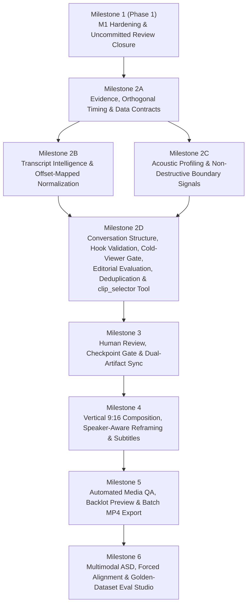

# AI Video Lab — Complete Implementation Roadmap, Engineering Rules and Execution Governance

**Document Path:** `architecture/02_EXECUTION_PLAN_AND_ENGINEERING_GOVERNANCE.md`  
**Repository:** `https://github.com/Unstocks/AI-video-Lab.git` (`C:\AI-Video-Lab`)  
**Companion Architecture Spec:** `architecture/01_SYSTEM_ARCHITECTURE.md`  
**Companion Decision Playbook:** `architecture/03_ENGINEERING_BRAIN_AND_DECISION_PLAYBOOK.md`  
**Current Verified HEAD:** `216a604` (evolved from baseline `7cf6b52f`) `[VERIFIED]`  
**Last Updated:** November 18, 2026

> This document is the **permanent operational execution contract** governing how Antigravity, Codex, or any future engineering agent plans, implements, verifies, and reports every milestone in AI Video Lab.

---

## SECTION A — Dependency-Ordered Implementation Roadmap

Milestones are strictly dependency-ordered. **Do not begin the next milestone merely because the current one appears to work — every milestone requires passing its acceptance criteria, verification commands, diff audit, and explicit owner approval.** `[PROPOSED]`



---

### Milestone 1 (Phase 1) — M1 Reliability, Security, Packaging & Uncommitted Review Closure — `[VERIFIED — COMMITTED 0699621]`
- **Status:** **COMMITTED & HARDENED (`0699621`, `a3bff47`, `f9796d8`).** Independently audited and verified: `tests/unit/test_url_ingest.py` + `tests/unit/test_ssrf_guard.py` (connect-time SSRF guard + upfront private-URL block + post-probe duration cap + H.264 proxy). `[VERIFIED]`
- **Objective:** Finalize URL intake hardening cleanly, fix the 3 review defects caught in Codex's uncommitted Phase 1 edits, and lock a verified, clean-install-safe M1 baseline. `[VERIFIED]`
- **Why It Exists:** Clean installs previously failed (`yt-dlp`, `youtube-transcript-api` undeclared), unknown durations bypassed caps, sequential file moves lacked rollback, and Codex's uncommitted edits introduced a cross-pipeline regression in `VideoDownloader` (`allowed_extractors` hardcoded globally) and an incomplete `URLIntake` `BaseTool` contract.
- **Prerequisites:** Read `architecture/01`, `02`, `03`; verify `git status -sb`.
- **Existing Components to Reuse:** `lib/url_ingest.py`, `tools/analysis/video_downloader.py`, `tools/analysis/transcript_fetcher.py`, `lib/source_media_review.py` (untouched), `tools/base_tool.py`, `tools/tool_registry.py`.
- **New Modules to Create / Complete:** `tools/analysis/url_intake.py` (`URLIntake(BaseTool)`), `pytest.ini`.
- **Files Modified:** `lib/url_ingest.py`, `tools/analysis/video_downloader.py`, `tools/analysis/transcript_fetcher.py`, `tools/analysis/url_intake.py`, `requirements.txt`, `setup.py`, `pipeline_defs/{clip-factory,podcast-repurpose}.yaml`, `skills/pipelines/clip-factory/idea-director.md`, `tests/unit/test_url_ingest.py`, `tests/qa/test_url_intake_smoke.py`, `README.md`.
- **Files Avoided:** `lib/checkpoint.py`, `lib/source_media_review.py`, `schemas/artifacts/*.schema.json`, `backlot/*`, pre-existing `planning/*`.
- **Interfaces & Contracts:** `URLIntakeAdapter.ingest_url(..., caption_languages=..., generate_h264_proxy=...)` emitting `source_manifest.json` v1.0 (additive optional fields: `pipeline_type`, `master_video_path`, `proxy_video_path`, `caption_language`, `caption_is_auto_generated`); `URLIntake.execute(inputs) -> ToolResult`.
- **ToolRegistry Integration:** `registry.discover()` registers `"url_intake"` (`ToolTier.SOURCE`, `capability="source_ingest"`) with accurate `dependencies` and `get_status()`.
- **Pipeline & Skill Integration:** `clip-factory.yaml` and `podcast-repurpose.yaml` `idea.tools_available` include `url_intake`; `idea-director.md` documents `url_intake` and `URLIntakeAdapter`.
- **Schema Impact:** None on canonical artifact schemas (`source_manifest.json` is an additive source-dir contract).
- **Dependencies:** `yt-dlp>=2025.1.15`, `youtube-transcript-api>=1.0.0` declared in `requirements.txt` & `setup.py` (already installed in `.venv`).
- **Tests:** `tests/unit/test_url_ingest.py` (26 tests including non-WAV fallback, bounded retries, multilingual + `include_auto_generated=False`, H.264 proxy creation with real FFmpeg/ffprobe, `URLIntake` error-to-`ToolResult`, caller-scoped `VideoDownloader` extractor filtering), `tests/qa/test_url_intake_smoke.py` (`--collect-only` 2 tests; `-m "not network"` passes offline), upstream contract regression tests (`test_pipeline_catalog.py`, `test_pipeline_manifest_categories.py`, `test_video_trimmer_workspaces.py`).
- **Acceptance Criteria:** **MET** (independently verified; awaiting owner authorization before any Git commit).
- **Rollback / Recovery:** Purely additive/hardening changes; revert individual files via targeted patch without touching existing `projects/` or `checkpoint.py`.

---

### Milestone 2A — Evidence, Orthogonal Timing & Data Contracts — `[VERIFIED — COMMITTED 4196087]`
- **Status:** **COMMITTED (`4196087`).** All 5 Layer 0 review defects closed and independently verified (`lib/models/{__init__,transcript,clip_plan}.py`, `schemas/artifacts/clip_selection_plan.schema.json`, `schemas/artifacts/__init__.py`). `[VERIFIED]`

### Milestone 2B — Transcript Intelligence & True Offset-Mapped Normalization — `[VERIFIED — COMMITTED 4196087]`
- **Status:** **COMMITTED (`4196087`).** All 5 audit catches closed and independently verified (`lib/transcript_normalizer.py`, `lib/conversation_structure.py`). `[VERIFIED]`

### Milestone 2C — Acoustic Evidence & Non-Destructive Boundary Signals — `[VERIFIED — COMMITTED 4196087]`
- **Status:** **COMMITTED (`4196087`).** `lib/acoustic_profiler.py` independently verified (`19/19` tests). `[VERIFIED]`

### Milestone 2D — Hook Validation, Cold-Viewer Gate, Editorial Evaluation, Deduplication & `clip_selector` Tool — `[VERIFIED — COMMITTED 4196087]`
- **Status:** **COMMITTED (`4196087`).** `lib/hook_validator.py`, `lib/cold_viewer_auditor.py`, `lib/editorial_evaluator.py`, `lib/deduplicator.py`, `tools/analysis/clip_selector.py` (`37/37` passed). `[VERIFIED]`

### Milestone 3 — Human Review, Checkpoint Integration & Dual-Artifact Sync — `[VERIFIED — COMMITTED b443b3c]`
- **Status:** **COMMITTED (`b443b3c`).** Unified `build_script_from_plan()`, `finalize_approved_selection()`, `verify_script_plan_sync()`; wired `pipeline_defs/{clip-factory,podcast-repurpose}.yaml`, `skills/pipelines/clip-factory/{script-director,executive-producer}.md`, and read-only `backlot/state.py`. `[VERIFIED]`

---

### Milestone 4 — Vertical 9:16 Composition, Speaker-Aware Reframing & Synchronized Subtitles — `[VERIFIED — COMMITTED c935bab]`
- **Status:** **COMMITTED & UPGRADED (`c935bab`, `080f19a`, `a3bff47`, `8027c36`, `b0ed975`, `f9796d8`).** Evolved into full Smart Reframe v2 cinematography engine (YuNet ONNX, `SmoothedCameraman`, `SplitLayout`, `ActiveSpeaker`, `PunchIn`, zero frame drift) + `Style: Seam` split subtitles + 8/8 bundled OFL fonts + RTX 3050 `h264_nvenc` + single-pass `-14 LUFS` `lib/ffmpeg_profiles.py`. `[VERIFIED]`

### Milestone 5 — Automated Media QA, Backlot Preview & Multi-Clip Export Delivery — `[VERIFIED — COMMITTED fb82380]`
- **Status:** **COMMITTED & HARDENED (`fb82380`, `080f19a`, `03ac66d`, `f9796d8`).** Registered `tools/analysis/media_qa.py` + `tools/video/vertical_clip_composer.py`, strict loudnorm-window enforcement (`-16..-12 LUFS`, `<= -1.0 dBTP`), hard-gated batch `export_bundle`, and read-only Backlot Clip Studio projection. `[VERIFIED]`

### Milestone 6a — 8 Designer ASS Subtitle Presets & 12-Dimension Golden Eval Studio — `[VERIFIED — COMMITTED cdfc094, f9796d8]`
- **Status:** **COMMITTED (`cdfc094`, `b0ed975`, `f9796d8`).** All 8 ASS subtitle presets (`lib/subtitle_styles.py`) paired with bundled DirectWrite-verified fonts in `assets/fonts/` + 12-dimension `lib/eval_studio.py`. `[VERIFIED]`

### Studio Phases 1–5 + Adversarial Backend Hardening + Broadcast Obsidian Pro UI — `[VERIFIED — COMMITTED a3bff47..216a604]`
- **Phase 1 (`a3bff47`):** Connect-time `lib/ssrf_guard.py`, preflight gate, unified `lib/ffmpeg_profiles.py` (RTX 3050 NVENC + single-pass `-14 LUFS` + metadata scrub).
- **Phase 2 (`8027c36`):** Smart Reframe v2 (`lib/face_detector.py` YuNet ONNX, `lib/camera_tracker.py`, `lib/split_layout.py`, `lib/active_speaker.py`, `lib/punch_in.py`, upgraded `auto_reframe.py`).
- **Phase 3 (`b0ed975`):** `lib/layout_ranges.py`, `Style: Seam` split subtitles, continuation-word merging, bundled OFL fonts.
- **Phase 4 Backend + Phase 5 (`03ac66d`):** Loopback/CSRF hardened `studio/` FastAPI server (`127.0.0.1:4760`), SQLite `SessionStore`, `fcc-claude` `SupervisorManager`, Backlot read-only `clip_studio` projection, Broadcast QA metrics, `lib/llm_gateway.py`.
- **Adversarial Backend Hardening (`f9796d8`):** Closed all P0–P2 audit findings (schema joins, 16MiB NDJSON streaming, exact-frame multi-scene Reframe v2, 8/8 bundled fonts, SQLite WAL, apostrophe-safe `sendcmd`, strict loudnorm window, director skills — **210/210 tests green**).
- **Broadcast Obsidian Pro Studio Frontend & Whole-System BFF (`216a604`):** `studio/catalog.py`, `studio/media_engine.py`, React 19 + TS + Vite 6 + Tailwind v4 + Framer Motion + Zustand SPA (`studio/web/` → `studio/ui/`) covering all 13 pipelines, 169 tools, 6 playbooks, 9 media profiles, NLE multi-track timeline (PCM waveform + inline filmstrip + on-canvas Single/Split crop + word-snapped transcript), Universal Pipeline Board, Broadcast QA, System 169-Tool Matrix, and Executive Producer Dock (**25/25 BFF/hardening tests + 0-error live Chromium E2E audit across 10 screenshots**).

---

### Remaining Work (Active Closure + Optional Future Horizon)
1. **Phase 0 (`BU-0.1` — System-Level `free-claude-code` Setup) — `[PENDING]`:** Install `uv`, `free-claude-code` (`127.0.0.1:8082`), and `@anthropic-ai/claude-code` outside `C:\AI-Video-Lab`, configure free provider chain (NVIDIA NIM → Gemini → OpenRouter), and verify `fcc-doctor` + `fcc-claude --output-format stream-json`.
2. **Phase 6 (`BU-6.1` — Full-Stack Live Production Sign-Off) — `[PENDING — BLOCKED ON BU-0.1]`:** Run a real 10–30 min 2-speaker podcast YouTube URL end-to-end through `http://127.0.0.1:4760` → `fcc-claude` → RTX 3050 NVENC Reframe v2 + `Style: Seam` → `media_qa` → on-canvas crop override → `export_bundle` → PNG visual audit.
3. **Optional Future Horizon (Milestone 6b) — `[OPTIONAL]`:** Real human-annotated podcast corpus in `eval_datasets/` (7+ archetypes), optional Python 3.11/3.12 ML sidecar for `faster-whisper`/`WhisperX` CTC forced alignment & `Light-ASD`/`pyannote`, and optional `remotion-composer` npm install (`remotion_nm=False`, while `ffmpeg` and `hyperframes` are already ready). `[PROPOSED]`

---

## SECTION B — 20 Permanent Implementation Restrictions

These rules are permanent and non-negotiable across all future sessions:

1. **Never rewrite OpenMontage without compelling verified evidence.**
2. **Never create a parallel orchestration framework** (no Python agent loops competing with the IDE control plane).
3. **Never duplicate existing production capabilities** (`video_downloader`, `transcript_fetcher`, `transcriber`, `audio_energy`, `silence_cutter`, `scene_detect`, `frame_sampler`, `auto_reframe`, `video_trimmer`, `subtitle_gen`, `remotion_caption_burn`, `video_compose`, `export_bundle`, `CostTracker`).
4. **Never expose an internal helper as a `BaseTool` without a clear workflow reason.**
5. **Never modify shared interfaces without inspecting all consumers** (e.g., `VideoDownloader` serves `video_analyzer` & reference workflows, not just `clip-factory`).
6. **Never change schemas without migration and backward-compatibility analysis.**
7. **Never mark a stage approved without actual human approval** recorded via `checkpoint_<stage>.json` (`human_approved=True`).
8. **Never fabricate transcript content, spoken hooks, or timestamps.**
9. **Never silently convert unknown values into perfect confidence** (`confidence=1.0` defaults are forbidden; use `None`).
10. **Never compromise source fidelity for editorial attractiveness** (no misleading truncation of qualifiers or cross-speaker stitching).
11. **Never optimize clip count over quality** (zero quota padding).
12. **Never install unnecessary dependencies.**
13. **Never install heavy models without explicit technical justification and owner approval.**
14. **Never claim tests passed unless the exact commands were executed and observed.**
15. **Never claim a manual smoke script is part of automated pytest coverage unless pytest actually collects it.**
16. **Never ignore, overwrite, or discard existing uncommitted user changes in Git.**
17. **Never perform destructive Git operations** (`git reset --hard`, `git clean -fd`, `git checkout -- .`, `git push --force`, history rewrites).
18. **Never commit or push unless explicitly authorized by the project owner.**
19. **Never change unrelated files during a milestone.**
20. **Never silently modify the approved architecture documents** (`architecture/01`, `02`, `03`) without an explicit architecture change proposal and owner approval.

---

## SECTION C — Engineering Standards

1. **Python Coding Standards:** `from __future__ import annotations`; clean PEP 8; small cohesive functions; no hidden global mutable state beyond established `ToolRegistry` / lazy model caches.
2. **Type Annotations:** Strict type hints on all public functions, dataclasses/Pydantic models, and `BaseTool` helpers; prefer `Literal`, `Optional`, `Path`, explicit return types.
3. **Data Validation & Schema Parity:** Validate external/artifact boundaries explicitly (`schemas.artifacts.validate_artifact` + domain semantic validators); remember `BaseTool` does NOT auto-validate `input_schema`/`output_schema`. Every numeric float field MUST guard against non-finite IEEE-754 values (`math.isfinite()` rejecting `NaN`/`inf`/`-inf`) and reject `bool`-as-`int`/`float` (`isinstance(v, bool)`), enforce `>= 0` bounds on timestamps/offsets, and maintain strict **1:1 parity** between Python models and Draft 2020-12 JSON Schemas (`required`, `minimum`, `minItems`, nullable types, `additionalProperties: false`).
4. **Error Handling:** Typed exceptions in `lib/`; clean `ToolResult(success=False, error=...)` capture at `BaseTool.execute()` boundaries; fail closed on security/duration/gate violations.
5. **Logging:** Standard `logging.getLogger(__name__)`; structured actionable warnings; **never log API keys, tokens, or credentials**.
6. **Dependency Management:** Keep `requirements.txt` and `setup.py` synchronized for core runtime; document optional GPU/ML/CV dependencies separately (`requirements-gpu.txt` or documented extras); constrain minimum versions cleanly.
7. **Test Design:** Verify real behavior, invariants, edge cases, and failure paths (never instantiation-only smoke assertions). Cover English, Hindi Devanagari (`कि`, `क़`), Hinglish, HTML entities, NFD/NFC combining marks (`e\u0301`), ZWJ emoji (`👨‍👩‍👧‍👦`), `NaN`/`inf`, negative timestamps, empty/corrupt inputs, and gate rejections.
8. **Schema Versioning:** Draft 2020-12 JSON Schema, `additionalProperties: false`, explicit `"version"` in top-level `"required"`, additive evolution before breaking bumps.
9. **Artifact Integrity & Deterministic Content Hashing:** Preserve immutable raw source media and raw transcripts; link derived artifacts with content hashes (`transcript_revision_id`, `clip_selection_plan_sha256`). Always compute content hashes **post-hydration** (e.g., Pydantic `mode="after"` on canonical hydrated models using sorted-key UTF-8 JSON), NEVER on raw unhydrated dicts in `mode="before"`, so dict-constructed and model-constructed objects always hash identically.
10. **Idempotency:** Declare accurate `idempotency_key_fields` on every `BaseTool`; re-running a stage or intake must clean up stale optional artifacts cleanly.
11. **Atomicity:** Single JSON files use temp-file + `os.replace()`; multi-file bundles use staging + backup-and-rollback commit with atomic manifest swap last.
12. **Resource Cleanup:** Always clean temporary/staging directories in `finally` blocks; close PIL image handles explicitly on Windows (`clip_embedder.py:103`).
13. **Security:** Validate `project_id` against traversal (`^[a-zA-Z0-9_-]+$`), enforce `relative_to()` containment, use subprocess argument lists (never `shell=True`), escape FFmpeg filter paths, and document SSRF boundaries honestly.
14. **Windows & Offline Sandbox Compatibility:** Always pass `encoding="utf-8"` on file I/O (prevent `cp1252` crashes); normalize path separators for FFmpeg concat/lavfi; in sandboxed Windows environments pass `--basetemp=.pytest_cache/tmp` (with `$env:TMP` and `$env:TEMP` pointed to `.pytest_cache\tmp`) so pytest never fails on restricted OS Temp directories. In offline sandboxes, avoid unfiltered `pytest tests/contracts/` or `video_compose.get_info()` / `registry.provider_menu_summary()` calls that trigger `HyperFramesCompose._runtime_check()` (`npx`) hangs; run targeted contract/tool suites and report exact scope honestly.
15. **FFmpeg Handling:** Always enforce subprocess `timeout`, check `returncode != 0`, verify output file existence + non-trivial size + `ffprobe` stream integrity, and use `-ss` before `-i` with `-t` (not `-to`) for zero-rebased clip trims.
16. **Provider Failure Handling:** Bounded retries with backoff on transient network errors; explicit structured blocker escalation on auth/quota/unavailable runtime errors; never silently swap providers or render runtimes.

---

## SECTION D — Milestone Execution Protocol & Permanent Operating Rules

### D.1 Mandatory 15-Step Milestone Execution Protocol
Every milestone MUST execute in this exact order:
```text
 1. Read architecture/01, 02, and 03.
 2. Inspect current live repository state (git status, HEAD, relevant files).
 3. Identify exact authorized milestone scope (and explicit non-goals).
 4. Verify prerequisites and open decisions.
 5. Analyze all affected downstream consumers.
 6. Design component interfaces and data contracts.
 7. Implement the smallest coherent, well-factored unit.
 8. Add or update unit, integration, contract, and failure-path tests.
 9. Run focused verification tests (with --basetemp=.pytest_cache/tmp on Windows).
10. Run relevant integration tests.
11. Run broader regression tests across affected subsystems.
12. Inspect the actual git diff line by line.
13. Verify compliance with architecture/01, 02, and 03 (including all 20 restrictions).
14. Produce a consolidated milestone engineering report (Section E).
15. STOP and request explicit owner review/approval at the milestone boundary.
```

### D.2 Permanent Antigravity Identity & Live-Verification-First Reaction Loop
On **every single turn** in AI Video Lab, Antigravity operates as a **20-Year Veteran Principal Software Architect, Co-Developer, and Master AI Prompt Engineer** collaborating with Codex (the parallel implementation engine) and the project owner:

1. **Brain First, Live State Second (Zero Memory Guessing):** Before responding to any technical request, Codex report, or milestone transition, consult `architecture/01`, `02`, and `03`, then inspect live disk state (`git status -sb`, `git rev-parse HEAD`, `git diff`, and the exact modified/created files). Never assume conversation memory matches the working tree.
2. **Never Trust a Codex Report on Faith ("Green Tests != Sound Architecture"):** Treat every Codex report as an independent engineering submission requiring full peer audit — NEVER rubber-stamp it because its unit tests passed. Independently:
   - Read every touched and newly created production file, schema, and test **line by line**.
   - Re-run the milestone tests and targeted upstream regressions independently in `.venv` (`--basetemp=.pytest_cache/tmp`).
   - Run the **Mandatory 8-Point Deep Audit Checklist**:
     1. *Architecture & DAG Compliance:* Matches `architecture/01–03`, respects all 20 restrictions, leaves protected files (`lib/checkpoint.py`, `lib/source_media_review.py`, existing 20 schemas, `backlot/*`, `planning/*`) untouched.
     2. *Cross-Pipeline & Shared-Caller Safety:* Checks every caller across all 13 OpenMontage pipelines so shared tools (`VideoDownloader`, `SilenceCutter`, `AutoReframe`, `ExportBundle`) never suffer collateral breakage.
     3. *Model ↔ JSON Schema 1:1 Parity:* Verifies `required` (including `"version"`), `minimum`/`maximum`, `minItems`, nullable types, enums, and `additionalProperties: false` match Python validators identically.
     4. *Language & Framework Traps:* Hunts duplicate dict keys, Pydantic `mode="before"` vs `mode="after"` hash/coercion divergence, `bool`-is-`int` bugs, `NaN`/`inf` float bypasses, mutable defaults, and silent early-return branches.
     5. *Real-World Domain Fidelity:* Stress-tests against messy reality — YouTube captions split mid-sentence every 2–4s, un-diarized `speaker=None`, HTML entities (`&amp;`, `&#39;`), embedded newlines, NFD combining marks, Devanagari matras/nuktas (`कि`, `क़`), Hinglish, ZWJ emoji, AV1 codecs, 0-silence clips.
     6. *`BaseTool` & Registry Contract:* Verifies `tier`, `capability`, `dependencies`, `input_schema`, `output_schema`, `artifacts`, `idempotency_key_fields`, clean `ToolResult(success=False, error=...)` capture, and live `ToolRegistry.discover()`.
     7. *Test Quality & Collection Honesty:* Confirms real behavioral & adversarial failure-path assertions (not `is not None` smoke checks), actual pytest collection, and Windows temp/UTF-8 cleanliness.
     8. *Code/Docs Honesty:* Rejects exaggerated claims (e.g., calling preflight IP filtering "strict SSRF protection", claiming word precision from coarse captions, or marking uncoded features "implemented").
3. **Deliver an Honest `[VERIFIED]` Verdict Before Issuing Any Next Prompt:** State clearly `ACCEPTED`, `ACCEPTED WITH MINOR FOLLOW-UPS`, or `CHANGES REQUESTED`, citing exact `file:line` references, root causes, and concrete downstream breakage for every defect found.

### D.3 Mandatory Architect-Grade Codex Prompt Construction Standard (9-Part Blueprint)
Antigravity MUST **NEVER** hand Codex a terse, vague, checklist-only prompt. Every single milestone prompt authored for Codex MUST be a **complete, self-contained, principal-architect execution blueprint** containing all **9 mandatory sections** (see `architecture/03` Section I for full reasoning & quality gate):

1. **Role, Context & Architecture Anchoring:** Anchor explicitly to exact sections, ADRs, and restrictions in `architecture/01`, `02`, `03` and the verified live `HEAD`/working-tree state.
2. **Architectural WHY & End-to-End Downstream Flow:** Explain *why* the milestone exists, what messy real-world upstream data looks like, and exactly how downstream milestones (`2A -> 2B -> 2C -> 2D -> 3 -> 4 -> Backlot`) consume its outputs.
3. **Strict Layering DAG, Allowed Files & Protected-File Boundaries:** Specify exact DAG layer, allowed imports, exact files to create/modify, explicitly forbidden/protected files, and explicit non-goals.
4. **Surgical Prior-Milestone Defect Closures & Hard Internal Gate (Whenever Prior Catches Exist):** List every caught defect with exact `file:line`, root cause, and exact fix — enforcing a **hard internal gate**: close and pass prior-milestone tests FIRST before creating any new milestone files.
5. **Exact Module, Class, Field, Method, Invariant & Error Contracts:** Specify exact signatures, types (`Optional`, `Literal`), immutability, return shapes, typed exceptions, `BaseTool` metadata, and numeric/hashing/domain invariants (`math.isfinite`, `>= 0`, `bool` rejection, post-hydration SHA-256).
6. **Exact JSON Schema & Serialization Parity Specification:** Whenever schemas are touched, enumerate every top-level `required` key, bound (`minimum`, `minItems`), nullable type, and round-trip invariant so Python and JSON Schema stay 1:1 aligned.
7. **Proactive Non-Obvious Engineering Traps & Algorithm Walkthrough:** Pre-solve the hardest implementation/domain traps directly inside the prompt (e.g., atomic character-cluster alignment built *during* HTML-unescape + NFC + whitespace collapse; why naive `str.find()` breaks on repeated words/Devanagari; why `SilenceCutter` returns early on 0 silences).
8. **Concrete Adversarial & Multilingual Test Matrix:** Enumerate exact test files and concrete adversarial fixtures (English, Devanagari `कि`/`क़`, Hinglish, HTML entities, NFD `e\u0301`, ZWJ emoji `👨‍👩‍👧‍👦`, `NaN`/`inf`, negative/inverted timestamps, empty/corrupt/out-of-order inputs, gate violations, upstream regressions).
9. **Windows-Sandbox-Safe Verification Gate & 12-Section Milestone Report Contract:** Provide exact copy-pasteable PowerShell verification commands (`$env:TMP` / `$env:TEMP` inside `.pytest_cache\tmp`, `--basetemp=.pytest_cache/tmp`, offline-safe regression selectors, `ToolRegistry` discovery probe when applicable), require the 12-section Milestone Report (Section E), and enforce an explicit **`STOP — DO NOT COMMIT OR START NEXT MILESTONE`** boundary.

### D.4 Architecture Governance, New Components & Code/Doc Conflict Rules
1. **When a New Component Is Proposed:** Run the 16-question interrogation in `architecture/03_ENGINEERING_BRAIN_AND_DECISION_PLAYBOOK.md` before writing code.
2. **When Architecture Changes Become Necessary:** Never silently edit `architecture/01–03`. Submit an explicit **Architecture Change Proposal** (Existing decision, New evidence, Why insufficient, Proposed change, Alternatives, Compatibility & migration impact, Consequences) and update all three documents in sync ONLY after owner approval.
3. **When Code Conflicts With Docs:** Inspect code first, classify the conflict as (a) intentional deviation, (b) undocumented change, (c) stale doc, or (d) implementation defect, and propose the smallest fix restoring coherence.

---

## SECTION E — Consolidated Milestone Reporting Contract

Every substantial milestone report MUST tag substantive claims with `[VERIFIED]`, `[CODEX FINDING]`, `[INFERRED]`, `[PROPOSED]`, `[UNVERIFIED]`, `[OPEN DECISION]`, or `[DEPRECATED]`, and include all 12 fields:

1. **What Changed** (concise summary of milestone deliverables)
2. **Why It Changed** (architectural rationale tied to roadmap)
3. **Exact Files** (created, modified, inspected, and intentionally untouched)
4. **Architecture Decisions** (choices made, alternatives rejected, ADRs affected)
5. **Tests Executed** (exact commands run)
6. **Actual Results** (exact collected/passed/failed/skipped counts and durations)
7. **Failures & Root Causes** (or `NONE`)
8. **Known Limitations** (honest boundaries and deferred items)
9. **Regression Risks** (cross-pipeline or downstream impacts assessed)
10. **Remaining Work** (what stays out of scope for subsequent milestones)
11. **Git Status & Commit Evidence** (`git status --short --branch`, active branch, `HEAD` SHA, commit SHA if authorized)
12. **Acceptance Criteria Verdict** (`MET` / `PARTIALLY MET` / `NOT MET` / `BLOCKED` + explicit approval request before next milestone)
