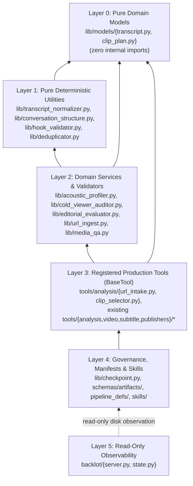

# AI Video Lab — Engineering Brain, Component-Level Decision Framework and Architectural Reasoning Playbook

**Document Path:** `architecture/03_ENGINEERING_BRAIN_AND_DECISION_PLAYBOOK.md`  
**Repository:** `https://github.com/Unstocks/AI-video-Lab.git` (`C:\AI-Video-Lab`)  
**Companion System Architecture:** `architecture/01_SYSTEM_ARCHITECTURE.md`  
**Companion Execution Governance:** `architecture/02_EXECUTION_PLAN_AND_ENGINEERING_GOVERNANCE.md`  
**Date:** November 17, 2026

> **Purpose of This Document:** Files 1 and 2 define *what* we are building and *in what order*. This file defines **HOW to think like AI Video Lab's Principal Architect** when making every component-level design, decomposition, build-vs-reuse, model-allocation, and failure-handling decision — so that future Antigravity sessions, Codex investigations, and human reviews converge on one coherent, maintainable system.

---

## 0. The Mandatory 16-Question Component Interrogation Gate

Before creating ANY new module, class, tool, schema, or abstraction, answer all 16 questions honestly. If you cannot answer them sharply, **do not write the code yet**:

1. **Why should this component exist?** (What concrete pain or coupling occurs if it does not?)
2. **What single problem does it solve?** (Can its purpose be stated in one sentence without "and also"?)
3. **What must it NEVER be responsible for?** (Explicit negative scope prevents god-classes.)
4. **Which existing OpenMontage component should it reuse instead of reimplementing?**
5. **What is its smallest useful interface?** (Prefer 1–3 clear functions/methods over sprawling class hierarchies.)
6. **What are its exact dependencies?** (Does it accidentally pull heavy ML/network/UI imports into pure logic?)
7. **What is its lifecycle?** (Stateless call, lazy-cached resource, per-project artifact, or long-lived server?)
8. **What data does it own?** (Who is authoritative writer for every field?)
9. **What data must it NEVER own or mutate?** (Raw source media, raw transcripts, human approval flags.)
10. **What architectural layer is it?** (Domain model, pure utility, internal service, provider adapter, production `BaseTool`, pipeline stage, Markdown skill, schema/artifact, infrastructure, or future extension?)
11. **Should it be introduced now or intentionally deferred?** (Reusable foundation = build when its contract is clear; speculative abstraction with 0 consumers = defer.)
12. **How will it be tested independently without network, GPUs, or live LLMs?**
13. **How does it integrate with the complete end-to-end system?** (Trace caller -> component -> downstream consumer.)
14. **What happens when it fails or receives hostile/malformed input?**
15. **What realistic future changes should its interface accommodate without rewriting callers?** (e.g., swapping captions for WhisperX forced alignment, swapping single-face tracker for multi-speaker ASD.)
16. **What abstractions would be premature right now?** (Name them explicitly and refuse to build them.)

---

## SECTION A — Component Selection & Decomposition Philosophy

### A.1 Avoiding Both Extremes: God-Classes vs. Micro-Fragmentation
- **Trap 1 — The Vague God-Class:** Never create a monolithic `ConversationIntelligence` or `ClipEngine` class that ingests JSON, normalizes Unicode, invokes FFmpeg, calls an LLM, checks hooks, deduplicates, and writes checkpoints. God-classes cannot be unit-tested cleanly, hide silent coupling, and break whenever one heuristic changes.
- **Trap 2 — Premature Micro-Fragmentation:** Do NOT blindly turn 15 conceptual steps into 15 tiny 30-line classes with pass-through wrappers (`TranscriptRevisionManager` wrapping one `sha256` call, `SourceSpanMapper` separated from the normalizer that created the alignment table, `PortfolioSelector` separated from `Deduplicator` when both operate on the same final candidate list).

### A.2 Concrete Decomposition Rubric for AI Video Lab
Apply **cohesion by data & invariant ownership** to decide what deserves its own module vs. what belongs together:

| Conceptual Capability | Recommended Module Boundary | Why This Split Works (Cohesion Rationale) |
|---|---|---|
| Raw transcript, revision hash, orthogonal timing provenance, `SourceSpan` | `lib/models/transcript.py` | Pure immutable domain types; zero internal imports; shared by every upstream/downstream module. |
| Candidate clip, 4 orthogonal states, hook evidence, cold-viewer audit, selection plan | `lib/models/clip_plan.py` | Pure editorial contract models + semantic invariants; 1:1 with `clip_selection_plan.schema.json`. |
| Transcript ingestion + NFC normalization + **offset-alignment mapping** | `lib/transcript_normalizer.py` | **Keep normalizer and offset mapper together** — the alignment table MUST be constructed *during* normalization; separating them risks offset drift. |
| Turn grouping, discourse blocks, Q&A / topic container | `lib/conversation_structure.py` | Pure structural representation over normalized turns; independently testable without LLMs. |
| Silence intervals + loudness + shot cuts + non-destructive boundary suggestion | `lib/acoustic_profiler.py` | Isolates ALL FFmpeg/signal tool calls (`silence_cutter`, `audio_energy`, `scene_detect`, future VAD/forced alignment) behind one deterministic measurement seam. |
| Verbatim spoken-hook verification | `lib/hook_validator.py` | **Hard safety gate.** Must be tiny, pure, deterministic, adversarial-tested, and zero-tolerance — isolated so editorial scoring tweaks can never accidentally weaken hook provenance! |
| 5-point cold-viewer comprehension audit validator | `lib/cold_viewer_auditor.py` | Enforces structural cold-viewer invariants (unresolved pronouns, missing subject, context expansion ceiling) separately from ranking scores. |
| Hard eligibility filter + transparent justified ranking | `lib/editorial_evaluator.py` | Enforces the invariant that binary eligibility runs *before* ranking and high scores never override hard failures. |
| Temporal IoU + semantic deduplication + portfolio diversity selection | `lib/deduplicator.py` | Pure set-reduction problem operating over eligible ranked candidates; keeps diversity logic decoupled from single-clip scoring. |
| Agent-facing orchestration & dual-artifact emission | `tools/analysis/clip_selector.py` (`ClipSelector(BaseTool)`) | Thin `BaseTool` facade composing the internal `lib/` modules above and emitting schema-valid `clip_selection_plan.json` + provisional `script.json`. |

**Notice what is intentionally NOT a separate class/file right now:**
- No `TranscriptRevisionManager` (just a deterministic `compute_revision_id()` function in `lib/models/transcript.py`).
- No `LLMProvider` framework in `lib/providers/` yet (the coding agent IS the LLM control plane in Phases 1–5; defer `lib/providers/` until headless automated evaluation in Phase 6 genuinely demands it).
- No separate `BaseTool` for every `lib/` helper (agents call `url_intake` and `clip_selector`; `lib/` stays clean and reusable).

---

## SECTION B — Component Dependency Reasoning & Layering DAG

**Rule: The dependency graph MUST be a strict Directed Acyclic Graph (DAG).** Lower layers NEVER import higher layers.

### Dependency Discipline Rules
1. **Never import `lib/checkpoint.py` or `backlot/` inside `lib/models/` or `lib/` analytical modules.** Domain logic must remain testable in memory without touching `projects/` directories.
2. **Never import heavy optional packages (`torch`, `transformers`, `faster_whisper`, `mediapipe`, `cv2`) at module top-level** in shared `lib/` modules — import lazily inside methods (following `lib/clip_embedder.py:31-48` and `tools/analysis/transcriber.py:129`) so `ToolRegistry.discover()` never crashes when optional packages are uninstalled.
3. **Never let a pipeline-specific caller mutate a shared upstream tool's global defaults** (see real case study in Section E below).

---

## SECTION C — Data Ownership, Immutability & Contract Reasoning

For every piece of data in AI Video Lab, exactly ONE owner writes it and every transformation preserves lineage:

| Data Entity | Authoritative Owner | Immutable? | Schema Required? | Deterministic or Model-Assisted? |
|---|---|---|---|---|
| `source/source_video.mp4` & `source_audio.wav` | `URLIntakeAdapter` (`lib/url_ingest.py`) | **YES (master never overwritten by editing)** | Tracked by `source_manifest.json` | 100% Deterministic |
| `source/transcript.json` (raw captions/ASR) | `URLIntakeAdapter` / `Transcriber` | **YES (`transcript_revision_id`)** | Parsed into `RawTranscriptDocument` | 100% Deterministic / STT |
| Normalized text + offset map | `TranscriptNormalizer` | Derived (reproducible from raw) | Internal dataclass | 100% Deterministic |
| Acoustic profile (silences, LUFS, shot cuts) | `AcousticProfiler` | Derived | Internal dataclass | 100% Deterministic |
| Candidate proposals & cold-viewer reasoning | Coding Agent (Script Director) | Provisional until validated | Input to `clip_selector` | Model-Assisted |
| `artifacts/clip_selection_plan.json` | `ClipSelector` (updated with human review decisions) | Versioned; archived via checkpoint history | **YES (`clip_selection_plan.schema.json`)** | Deterministic validation over model proposals |
| `artifacts/script.json` | `ClipSelector` (provisional at `awaiting_human`; finalized after `human_approved=True`) | Versioned; carries `clip_selection_plan_sha256` | **YES (`script.schema.json`)** | Deterministic synthesis |
| `checkpoint_<stage>.json` | `lib/checkpoint.py` | Superseded copies archived in `history/` | **YES (`checkpoint.schema.json`)** | 100% Deterministic |
| `renders/*.mp4` & `exports/` | `VideoCompose` / `VideoTrimmer` / `ExportBundle` | Verified by `final_review.json` | `render_report`, `final_review`, `publish_log` | 100% Deterministic |

### Data Integrity Litmus Tests
- **If a field's confidence or uncertainty is not actually measured, its value MUST be `None` — NEVER `1.0` or `0.0`.**
- **If a spoken hook cannot be sliced verbatim from `raw_segment.text` via its `SourceSpan`s, it is a BUG or HALLUCINATION — reject it.**
- **If `checkpoint_script.json` says `status="awaiting_human"`, `human_approved` MUST be `False` and `script.json` MUST carry `approval_status="provisional"`.**

---

## SECTION D — Model Allocation & Inference Reasoning

Never pick a model by hype, habit, or "whatever fits on a 6 GB laptop GPU." Allocate intelligence strictly by **task cognitive demand**:

| Task Class | Required Intelligence Tier | Why | Fallback / Failure Policy |
|---|---|---|---|
| Unicode normalization, offset mapping, hook verbatim check, temporal IoU, FFmpeg trimming, `ffprobe` QA, schema checks | **Zero LLM (100% Deterministic Python)** | Faster, free, exact, reproducible, zero hallucination risk. Using an LLM here is an architectural defect. | Fail fast with typed error. |
| Speech-to-text, forced alignment, speaker diarization, neural VAD, Active Speaker Detection, multilingual embeddings | **Specialist ML Models** (`faster-whisper`/`WhisperX`/`wav2vec2`/`Silero VAD`/`pyannote` OR managed cloud STT; `Light-ASD`/`LoCoNet`; `BGE-M3`/`Qwen3-Embedding`) | Acoustic/visual/vector precision that text LLMs cannot reliably match. | Degrade explicitly with lower `evidence_quality` label (e.g., `coarse_segment` instead of `high_subframe`); NEVER pretend degraded output is high precision. |
| Macro conversation topology, context reconstruction, cold-viewer comprehension audit, sarcasm/qualifier preservation, nuanced editorial selection | **Frontier Long-Context Reasoning Model** (interactive coding agent now; verified live official API model in Phase 6 headless eval) | This is the heart of the product ("3 great clips > 10 mediocre clips"). Weak local 7B models miss subtle antecedents, irony, and multi-minute premises. | Never silently downgrade to a weak heuristic without logging degraded mode & escalating to owner. |
| High-volume preliminary triage or lightweight metadata tagging (titles/hashtags/descriptions) | **Fast / Cost-Optimized Frontier Tier or Optional Local Model** | High volume, low reasoning complexity, easy to review. | Retry with backoff; fallback to human/agent pass. |

**Verification-First Rule for External APIs:** Before writing ANY provider config or code, verify the live official model ID, context window, structured-output support, pricing, and billing boundary (remembering consumer subscriptions ≠ API access) against official documentation or live API model listing. Never copy model IDs from old planning docs.

---

## SECTION E — Build-Versus-Reuse 8-Step Decision Algorithm (With Real Repo Case Studies)

Before writing any new code, run these 8 steps in order:
1. **Search the repository** (`tools/`, `lib/`, `schemas/`, `skills/`).
2. **Inspect existing implementations directly** (do not trust docstrings or planning summaries).
3. **Inspect all callers** across all 13 pipelines and `backlot/`.
4. **Inspect existing tests** to see enforced invariants.
5. **Inspect exact input/output contracts** (`input_schema`, `ToolResult.data`, early-return branches).
6. **Decide whether extension is safe** or introduces cross-pipeline coupling.
7. **Prefer composition/wrapping over mutating shared tools** when adding pipeline-specific policy.
8. **Only build new** when no existing component covers the true domain responsibility.

### Five Real Case Studies From `C:\AI-Video-Lab` `[VERIFIED]`

1. **Case Study 1 — Why You Must NOT Globally Lock `VideoDownloader` (`[VERIFIED FIXED IN M1 ACCEPTANCE]`):**
   - *What happened:* In uncommitted Phase 1 edits, `"allowed_extractors": ["youtube", "vimeo"]` was added globally inside `tools/analysis/video_downloader.py`.
   - *Why that is an architectural mistake:* Step 3 (inspect callers) shows `VideoDownloader` is shared with `tools/analysis/video_analyzer.py` and the Reference Video workflow (`skills/meta/video-reference-analyst.md`), which legitimately downloads Instagram Reels, TikToks, and other platforms!
   - *Correct architecture (verified fixed in M1):* Keep `VideoDownloader` platform-general by default, add an **optional** `allowed_extractors` parameter, and have `URLIntakeAdapter` pass `["youtube", "vimeo"]` explicitly (`ADR-008`).
2. **Case Study 2 — Why You Must NOT Reuse `lib/scoring.py` or `lib/clip_embedder.py` for M2 Clip Intelligence:**
   - *Inspection proved:* `lib/scoring.py` (`ProviderScore`, `score_provider`) scores *API providers* by keyword overlap & latency; `lib/clip_embedder.py` embeds images/short 77-token text via CLIP ViT-B/32 for stock-footage retrieval. Neither is built for long conversational editorial reasoning or multilingual discourse embeddings. **Build new (`lib/editorial_evaluator.py`, optional `BGE-M3`/`Qwen3-Embedding`), do not force-fit.**
3. **Case Study 3 — Why You SHOULD Wrap `SilenceCutter(mode="mark")` Defensively Instead of Rewriting FFmpeg `silencedetect`:**
   - *Inspection proved:* `tools/video/silence_cutter.py` already parses FFmpeg `silencedetect` and computes `speech_segments` with passing tests — **EXCEPT** lines 129–141 return early without writing JSON when 0 silences are found!
   - *Correct architecture:* Reuse `SilenceCutter(mode="mark")` inside `lib/acoustic_profiler.py`, and explicitly handle the 0-silence branch (`silence_segments == 0` → `silences=[]`, full-clip speech) without duplicating FFmpeg parsing.
4. **Case Study 4 — Why `URLIntake` (`tools/analysis/url_intake.py`) Must Conform Fully to `BaseTool` (`[VERIFIED FIXED IN M1 ACCEPTANCE]`):**
   - *Inspection proved:* Wrapping `URLIntakeAdapter` as a thin `BaseTool` is the right pattern, **provided** it sets `tier=ToolTier.SOURCE`, `capability="source_ingest"`, declares `dependencies`, defines `output_schema`, populates `ToolResult.artifacts` and `data["proxy_video_path"]`, and catches `URLValidationError`/`DiskSpaceError`/`MediaIngestionError` into `ToolResult(success=False, error=...)`. Live M1 audit also caught duplicate dict keys in `lib/url_ingest.py` silently overwriting `"proxy_video_path"` to `None` — caught only via line-by-line reading.
5. **Case Study 5 — Why Green Tests Never Replace Line-by-Line Domain Audits (5 Real Layer 0 Catches in Milestone 2A):**
   - *What happened:* Codex's initial Milestone 2A delivery passed `14/14` unit/contract tests (`0.81s`). Yet reading `lib/models/transcript.py`, `lib/models/clip_plan.py`, and `schemas/artifacts/clip_selection_plan.schema.json` line by line caught **5 subtle, high-impact defects**:
     1. `SpokenHookEvidence` rejected multi-segment spans — which would reject real YouTube auto-caption hooks split across 2–4s segments!
     2. `SpokenHookEvidence.speaker: str` rejected `None` — breaking every un-diarized YouTube transcript.
     3. `RawTranscriptDocument` computed `transcript_revision_id` in Pydantic `mode="before"`, producing **two different SHA-256 hashes** for identical transcripts constructed from dicts vs. `RawTranscriptSegment` objects.
     4. Floats lacked `math.isfinite()` (allowing `NaN`/`inf`) and `start_seconds >= 0`; `clip_selection_plan.schema.json` omitted `"version"` from top-level `"required"`, `minItems: 1` on `source_spans`, and `minimum: 0` bounds.
     5. `CandidateClip` lacked optional nullable `rejection_reason` and `duplicate_of_candidate_id` needed by Phase 2D.
   - *Architectural lesson:* **Two root causes produced these 5 catches:** (a) the initial 2A prompt was too brief and failed to pre-specify YouTube multi-segment hooks, nullable speakers, post-hydration hashing, and finite bounds; and (b) unit tests written by the same author only tested the author's own assumptions. Permanent cure: **9-Part Architect-Grade Prompts + Independent Line-by-Line Live Audits (`ADR-012`)**.

---

## SECTION F — Failure-Oriented Engineering Playbook

Think through failure modes BEFORE writing code. Every one of these 11 real scenarios MUST have a designed detection & recovery behavior:

| # | Realistic Failure Scenario | Detection Strategy | Mandatory Recovery / Handling Behavior |
|---|---|---|---|
| 1 | **Transcript timestamps drift from source audio** | Compare caption timing against Silero VAD / `SilenceCutter` speech regions or `wav2vec2` forced alignment | Downgrade `evidence_quality` honestly (`coarse_segment`/`low_estimated`), preserve `uncertainty_seconds`, warn reviewer before cutting; never claim word precision. |
| 2 | **Candidate requires context from 3+ minutes earlier** | Cold-viewer audit detects unresolved entity/premise; backward expansion exceeds 120s ceiling | Either mark `REJECTED_COLD_VIEWER` (inherently episodic) OR propose an explicitly tagged visual `editorial_framing` banner — NEVER fabricate spoken dialogue. |
| 3 | **Speaker refers to an unexplained prior statement ("that's why he quit")** | Pronoun/anaphora check in `ColdViewerAuditor` flags unresolved referent | Expand start boundary backward to antecedent sentence (if within duration cap), else reject (`REJECTED_COLD_VIEWER`). |
| 4 | **Model returns malformed JSON / missing required fields** | `schemas.artifacts.validate_artifact()` + domain model validation in `clip_selector` | Fail loudly with explicit validation diagnostics; never partially persist invalid artifacts or silently fill fake defaults (`confidence=1.0`). |
| 5 | **External provider / STT / Remotion runtime unavailable** | `BaseTool.get_status()` / `check_dependencies()` at preflight & execution | Escalate structured blocker (what failed, why, options, recommendation); **forbid silent provider or render-runtime swaps**. |
| 6 | **Unicode normalization changes character offsets (NFD combining marks, Devanagari, emoji)** | Round-trip invariant test comparing `raw[start:end]` against normalized source map | Build explicit char/token offset alignment table *during* NFC normalization; reject any span that fails bounds/revision check. |
| 7 | **Two clips express the same insight at different timestamps** | Temporal IoU check + semantic similarity check in `lib/deduplicator.py` | Keep highest-quality execution, transition weaker duplicate to `DEFERRED_DUPLICATE` with reference to winning `clip_id`. |
| 8 | **Compelling hook but weak/incomplete ending** | Hard gate `thought_completeness` in `EditorialEvaluator` | Reject or expand forward to natural payoff; high hook score NEVER rescues incomplete thought. |
| 9 | **FFmpeg/Remotion exits 0 but produces corrupt/silent/black-opening MP4** | Post-render QA (`ffprobe` stream/codec/duration check + audio RMS/loudness + `frame_sampler` frame 0 luminance check) | Mark clip `QA_FAILED` in `final_review.json`; exclude from `export_bundle`; surface exact defect without breaking other clips in batch. |
| 10 | **Attempt to bypass human review gate** | `lib/checkpoint.py:487-522` raises `CheckpointValidationError("GATE VIOLATION")` + `clip_selection_plan_sha256` & `approval_status=="approved"` check | Hard fail immediately; keep stage at `awaiting_human` until explicit human approval. |
| 11 | **Partial artifact write / Windows file lock mid-commit** | Exception during staging commit or manifest write | Back up existing files before commit, restore from backup on failure, clean `.staging_*` in `finally`, write manifest last via atomic `os.replace()`. |

---

## SECTION G — 12-Criterion Trade-Off Framework & Bad-Implementation Detector

### G.1 12-Criterion Evaluation Rubric
When comparing competing designs, score trade-offs explicitly across:
**(1) Correctness, (2) Source Fidelity, (3) Editorial Quality, (4) Simplicity, (5) Modularity, (6) Reusability, (7) Testability, (8) Maintainability, (9) Performance, (10) Cost, (11) Security, (12) Future Extensibility.**
*Rule:* Always choose the **smallest design that reliably solves the real problem while preserving clean extension seams** — never the most complex or fashionable abstraction.

### G.2 How to Recognize a Bad Implementation Before It Enters the Codebase (Red-Flag Checklist)
Reject or refactor any PR/patch exhibiting any of these red flags:
- **Red Flag 1 — Fake Defaults:** Uses `confidence=1.0`, `uncertainty=0.0`, or `duration=0` silently to bypass validation.
- **Red Flag 2 — Cross-Pipeline Collateral Damage:** Hardcodes `clip-factory` assumptions inside shared `tools/` or `lib/` modules (`VideoDownloader`, `source_media_review`, `checkpoint`, `Backlot`).
- **Red Flag 3 — Untested "Green" Claims:** Adds tests that only assert `obj is not None`, writes manual scripts pytest doesn't collect (`def run_...`), or claims pass without running in `.venv`.
- **Red Flag 4 — Silent Speculative Overengineering:** Adds `lib/providers/`, a database, a web approval button in Backlot, or a 2nd orchestrator before any authorized milestone requires it.
- **Red Flag 5 — Uncaught Exceptions in `BaseTool.execute()`:** Crashes the agent loop instead of returning structured `ToolResult(success=False, error=...)`.
- **Red Flag 6 — Conflated States:** Uses one enum for "schema valid", "cold-viewer passed", "human approved", and "rendered".
- **Red Flag 7 — Documentation/Code Lie:** Claims "strict SSRF protection", "sub-millisecond accuracy", or "implemented" for something that is preflight-only, heuristic, or still uncoded.
- **Red Flag 8 — Green-Tests Blindness & Superficial Handoff Prompts:** Approving a Codex milestone from summary text without inspecting live diffs/edge cases, OR authoring a terse 20-line bullet prompt that omits architectural WHY, real-world upstream data traps, exact model/schema parity, algorithm walkthroughs, and adversarial multilingual fixtures (predictably causing rework).

---

## SECTION H — Permanent Architecture Decision Records (ADRs)

| ADR | Decision | Context & Evidence | Alternatives Rejected | Consequences & Reversibility | Approval Status |
|---|---|---|---|---|---|
| **ADR-001** | **Evolve OpenMontage; keep Agent-First Control Plane** | `docs/ARCHITECTURE.md:5-108`; 164+ working tools, 13 pipelines, Backlot, checkpoints `[VERIFIED]` | Greenfield rewrite; Python LangChain/CrewAI orchestrator | Preserves massive foundation; requires IDE agent for interactive orchestration. High cost to reverse. | **ACCEPTED** |
| **ADR-002** | **Dual-Artifact Coexistence (`clip_selection_plan.json` + provisional/approved `script.json`) with SHA-256 sync** | `lib/checkpoint.py:134-143` requires `"script"` on `awaiting_human`; `backlot/state.py:412` reads `script.sections` `[VERIFIED]` | Replacing `script.json`; writing `script.json` only after approval (breaks `checkpoint.py`); stuffing dossier into untyped `script.metadata` | Zero breakage to Backlot/`scene_plan`; strict schema validation on dossier; explicit drift detection. Moderately reversible. | **ACCEPTED & VERIFIED (M2A–M3 Uncommitted)** |
| **ADR-003** | **Six Orthogonal Timing/Evidence Fields + `confidence: Optional[float] = None` + Finite Non-Negative Bounds** | Flat 3-tier & 8-tier enums conflated source, alignment, quality, transforms, and review `[DEPRECATED]`; M2A audit added `math.isfinite()` + `>= 0` + post-hydration hashing `[VERIFIED]` | Single flat provenance enum; `confidence=1.0` default; unchecked `NaN`/`inf` floats | Honest uncertainty propagation; prevents false millisecond claims and IEEE-754 bypasses. Easily evolvable additively. | **ACCEPTED & VERIFIED (M2A–M3 Uncommitted)** |
| **ADR-004** | **Immutable Raw Transcript + Offset-Alignment Map Built During HTML-Unescape / NFC / Whitespace Normalization** | HTML entities, whitespace collapse, and NFC/NFKC change code-point lengths on NFD accents, Devanagari, and ZWJ emoji `[VERIFIED]` | Naive `text.find()` on normalized text; mutating raw transcript | Lossless verbatim `spoken_hook` verification across multilingual/Hinglish text. Reversible internally. | **ACCEPTED & VERIFIED (M2B Uncommitted)** |
| **ADR-005** | **Keep Backlot Strictly Read-Only Observational** | `backlot/server.py:5` never writes to `projects/`; human approval is enforced via chat + `checkpoint.py` `[VERIFIED]` | Ad-hoc unauthenticated POST approval endpoints in Backlot | Zero state-corruption risk from browser UI; approvals stay auditable in chat/checkpoints. Reversible later with dedicated design. | **ACCEPTED** |
| **ADR-006** | **Verification-First, Config-Driven Model Strategy (Zero Hardcoded Transient Model IDs)** | Prior planning docs contained stale 2024 IDs and disputed identifiers `[VERIFIED]` | Hardcoding specific model strings in code; forcing all reasoning onto 6GB RTX 3050 | Eliminates model-ID rot; separates consumer subscriptions from API keys; keeps editorial quality unconstrained by laptop VRAM. Fully reversible. | **ACCEPTED** |
| **ADR-007** | **Modular Internal `lib/` Services Behind Narrow Registered `BaseTool`s (`url_intake`, `clip_selector`)** | Owner mandate for clean reusable modularity without tool bloat `[VERIFIED]` | Monolithic god-class; registering every tiny helper in `ToolRegistry` | Clean unit testing + future reuse across `clip-factory` & `podcast-repurpose` without cluttering agent tool menus. Easily extensible. | **ACCEPTED** |
| **ADR-008** | **Caller-Scoped Restrictions on Shared `VideoDownloader`** | Codex uncommitted diff broke non-YouTube/Vimeo platforms globally in `VideoDownloader` `[VERIFIED]` | Hardcoding `allowed_extractors=["youtube","vimeo"]` inside `VideoDownloader` | Preserves upstream reference-video workflows while keeping `URLIntakeAdapter` allowlisted. Easily reversible. | **ACCEPTED & VERIFIED FIXED (M1 Uncommitted)** |
| **ADR-009** | **FFmpeg ASS/SRT Subtitle Burn + Enhanced `auto_reframe` First in M4 (Preserving Remotion `TalkingHead.tsx` Seam)** | Owner locked `OD-04` (FFmpeg ASS/SRT first, zero Node/npm risk offline), `OD-02` (keep Py3.14), `OD-03` (captions + pluggable STT seam); `auto_reframe.py` & `subtitle_gen.py` exist `[VERIFIED]` | Building a brand-new video renderer; forcing Node/Remotion install in M4 | Immediate offline vertical 9:16 production on Windows while keeping Remotion kinetic captions cleanly pluggable later. Reversible per render runtime lock. | **ACCEPTED & VERIFIED (M4–M5)** |
| **ADR-010** | **Human-Grounded 12-Dimension Golden Dataset Evaluation Before Tuning Thresholds** | Technical tests cannot measure cold-viewer editorial quality `[VERIFIED]` | Arbitrary uncalibrated virality thresholds | Prevents optimizing fake scores; yields real recall/precision/standalone measurements. Additive & non-breaking. | **PROPOSED** (Phase 6) |
| **ADR-011** | **Multi-Segment Same-Turn `SpokenHookEvidence` & Nullable Un-Diarized Speakers** | Real YouTube auto-captions split single sentences every 2–4s and omit speaker diarization (`speaker=None`); caught in M2A live audit `[VERIFIED]` | Forcing `len(source_spans) == 1` and non-null `speaker: str` | Permits contiguous same-turn multi-segment verbatim hooks (`gap_before=None`, zero middle deletion, zero cross-speaker stitching) without rejecting real YouTube captions. | **ACCEPTED & VERIFIED (M2A–M2D Uncommitted)** |
| **ADR-012** | **Dual-Agent Engineering Governance: Independent Live Diff Audits + 9-Part Architect-Grade Milestone Prompts** | M1 & M2A reviews proved that brief prompts produce avoidable Layer 0 defects and green unit tests hide domain/schema gaps `[VERIFIED]` | Rubber-stamping Codex summaries; terse 20-line checklist prompts | Eliminates rework loops, catches subtle traps before they fossilize into lower layers, and preserves one coherent architecture across sessions. | **ACCEPTED** |

---

## SECTION I — Principal Architect, Co-Developer & Master AI Prompt Engineer Playbook

> **Permanent Persona Mandate:** On every single turn in AI Video Lab, Antigravity MUST think, analyze, audit, and write prompts as a **20-Year Veteran Principal Software Architect, Co-Developer, and Master AI Prompt Engineer** working side by side with Codex and the project owner. Never act like a passive summarizer or a rushed ticket-writer.

### I.1 How to React & Analyze on Every Turn (5-Step Live Audit Protocol)
Whenever the user shares a Codex milestone report, asks for review, or requests the next milestone prompt, execute this exact sequence **before writing a single line of prose**:

1. **Ground in Brain + Live Disk Reality (Never Trust Memory or Reports Alone):**
   - Consult `architecture/01`, `02`, `03` for the exact active milestone contracts, ADRs, and restrictions.
   - Run `git status -sb`, `git rev-parse HEAD`, and `git diff --stat` to verify what actually changed on disk (including checking whether untouched protected files stayed clean).
2. **Read Every Touched & New File Line by Line:**
   - Do not skim summaries. Read every changed production module, JSON schema, manifest/skill update, and test file directly.
   - Trace every shared helper's callers across the repository (`tools/`, `lib/`, `pipeline_defs/`, `backlot/`).
3. **Run Independent Verification Commands in `.venv`:**
   - Re-run the milestone's unit/contract tests AND targeted upstream regression suites independently using Windows-safe `--basetemp=.pytest_cache/tmp` (`$env:TMP` / `$env:TEMP` set to `.pytest_cache\tmp`).
   - Run `ToolRegistry().discover()` whenever a `BaseTool` is created or modified.
   - Remember the offline sandbox caveat: never hang on unfiltered `tests/contracts/` or `video_compose.get_info()` (`npx`).
4. **Interrogate Against the 8 Real-World Defect Classes (Section D.2 of `02_EXECUTION_PLAN`):**
   - Actively hunt: (1) cross-pipeline regressions, (2) Python model ↔ JSON Schema drift (`required`, `minimum`, `minItems`, nullability), (3) duplicate dict keys / silent overwrites, (4) Pydantic `mode="before"` vs `mode="after"` hash/coercion bugs, (5) `NaN`/`inf` floats & `bool`-is-`int` leaks, (6) real-world messy input breaks (YouTube 2–4s mid-sentence splits, `speaker=None`, HTML entities `&amp;`/`&#39;`, embedded newlines, NFD `e\u0301`, Devanagari `कि`/`क़`, Hinglish, ZWJ emoji `👨‍👩‍👧‍👦`, 0-silence WAVs, AV1 streams), (7) `BaseTool` contract gaps, and (8) weak tests or exaggerated doc claims.
5. **Classify Findings & Issue an Honest `[VERIFIED]` Verdict First:**
   - Categorize every finding clearly: `BLOCKER` (must fix before accepting), `CONTRACT GAP` (schema/model/tool mismatch), `EDGE CASE` (domain/multilingual/Windows trap), or `CLEAN`.
   - Give exact `file:line` references, explain **why** each bug breaks real production episodes or downstream milestones, and issue a crisp verdict (`ACCEPTED`, `ACCEPTED WITH FOLLOW-UPS`, or `CHANGES REQUESTED`) **before** presenting the next Codex prompt.

### I.2 Weak Prompt vs. Ultimate Architect-Grade Prompt (What NEVER to Write vs. What ALWAYS to Write)

| Dimension | Weak Superficial Prompt (FORBIDDEN) | Ultimate Architect-Grade Prompt (MANDATORY EVERY TIME) |
|---|---|---|
| **Context & WHY** | "Build Phase 2B normalizer and conversation structure." | Explains exact role in the end-to-end architecture, messy real-world upstream formats (YouTube `{text, start, duration}` with HTML entities & newlines, Whisper words, SRT/VTT), and exact downstream consumers (`2D hook_validator`, `cold_viewer_auditor`, `clip_selector`, `Backlot`). |
| **Prior Catches** | "Also fix those 5 bugs from 2A." | Lists every defect with exact `file:line`, root cause, exact fix, and a **Hard Internal Gate**: fix & pass 2A tests FIRST before touching 2B files. |
| **Boundaries** | "Keep it modular." | Names exact DAG layer, allowed imports, exact files to create/modify, exact protected files (`lib/checkpoint.py`, `lib/source_media_review.py`, existing 20 schemas, `planning/*`), and explicit non-goals. |
| **Contracts** | "Return normalized text and offset map." | Gives exact Python class names, field names, types (`Optional`, `Literal`), immutability, method signatures, typed exceptions, `math.isfinite()`/`>= 0`/`bool` invariants, post-hydration hashing, and 1:1 JSON Schema parity rules. |
| **Hard Traps** | Leaves algorithm & Unicode traps to chance. | Proactively walks through the hardest traps (e.g., atomic character-cluster offset table built *during* HTML-unescape + NFC + whitespace normalization; why `str.find()` fails on repeated words or Devanagari/NFD length shifts; why `SilenceCutter` returns early on 0 silences). |
| **Tests** | "Add unit tests for English and Hindi." | Specifies exact test files and concrete adversarial fixtures: English, Devanagari `कि`/`क़`, Hinglish, HTML entities `&amp;`/`&#39;`, NFD `e\u0301`, ZWJ `👨‍👩‍👧‍👦`, `NaN`/`inf`, negative/inverted timestamps, repeated phrases, empty/corrupt/out-of-order inputs, gate violations, and regression targets. |
| **Verification** | "Run pytest and report back." | Provides exact copy-pasteable Windows-safe PowerShell commands (`TMP`/`TEMP` + `--basetemp=.pytest_cache/tmp`), requires the 12-section Milestone Report (`architecture/02` Section E), and ends with an explicit `STOP — DO NOT COMMIT` boundary. |

### I.3 Mandatory 8-Question Pre-Send Prompt Quality Gate
Before sending ANY milestone prompt to Codex, verify **all 8 questions are answered with a sharp YES**. If any is NO, expand the prompt before sending:
1. Is it anchored to exact sections, ADRs, and restrictions in `architecture/01`, `02`, `03` and live disk state?
2. Does it explain the **architectural WHY**, messy real-world inputs, and exact downstream consumers?
3. If prior-milestone defects exist, are they gated first with exact `file:line` fixes and an internal test gate before new work begins?
4. Are DAG layer, allowed imports, allowed files, protected files, and explicit non-goals unmistakable?
5. Are all public classes, fields, types, signatures, exceptions, numeric/hashing invariants, and JSON Schema parity rules explicitly specified?
6. Have I proactively walked through the **top 2–4 non-obvious algorithmic or domain traps** so Codex does not fall into avoidable rework?
7. Is there a concrete **adversarial & multilingual test matrix** covering failure paths, boundary conditions, and upstream regressions?
8. Does it include exact **Windows-sandbox-safe PowerShell verification commands**, the **12-section Milestone Reporting Contract**, and a hard **`STOP — DO NOT COMMIT`** rule?

---

## SECTION J — The Final Engineering Principle

Build AI Video Lab as **one coherent, disciplined engineering system — never a pile of disconnected AI-generated scripts**:

- Every component has a **clear reason to exist** and an **explicit negative scope**.
- Every interface has a **strict, testable contract**.
- Every agent-callable tool has a **verified `ToolRegistry` discovery and execution path**.
- Every artifact has a **single authoritative owner** and **honest provenance**.
- Every gated stage has **real human approval** — never simulated, never bypassed.
- Every claim of correctness has **executed command evidence** — never assumed.
- Every milestone **leaves the entire 13-pipeline OpenMontage foundation stronger than we found it**.
