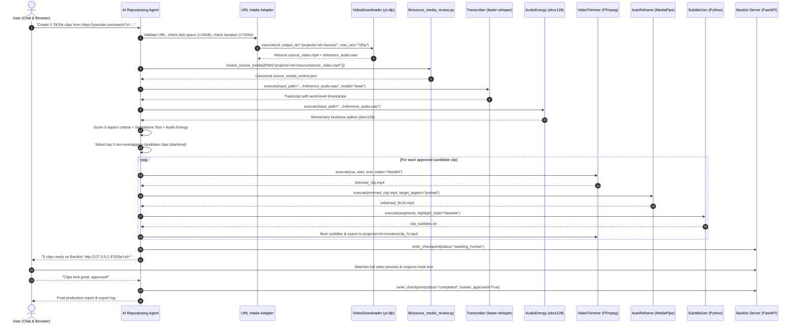

# FINAL ARCHITECTURE AND IMPLEMENTATION BLUEPRINT
## URL-to-Clips Automation Engine for OpenMontage (`AI-Video-Lab`)

**Workspace:** `C:\AI-Video-Lab`  
**Architecture Model:** Autonomous, Local-First, Instruction-Driven Video Repurposing  
**Date:** 2026-11-16  

---

## 1. Revised Architecture & Structural Decisions

Based on our forensic code validation and technical research, we adopt the **Dedicated URL Intake Adapter Architecture**:

```
┌─────────────────────────────────────────────────────────────────────────────┐
│                          TARGET REPURPOSING FLOW                            │
│                                                                             │
│  [User: YouTube URL + "Extract 5 Shorts"]                                   │
│       │                                                                     │
│       ▼                                                                     │
│  1. URL INTAKE ADAPTER (Preflight)                                          │
│     ├── Validates URL syntax and platform pattern                           │
│     ├── Pre-flight Disk Space Check (Requires >= 10GB free)                 │
│     ├── VideoDownloader (yt-dlp): 720p/1080p MP4 + 16kHz WAV               │
│     └── Materializes in: projects/<project_id>/source/source_video.mp4      │
│       │                                                                     │
│       ▼                                                                     │
│  2. CANONICAL SOURCE MEDIA REVIEW (Pristine, Unmodified)                    │
│     ├── lib/source_media_review.py probes source_video.mp4                  │
│     └── Produces: source_media_review.json                                  │
│       │                                                                     │
│       ▼                                                                     │
│  3. CLIP FACTORY STATE MACHINE (pipeline_defs/clip-factory.yaml)            │
│     ├── IDEA STAGE: Configures batch target (5 clips) and 9:16 portrait     │
│     ├── SCRIPT STAGE:                                                       │
│     │   ├── Transcriber (faster-whisper) -> Word-level timestamps           │
│     │   ├── AudioEnergy (ebur128) -> Peak vocal loudness markers            │
│     │   └── Agent evaluates 5-aspect criteria & Standalone Test             │
│     │   └── Output: script.json (Candidate moments with start/end bounds)   │
│     ├── SCENE PLAN STAGE: Safe zones (top hook, middle face, bottom subs)   │
│     ├── ASSET STAGE: SubtitleGen creates word-by-word / karaoke cues        │
│     ├── EDIT STAGE: SilenceCutter trims dead air & optimizes first 3s hook   │
│     └── COMPOSE STAGE:                                                      │
│         ├── VideoTrimmer: Frame-accurate libx264 cut                        │
│         ├── AutoReframe: MediaPipe face-tracking or stacked split-screen    │
│         └── VideoCompose: Remotion / FFmpeg burned animated subtitles       │
│       │                                                                     │
│       ▼                                                                     │
│  4. HUMAN-IN-THE-LOOP APPROVAL & BACKLOT MONITOR                            │
│     ├── Pipeline writes checkpoint_compose.json (status="awaiting_human")   │
│     ├── User opens Backlot UI (http://127.0.0.1:4750/p/<project_id>)        │
│     ├── User previews full 9:16 video clips with audio and captions         │
│     └── User replies in chat: "Approved" -> Final export package created    │
└─────────────────────────────────────────────────────────────────────────────┘
```

### Key Architectural Refinements:
1. **Zero Modifications to Core Ingestion:** `lib/source_media_review.py` remains 100% untouched. URL resolution is handled upstream by an explicit Intake Adapter.
2. **Dynamic Duration Ceilings:** Long-form downloads support up to 2 hours (`max_duration_seconds: 7200`) protected by a 10GB disk space pre-flight guard.
3. **Dual Transcription Strategy:** Fast-path instant YouTube transcript retrieval via `transcript_fetcher` for metadata and candidate scanning; local `faster-whisper` for word-accurate boundary cuts.
4. **Chat-Native Approval:** Operates synchronously with Backlot as a read-only live preview canvas, preserving OpenMontage's human-in-the-loop governance without needing backend database mutations.

---

## 2. Component Interaction & Data Contracts



---

## 3. Surgical Code Modifications (Diff-Ready Specifications)

To preserve the repository's integrity and keep git working trees completely clean, we limit changes to **two declarative configuration files** and **one standalone helper adapter**.

### 3.1 New Standalone Intake Adapter: `lib/url_ingest.py`
*(New file; does not modify or overwrite any existing OpenMontage code)*

```python
"""URL ingestion helper for OpenMontage footage-led pipelines.

Materializes remote video URLs (YouTube, Vimeo, etc.) into local project
storage before passing control to source_media_review.
"""

from __future__ import annotations

import logging
import shutil
from pathlib import Path
from typing import Any

from tools.base_tool import ToolResult

logger = logging.getLogger(__name__)


def ingest_source_url(
    url: str,
    project_dir: Path,
    tool_registry: Any,
    max_duration_seconds: int = 7200,
    max_resolution: str = "720p",
    min_disk_free_gb: float = 10.0,
) -> Path:
    """Download and materialize a remote video URL into the project workspace.

    Args:
        url: Remote media URL (YouTube, Shorts, TikTok, etc.)
        project_dir: Root directory of the current project.
        tool_registry: ToolRegistry instance containing video_downloader.
        max_duration_seconds: Hard safety limit (default: 2 hours).
        max_resolution: Video quality limit (default: 720p for optimal clipping).
        min_disk_free_gb: Minimum free space required to proceed.

    Returns:
        Path to the downloaded local MP4 video file.

    Raises:
        RuntimeError: If disk space is low, tool is unavailable, or download fails.
    """
    # 1. Preflight Disk Check
    free_gb = shutil.disk_usage(project_dir).free / (1024**3)
    if free_gb < min_disk_free_gb:
        raise RuntimeError(
            f"Insufficient disk space: {free_gb:.1f} GB available, "
            f"minimum {min_disk_free_gb:.1f} GB required."
        )

    # 2. Setup Source Directory
    source_dir = project_dir / "source"
    source_dir.mkdir(parents=True, exist_ok=True)

    # 3. Retrieve Downloader Tool
    downloader = tool_registry.get("video_downloader")
    if not downloader:
        raise RuntimeError("video_downloader tool is not registered in the environment.")

    # 4. Execute Download
    logger.info("Ingesting source URL: %s into %s", url, source_dir)
    result: ToolResult = downloader.execute({
        "url": url,
        "output_dir": str(source_dir),
        "format": "video",
        "max_resolution": max_resolution,
        "max_duration_seconds": max_duration_seconds,
    })

    if not result.success:
        raise RuntimeError(f"URL ingestion failed: {result.error}")

    video_path = result.data.get("video_path")
    if not video_path or not Path(video_path).is_file():
        raise RuntimeError("Downloader reported success but video file is missing on disk.")

    return Path(video_path)
```

---

### 3.2 Update Pipeline Manifest: `pipeline_defs/clip-factory.yaml`
Add permissions for `video_downloader`, `transcript_fetcher`, `auto_reframe`, and `silence_cutter` into the pipeline definition:

```yaml
# In pipeline_defs/clip-factory.yaml:

stages:
  - name: idea
    skill: pipelines/clip-factory/idea-director
    optional_artifacts_in:
      - source_media_review
    produces:
      - brief
      - decision_log
    # ADDED: Intake tools available to the Idea Director
    tools_available:
      - video_downloader
      - transcript_fetcher
    checkpoint_required: true
    human_approval_default: true

  - name: edit
    skill: pipelines/clip-factory/edit-director
    required_artifacts_in:
      - scene_plan
      - asset_manifest
    produces:
      - edit_decisions
    # ADDED: Silence cutter for automatic jump-cuts
    tools_available:
      - silence_cutter
    checkpoint_required: true
    human_approval_default: false

  - name: compose
    skill: pipelines/clip-factory/compose-director
    required_tools:
      - video_compose
      - video_trimmer
      - audio_mixer
    # ADDED: auto_reframe for vertical portrait formatting
    optional_tools:
      - audio_enhance
      - color_grade
      - auto_reframe
    tools_available:
      - video_compose
      - video_trimmer
      - audio_mixer
      - audio_enhance
      - color_grade
      - auto_reframe
    checkpoint_required: true
    human_approval_default: false
```

---

### 3.3 Update Idea Director Skill: `skills/pipelines/clip-factory/idea-director.md`
Add explicit intake protocol guidance at line 22:

```markdown
### 0. Source Intake (URL or Local File)

If the user provides a video URL (YouTube, Shorts, TikTok, Podcast):
1. Run `lib/url_ingest.py:ingest_source_url` or call `video_downloader` to fetch the source media into `projects/<id>/source/`.
2. Once the local `.mp4` file is materialized, call `lib/source_media_review.py:review_source_media()` with the local path.
3. If the user provides a local file path directly, proceed directly to `review_source_media()`.
```

---

## 4. Phased Implementation Roadmap

```
┌─────────────────────────────────────────────────────────────────────────────┐
│                            EXECUTION ROADMAP                                │
│                                                                             │
│  [MANDATORY MVP TRACK]                                                      │
│  ├── Milestone 1: Host Media Binaries & Virtualenv Packages                 │
│  ├── Milestone 2: URL Intake Adapter & Manifest Registration                │
│  └── Milestone 3: End-to-End Extraction Smoke Test (URL -> 3 Clips)         │
│                                                                             │
│  [QUALITY & REFINEMENT TRACK]                                               │
│  ├── Milestone 4: Face-Tracked 9:16 Auto-Reframing Integration              │
│  └── Milestone 5: Remotion Kinetic Subtitle Burn Polish                     │
└─────────────────────────────────────────────────────────────────────────────┘
```

### Milestone 1: Host Media Binaries & Virtualenv Packages (Mandatory MVP)
- **Objective:** Activate dormant OpenMontage tools by providing missing binaries and Python packages.
- **Scope:**
  1. Add FFmpeg/FFprobe binaries to Windows PATH (e.g., via Scoop: `scoop install ffmpeg` or manual binary download).
  2. Install verified Python wheels into `.venv`:
     ```bash
     .\.venv\Scripts\pip.exe install yt-dlp faster-whisper youtube-transcript-api
     ```
- **Files Affected:** None (Environment setup only).
- **Acceptance Criteria:**
  - `ffmpeg -version` and `ffprobe -version` succeed in terminal.
  - `python -c "import yt_dlp, faster_whisper; print('OK')"` outputs `OK`.
- **Rollback Strategy:** Uninstall packages via `pip uninstall`; remove FFmpeg from PATH.

### Milestone 2: URL Intake Adapter & Manifest Registration (Mandatory MVP)
- **Objective:** Connect the intake bridge without mutating existing source-review logic.
- **Scope:**
  1. Create `lib/url_ingest.py`.
  2. Update `pipeline_defs/clip-factory.yaml` (add tools to `idea` and `compose` stages).
  3. Update `skills/pipelines/clip-factory/idea-director.md`.
- **Files Affected:**
  - `lib/url_ingest.py` (New file)
  - `pipeline_defs/clip-factory.yaml` (Modified)
  - `skills/pipelines/clip-factory/idea-director.md` (Modified)
- **Acceptance Criteria:**
  - Contract test passes: `pytest tests/contracts/test_pipeline_manifest_categories.py`.
  - Manifest loads cleanly via `lib/pipeline_loader.py`.
- **Rollback Strategy:** Revert git changes via `git checkout -- pipeline_defs/clip-factory.yaml skills/pipelines/clip-factory/idea-director.md`; delete `lib/url_ingest.py`.

### Milestone 3: End-to-End Extraction Smoke Test (Mandatory MVP)
- **Objective:** Prove that a YouTube URL extracts multiple valid short clips.
- **Scope:**
  1. Run the pipeline with a 10-minute public domain or CC-licensed YouTube talk.
  2. Verify:
     - Media downloads to `projects/<id>/source/source_video.mp4`.
     - `transcriber` creates word timestamps.
     - Agent scores and selects 3 candidate moments.
     - `video_trimmer` cuts 3 clean MP4 clips.
     - `subtitle_gen` creates SRT subtitles.
     - Backlot server serves video previews at `http://127.0.0.1:4750/p/<id>`.
     - Human approval resumes pipeline to `completed`.
- **Acceptance Criteria:** 3 playable `.mp4` video clips exist in `projects/<id>/renders/` with verified audio and video sync.

### Milestone 4: Face-Tracked 9:16 Auto-Reframing Integration (Quality Track)
- **Objective:** Ensure speakers are centered in vertical mobile formats.
- **Scope:**
  1. Install `mediapipe` and `opencv-python` in `.venv`.
  2. Wire `auto_reframe` into `skills/pipelines/clip-factory/scene-director.md` and `compose-director.md`.
  3. Test on solo interview footage; verify upper-35% head placement.
- **Acceptance Criteria:** Video output is 1080x1920 with centered speaker and no horizontal black pillarboxes.

---

## 5. Risk Assessment & Operational Safeguards

| Risk | Impact | Architectural Mitigation |
| :--- | :--- | :--- |
| **YouTube Bot Detection / Throttling** | Download fails or hangs | `yt-dlp` configured with 10 socket retries; support for passing browser cookies (`--cookies-from-browser chrome`). |
| **Disk Space Exhaustion** | System crashes during long download | Hard pre-flight check in `lib/url_ingest.py` enforcing $\ge 10\text{ GB}$ free space before download begins. |
| **Dangling Context in Clips** | Low-quality viral clips | Script Director strictly enforces the **Standalone Test** (rejects opening pronouns and incomplete payoffs). |
| **Multi-Speaker Cropping Error** | Speaker cropped off-screen | Scene Director identifies 2-speaker layouts and routes to stacked split-screen instead of single-center crop. |
| **Upstream Git Drift** | Merge conflicts with OpenMontage updates | Zero modifications to core framework files (`lib/source_media_review.py`, `tools/*`). All additions are modular. |

---

## 6. Definition of Project Success

The URL-to-Clips integration is complete and successful when:
1. A user can paste a public video URL in chat.
2. The system automatically downloads the source, checks audio loudness, and transcribes speech with word timestamps.
3. The AI agent identifies 5 high-impact, standalone moments and plans 9:16 framing.
4. Clean, frame-accurate clips are cut with burned subtitles.
5. The Backlot living board displays all 5 clips for human review.
6. A one-word chat message (`"Approved"`) completes the project and prepares files for social media publishing.
