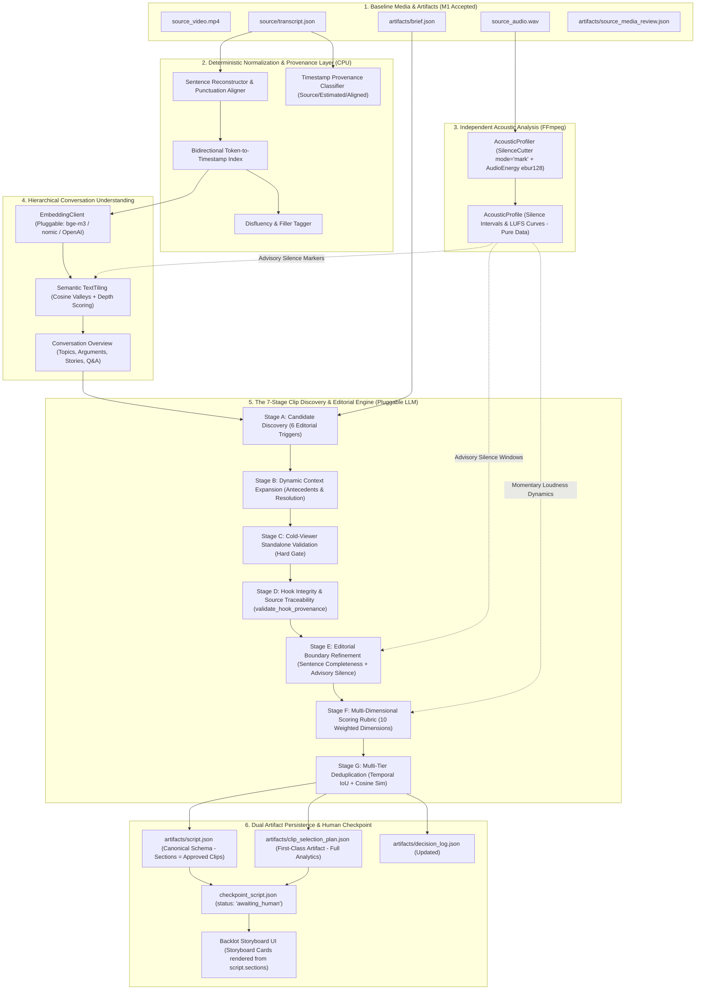
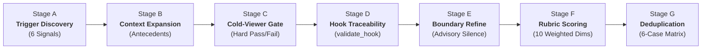

# M2 FINAL — CONVERSATION INTELLIGENCE, EDITORIAL REASONING & CLIP DISCOVERY ARCHITECTURE
**Project:** AI Video Lab (`C:\AI-Video-Lab`)  
**Pipeline:** `clip-factory` (v2.0)  
**Document:** `planning/13_M2_CONVERSATION_INTELLIGENCE_AND_CLIP_DISCOVERY_ARCHITECTURE.md`  
**Date:** November 17, 2026  
**Author:** Principal Software Architect, Senior Python Engineer & Video Intelligence Researcher  
**Status:** Architecture Blueprint & System Specification (Implementation Authorization: NOT GRANTED)  

---

## 1. Architectural Philosophy: Editorial Quality Over Extraction Quantity

The fundamental defect of current open-source and commercial video clipping tools is **superficial extraction**: slicing arbitrary 30-to-60-second transcript windows whenever an LLM notices a high-energy keyword or viral buzzword. `[RESEARCHED]`

This produces clips that fail the basic test of human communication:
- They begin with an unresolved pronoun (*"And that's why he told me never to do it again"*).
- They cut off before the payoff of the story lands.
- They distort the speaker's nuance by removing an essential qualification stated 10 seconds earlier.
- They capture a rambling, unfocused monologue that bores a cold audience.

Our core principle for Milestone 2 is:
> **We would rather discover three genuinely compelling, complete, and self-contained clips than extract ten mediocre, confusing, or misleading ones.** `[PROPOSED]`

Every candidate clip must satisfy:
1. **A Clear, Attention-Holding Hook:** A naturally occurring opening statement, question, or narrative tension that orientates the viewer in the first 2-3 seconds without dialogue fabrication. `[PROPOSED]`
2. **Context Independence (The Cold Viewer Test):** An unknown viewer stumbling upon the short on TikTok, Reels, or YouTube Shorts must immediately understand the subject without having watched the previous 20 minutes of the podcast. `[PROPOSED]`
3. **Narrative Completeness:** A distinct beginning, development, and satisfying punchline, lesson, or conclusion. `[PROPOSED]`
4. **Factual & Intentional Fidelity:** The clip must preserve the authentic context of what the speaker said, preventing misleading truncation or clickbait distortion. `[PROPOSED]`

---

## 2. End-to-End System Architecture

The Milestone 2 intelligence engine is structured as a staged, hierarchical processing pipeline. Deterministic Python algorithms handle text normalization, time indexing, and candidate deduplication; pluggable frontier AI models perform topic understanding, semantic scoring, and hook evaluation. `[PROPOSED]`

---

## 3. Provenance-Aware Timestamp System

Universal fixed padding (+0.25s preroll, +0.35s postroll) is abolished as a substitute for reliable timing. Adding arbitrary fixed padding to an estimated word boundary does not guarantee speech preservation and often captures preceding speaker interruptions. `[PROPOSED]`

The system replaces fixed padding with an explicit **Provenance-Aware Timestamp Model**: `[PROPOSED]`

### 3.1 Three Immutable Provenance Classes
1. **`SOURCE_SEGMENT`**:  
   - Direct timing from caption snippets (e.g. YouTube auto-captions) or Whisper chunk blocks.
   - Precision: Coarse phrase-level. Uncertainty bound: $\pm 0.0\text{s}$ at segment start/end, but words inside have undefined boundaries. `[VERIFIED: transcript_fetcher.py]`
2. **`ESTIMATED_INTERPOLATED`**:  
   - Sub-segment word timings reconstructed via character-length and phonetic duration heuristics.
   - Explicit uncertainty bound: $\pm 0.40\text{s}$ to $\pm 0.60\text{s}$.
   - **Contract Rule:** Must be explicitly marked as estimated. Downstream video trimming components are forbidden from treating this as frame-accurate. `[PROPOSED]`
3. **`ACOUSTICALLY_VERIFIED`**:  
   - Boundaries confirmed by acoustic measurement (FFmpeg `silencedetect` pause edge or forced CTC phoneme alignment).
   - Explicit uncertainty bound: $\pm 0.04\text{s}$ (frame-accurate at 25fps).
   - **Contract Rule:** Safe for frame-accurate video trimming and word-level subtitle highlight. `[VERIFIED: silence_cutter.py]`

### 3.2 Dynamic Boundary Policy Based on Provenance
- If boundary is `ACOUSTICALLY_VERIFIED`: Cut directly at the verified speech boundary or silence midpoint. Zero artificial padding added.
- If boundary is `ESTIMATED_INTERPOLATED`:
  - The system queries `AcousticProfile` for a silence interval within the uncertainty window $[t - \delta, t + \delta]$.
  - If a silence is found: Snaps to the silence window and elevates provenance to `ACOUSTICALLY_VERIFIED`.
  - If NO silence is found (continuous speech): Does NOT guess. Keeps `ESTIMATED_INTERPOLATED`, flags `timing_confidence: "LOW"`, and applies an editorial safeguard window equal to the measured uncertainty $\pm \delta$ while flagging the clip as `NEEDS_HUMAN_REVIEW`. `[PROPOSED]`

---

## 4. Spoken Hook Integrity & Source Traceability

Checking whether a hook is a substring of transformed text is insufficient because transformations (sentence reconstruction, punctuation, disfluency removal) can mask departures from actual speech. `[PROPOSED]`

### 4.1 Three Distinct Concepts
1. **`spoken_hook`**: The actual verbatim words spoken by the person in the video.
2. **`editorial_title`**: A short headline created to communicate the clip's topic (e.g. *"The 10,000-Hour Rule Is Wrong"*). Clearly demarcated as editorial text.
3. **`editorial_framing`**: A 1-2 sentence background context / premise (e.g. *"In this segment, the author explains why deliberate practice differs from mere repetition"*).

### 4.2 Application-Level Validator: `validate_hook_provenance`
JSON Schema alone cannot prove cross-segment string provenance. The application-level validator enforces: `[PROPOSED]`
1. **Exact Token Sequence Match:** Stripping punctuation and casing from the proposed `spoken_hook` must produce a token sequence that exists verbatim in the raw source transcript.
2. **Exact Source Character Span:** Returns the exact character offsets `[char_start, char_end]` in the raw transcript evidence.
3. **Contiguity Check:** The hook must span a contiguous sequence of source tokens across at most $N$ contiguous source segments.
4. **Attribution Check:** If speaker labels exist, all tokens in the hook must belong to the same speaker turn.
5. **Timestamp Anchor:** The hook's start/end timestamps must map directly to the underlying source segment timestamps.

---

## 5. Acoustic Analysis vs Editorial Boundary Selection

A technically accurate silence detector does not guarantee a good editorial cut. Speakers pause mid-sentence, pause dramatically before punchlines, or speak continuously across topic shifts. `[PROPOSED]`

### 5.1 Decoupled Responsibilities & Interfaces

1. **`AcousticProfiler` Component (`lib/acoustic_profiler.py`):**
   - Responsibilities: Runs FFmpeg `SilenceCutter(mode="mark")` and `AudioEnergy(ebur128)`. `[VERIFIED: tools/video/silence_cutter.py, tools/analysis/audio_energy.py]`
   - Output: `AcousticProfile` data structure holding silence intervals, speech intervals, and momentary loudness.
   - Constraint: Pure measurement. Makes ZERO editorial decisions.
2. **`EditorialBoundarySelector` Component (`lib/editorial_boundary_selector.py`):**
   - Responsibilities: Evaluates grammatical completeness, terminal punctuation, speaker turns, and narrative setup/payoff.
   - Advisory Integration:
     - When a sentence boundary is adjacent to an acoustic silence ($\le 0.4\text{s}$): snaps boundary to the silence midpoint.
     - When a speaker pauses dramatically mid-sentence: recognizes that the thought is incomplete and REFUSES to cut at the pause.
     - When speech is continuous (no pause): retains sentence boundary, sets provenance to `ESTIMATED_INTERPOLATED`, and flags `NEEDS_HUMAN_REVIEW`. `[PROPOSED]`

---

## 6. The 7-Stage Clip Discovery & Editorial Engine

### Stage A: Trigger Discovery (6 Editorial Signals)
Scans conversation for:
1. *Hook Trigger:* Bold assertions, counter-intuitive claims, provocative questions.
2. *Story Trigger:* Narrative arc (setup $\rightarrow$ conflict $\rightarrow$ resolution).
3. *Insight Trigger:* Actionable frameworks, rules of thumb, mental models.
4. *Debate Trigger:* Intellectual friction, contrasting perspectives.
5. *Emotional Trigger:* Vulnerability, humor, epiphany, deep conviction.
6. *Q&A Trigger:* Sharp question followed by a definitive answer.

### Stage B: Dynamic Context Expansion
Expands bounds $[t_{start}, t_{end}]$ backward to enclose antecedent noun phrases (resolving pronouns like *"he"*, *"that project"*) and forward to capture terminal resolution. `[PROPOSED]`

### Stage C: Cold-Viewer Standalone Audit (Hard Eligibility Gate)
The intelligence model evaluates the candidate:
> *"You are an audience member who has never watched this podcast and has zero context. Does this excerpt make complete sense on its own? Answer ELIGIBLE or REJECTED with explicit linguistic reasons."*

**Hard Rule:** If a candidate fails the Cold Viewer Audit, it is REJECTED immediately. Scores can never compensate for failing this test. `[PROPOSED]`

### Stage D: Hook Integrity & Source Traceability
Applies `validate_hook_provenance` to guarantee that `spoken_hook` is an exact verbatim token sequence from the raw source evidence with exact character spans. `[PROPOSED]`

### Stage E: Natural Boundary Refinement
Applies `EditorialBoundarySelector` to snap boundaries to acoustic silences where available without cutting mid-thought. `[PROPOSED]`

### Stage F: Multi-Dimensional Scoring Rubric (10 Weighted Dimensions)
Candidates that pass all eligibility gates are scored out of 100: `[PROPOSED]`
1. Hook Strength (15%)
2. Standalone Coherence (15%)
3. Value Density & Insight (15%)
4. Narrative Arc & Payoff (10%)
5. Emotional Resonance (10%)
6. Visual Dynamism / Loudness Energy (10%)
7. Quotability (10%)
8. Pacing & Momentum (5%)
9. Platform Fit (5%)
10. Editorial Cleanliness (5%)

### Stage G: Multi-Tier Deduplication (6-Case Redundancy Taxonomy)
Replaces the single IoU threshold with a 6-case taxonomy: `[PROPOSED]`
1. *Nearly Identical Time Ranges ($\text{IoU} \ge 0.70$):* Keep highest-scoring candidate; reject duplicate.
2. *Same Content, Competing Boundaries ($0.30 \le \text{IoU} < 0.70$):* Select cleaner boundary edit.
3. *Nested Clip in Longer Story ($\text{Containment} \ge 0.80$):* Evaluate whether shorter version is self-contained. Flag alternative for human review.
4. *Same Idea, Different Sections ($\text{IoU} \approx 0, \text{Cosine} \ge 0.85$):* Keep higher value density; demote redundant topic.
5. *Distinct Moments Sharing Topic ($\text{IoU} \approx 0, \text{Cosine} 0.70 - 0.84$, distinct propositions):* Preserve both.
6. *A/B Variants (different hooks, same body):* Group under single candidate card for human choice.

---

## 7. Dual Artifact Architecture & Downstream Compatibility

To maintain 100% backward compatibility with OpenMontage's `lib/checkpoint.py`, `pipeline_defs/clip-factory.yaml`, and Backlot storyboard rendering (`backlot/state.py`), the `script` stage produces **two coordinated artifacts**: `[VERIFIED: lib/checkpoint.py, backlot/state.py]`

1. **Canonical `artifacts/script.json`**:
   - Matches `schemas/artifacts/script.schema.json`.
   - Each `section` represents an approved clip (`id: "clip_01"`, `start_seconds`, `end_seconds`, `text`, `label: "Editorial Title"`).
   - Backlot automatically renders each section as an interactive storyboard card.
   - Downstream stages (`scene_plan`, `assets`, `edit`) consume `script.sections` seamlessly.
2. **First-Class `artifacts/clip_selection_plan.json`**:
   - Matches `schemas/artifacts/clip_selection_plan.schema.json`.
   - Contains the complete conversation intelligence breakdown: topic map, candidate evaluations, provenance classes, exact character spans, cold-viewer reasoning, 10-dimension rubric scores, and deduplication records.
