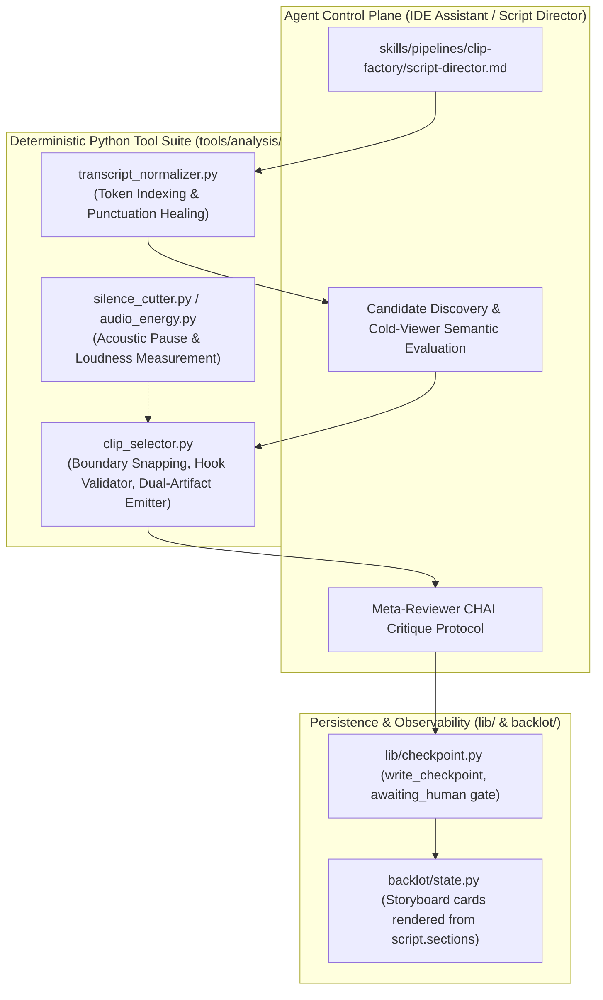
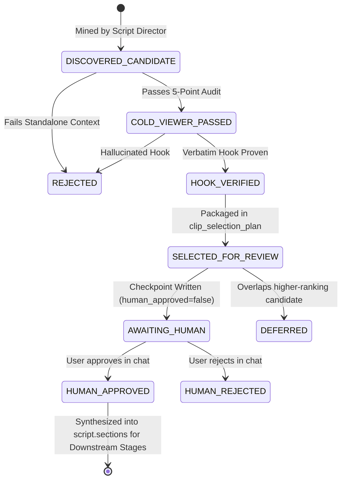

# M2 — Final Evidence-Grounded Conversation Intelligence & Editorial Discovery Architecture
**Document:** `planning/13_M2_CONVERSATION_INTELLIGENCE_AND_CLIP_DISCOVERY_ARCHITECTURE.md`  
**Repository:** `https://github.com/Unstocks/AI-video-Lab` (`C:\AI-Video-Lab`)  
**Primary Branch:** `main` tracking `origin/main`  
**Pipeline:** `clip-factory` (v2.0)  
**Target Milestone:** M2 — Conversation Intelligence, Semantic Moment Discovery & High-Quality Clip Selection  
**Document Status:** Definitive Architecture Blueprint & System Specification  
**Execution Mode:** Independent Read-Only Forensic Architecture Audit  
**Implementation Authorization Status:** **NOT GRANTED**  
**Date:** November 17, 2026  
**Author:** Principal Software Architect, Senior Python Engineer & Video Intelligence Researcher  

---

## 1. Product Contract & Editorial Principles

Automated video clipping fails when it treats conversations as flat streams of keywords, slicing fixed 30-to-60-second fragments without understanding narrative structure. This produces disjointed clips that begin with unresolved pronouns (*"And that's why he told me never to do it again"*), cut off before payoffs land, or misrepresent the speaker by stripping essential qualifications. `[RESEARCHED]`

### Core Product Contract
> **We prioritize editorial quality over clip quantity: Three genuinely exceptional, contextually complete, and self-contained clips are vastly more valuable than ten mediocre or confusing fragments.** `[PROPOSED]`

### Non-Negotiable Editorial Principles:
1. **Full Conversational Context Before Selection:** Macro-conversation structure must be understood before proposing candidate boundaries.
2. **Cold-Viewer Comprehension (Standalone Viability):** An unfamiliar viewer stumbling upon the clip on social feeds (Shorts, Reels, TikTok) must immediately grasp the subject, participants, and context without having watched preceding video content.
3. **Natural Narrative Boundaries:** Clips must begin and end at natural conversational boundaries (complete thoughts, stories, explanations), never truncated mid-clause.
4. **Zero Fabricated Spoken Hooks:** A generated title or packaging summary must never masquerade as spoken dialogue. Spoken hooks must be verified verbatim against raw transcript evidence.
5. **No Misleading Context Truncation:** Essential qualifications, satirical cues, or immediate counter-arguments must not be excised to artificially create sensationalism.
6. **No Arbitrary Quota Inflation:** If a 60-minute discussion only contains two outstanding moments, the system must output two high-quality candidates rather than lowering standards to satisfy an arbitrary count.
7. **Human Governance at Checkpoint:** All candidate clips must be presented for human review at the established stage gate before downstream visual planning and rendering.

---

## 2. Agent-Native Architecture & Division of Responsibility

OpenMontage operates on an **Agent-First Control Plane** `[VERIFIED: docs/ARCHITECTURE.md lines 90–108]`:
- **The AI Coding Assistant (Antigravity) is the Orchestrator:** It reads pipeline definitions (`pipeline_defs/clip-factory.yaml`), executes stage director skills (`skills/pipelines/clip-factory/*`), and evaluates qualitative criteria.
- **Python is the Deterministic Tool & Persistence Engine:** Python provides BaseTool implementations (`tools/`) and state management (`lib/checkpoint.py`). Python does not contain a secondary autonomous agent or runtime LLM loop.



---

## 3. Raw Evidence Preservation & Unicode Offset Semantics

Raw transcript evidence must remain immutable. Punctuation healing, casing normalization, and sentence reconstruction must never mutate or discard original source segments. `[PROPOSED]`

### 3.1 Raw Evidence Data Contract
Every segment parsed from native captions or Whisper STT is stored in its unaltered form:
```json
{
  "segment_id": 42,
  "start_seconds": 124.50,
  "end_seconds": 128.20,
  "text": "and then he told me that's why we don't build it",
  "speaker": "Speaker_1",
  "confidence": 0.94,
  "timing_provenance": "ASR_SEGMENT_TIMING"
}
```

### 3.2 Unicode and Offset Coordinate System `[PROPOSED]`
To eliminate index drift and character corruption across multilingual transcripts:
1. **Character Offset Coordinate System:** All character spans use **Python Unicode code point indices** on string objects. Offsets are represented as half-open intervals:
   $$[\text{char\_start}, \text{char\_end})$$
   where `text[char_start:char_end]` exactly slices the target string.
2. **Canonical Normalization Form:** All text is normalized using **Unicode Normalization Form C (NFC)** (`unicodedata.normalize("NFC", text)`). This ensures precomposed characters (e.g. accented letters, Devanagari vowel signs like `कि` composed of `क` + `ि`) have a deterministic, canonical code point sequence.
3. **Byte Offsets vs. Code Point Offsets:** Byte offsets (`len(text.encode("utf-8"))`) are strictly restricted to low-level binary I/O. All application-level indexes, token maps, and schema offsets store Unicode code point spans.
4. **Segment-Relative vs. Global Coordinates:**
   - `source_span` stores: `(segment_id: int, seg_char_start: int, seg_char_end: int)`.
   - `normalized_span` stores: `(norm_char_start: int, norm_char_end: int)` across the full reconstructed narrative text.
   - The `TranscriptNormalizer` maintains an exact, bidirectional lookup table mapping any `normalized_span` to its constituent list of `source_span` tuples.

---

## 4. Technically Honest Timestamp Provenance Model

Conflating caption display timestamps with acoustic speech edges or forced alignment introduces false precision. The system implements an explicit **8-Tier Timestamp Provenance Taxonomy**: `[PROPOSED]`

### 4.1 The 8-Tier Provenance Taxonomy

| Provenance Tier | Origin of Timing Value | Directly Observed vs Derived | Measured Uncertainty | Operational Use & Boundary Authority |
| :--- | :--- | :--- | :--- | :--- |
| **`CAPTION_SEGMENT_TIMING`** | Native YouTube / WebVTT caption snippet boundary. | Directly observed from caption container. | $\pm 0.30\text{s}$ to $\pm 0.50\text{s}$ (due to subtitle display latency). | Coarse phrase-level timing. Interior words have undefined timestamps. Cannot be used for frame-accurate cuts. |
| **`ASR_SEGMENT_TIMING`** | Speech recognizer (Whisper) segment chunk boundary. | Derived from model encoder-decoder window. | $\pm 0.20\text{s}$. | Accurate to sentence/phrase level. Usable for candidate scoping. |
| **`ASR_WORD_ESTIMATED`** | Word timestamp derived from Whisper cross-attention weights. | Derived via attention peak heuristic. | $\pm 0.15\text{s}$ to $\pm 0.25\text{s}$. | Usable for subtitle highlighting; not guaranteed cut-safe on fast speech. |
| **`INTERPOLATED_CHARACTER_HEURISTIC`** | Proportional division of segment duration across word characters. | Estimated via heuristic math. | $\pm 0.40\text{s}$ to $\pm 0.60\text{s}$. | Explicitly flagged as low confidence; downstream tools must apply human review. |
| **`FORCED_ALIGNMENT_PHONEME`** | Acoustic CTC phoneme alignment (wav2vec2/MMS). | Directly measured against acoustic frame model. | $\pm 0.03\text{s}$ (sub-frame accurate at 25fps). | Highly cut-safe. Preferred boundary timing when alignment model is run. |
| **`VAD_SPEECH_REGION`** | Voice Activity Detection (neural or energy threshold). | Measured from raw audio waveform. | $\pm 0.05\text{s}$. | Detects speech onset and offset; does not distinguish individual words. |
| **`SILENCE_PROXIMITY_SNAP`** | Boundary snapped to an adjacent acoustic pause midpoint. | Derived by combining text boundary with signal silence. | $\pm 0.04\text{s}$ relative to pause center. | Advisory snapping applied when text boundary aligns with natural pause. |
| **`HUMAN_ADJUSTED`** | Hand-tuned boundary set during review. | Manually verified by human editor. | $\pm 0.00\text{s}$ (authoritative editorial override). | Absolute authority over automated boundary calculations. |

### 4.2 Separation of Four Independent Concepts `[PROPOSED]`
1. **Speech Evidence:** Where speech actively occurs in audio (VAD, ASR words).
2. **Acoustic Evidence:** What the audio signal indicates (silence pauses $< -35\text{dB}$, momentary LUFS peaks).
3. **Alignment Evidence:** How transcript tokens map to temporal audio features.
4. **Editorial Boundary:** Where the narrative thought begins or ends for storytelling impact.

### 4.3 Abolition of the 400ms Hard Snapping Rule
The previous proposal to automatically snap any boundary within 400ms to a silence midpoint is **rejected as a rigid rule**. An acoustic pause is *advisory supporting evidence*. 
- If a speaker pauses dramatically mid-sentence before an emphatic phrase, cutting at the silence destroys narrative continuity.
- Snapping is only applied when the editorial thought is grammatically and semantically complete, and a confirmed pause exists immediately adjacent ($\le 300\text{ms}$) to the terminal word.

---

## 5. Spoken Hook Integrity & Source Traceability

Checking whether a hook is a substring of transformed text is insufficient because text transformations (sentence reconstruction, punctuation, disfluency removal) can mask departures from actual speech. `[PROPOSED]`

### 5.1 Three Distinct Concepts
1. **`spoken_hook`**: The actual verbatim words spoken by the source speaker in the first 2–5 seconds of the clip.
2. **`editorial_title`**: A social media headline created to communicate the clip's topic (e.g. *"The 10,000-Hour Rule Is Wrong"*). Clearly demarcated as editorial text.
3. **`editorial_framing`**: An optional visual intro card or textual premise (e.g. *"In this segment, the author explains why deliberate practice differs from mere repetition"*).

### 5.2 Application-Level Validator: `validate_hook_provenance`
JSON Schema alone cannot prove cross-segment string provenance. The application-level validator enforces: `[PROPOSED]`
1. **Contiguous Verbatim Match:** Stripping casing and punctuation from the proposed `spoken_hook` must match a contiguous sequence of words in the raw source transcript.
2. **No Middle Word Deletion:** Removing words from the middle of a sentence and joining them without ellipsis or pause representation is rejected.
3. **Exact Source Character Span:** Returns the exact character offsets `[char_start, char_end)` in the raw transcript evidence.
4. **Single Speaker Turn:** All tokens in the hook must belong to the same speaker turn. Cross-speaker banter can form the context, but cannot be attributed to a single speaker's hook.
5. **Zero Tolerance:** If `validate_hook_provenance` fails, the candidate cannot be admitted to `clip_selection_plan.json`. Zero tolerance for hallucinated spoken dialogue.

---

## 6. Cold-Viewer Comprehension Test (Hard Editorial Gate)

Before any candidate is admitted to the ranking pool, it must pass the **Cold-Viewer Standalone Audit**:

```
                              THE COLD-VIEWER AUDIT
  ┌────────────────────────────────────────────────────────────────────────┐
  │ 1. Is the subject or topic clearly established within the first 5s?   │
  │ 2. Are all key people, products, or concepts explicitly identified?    │
  │ 3. Are all pronouns ('he', 'she', 'they', 'this') resolved in-clip?   │
  │ 4. Does the excerpt communicate a distinct, understandable point?      │
  │ 5. Is there a satisfying narrative or logical conclusion/payoff?       │
  └────────────────────────────────────────────────────────────────────────┘
                    │                                    │
               All YES                              Any NO
                    ▼                                    ▼
         Admit to Candidate Pool              Execute Backward/Forward Search
                                                         │
                                             Resolved? ──┴── Too Long / Bloated?
                                                 │                  │
                                              YES: Admit         NO: REJECT
```

### Context Expansion Rules
1. **Antecedent Resolution:** If the seed sentence begins with an unresolved pronoun (*"He didn't realize it"*, *"They failed"*), the system traces backwards to include the sentence introducing the referent.
2. **Setup Preservation:** If a revelation depends on an initial premise or thought experiment, the boundary expands to capture the setup.
3. **Payload / Punchline Closure:** The boundary extends until the speaker reaches conversational rest or a conversational partner responds.
4. **Length Guardrail:** If context expansion expands the excerpt beyond 120 seconds, the moment is deemed inherently episodic (unsuitable for short-form extraction) and rejected.

---

## 7. Candidate Eligibility, Scoring & Batch Diversity

### 7.1 Formal Candidate Lifecycle States `[PROPOSED]`
To resolve the contradiction of having "approved clips" before human review, the system implements an explicit **8-State Candidate Lifecycle**:



### 7.2 Multi-Dimensional Ranking Dimensions (10 Dimensions)
Eligible candidates are scored across ten editorial criteria:
1. `hook_strength` (0–10): Immediate curiosity, controversy, or question raised in first 3s.
2. `standalone_comprehension` (0–10): Clarity of subject without external context.
3. `narrative_completeness` (0–10): Structural presence of setup, development, and payoff.
4. `insight_density` (0–10): Depth of practical, technical, or philosophical value.
5. `emotional_resonance` (0–10): Humor, passion, conviction, or relatability.
6. `novelty_factor` (0–10): Freshness of perspective vs generic cliches.
7. `speech_flow` (0–10): Rhythm, pacing, absence of jarring disfluencies.
8. `duration_suitability` (0–10): Optimal short-form duration (30s–60s sweet spot).
9. `acoustic_cut_safety` (0–10): Cleanliness of start/end speech pauses.
10. `source_evidence_quality` (0–10): Word-level confidence and caption fidelity.

### 7.3 Deduplication & Batch Diversity
- **Temporal IoU Filter:** If two candidates have an Intersection-over-Union (IoU) $> 0.35$, the lower-scoring candidate is deferred.
- **Semantic Diversity Batching:** If two candidates cover the exact same conceptual point (cosine similarity $> 0.85$ on argument embeddings), only the strongest version is retained in the primary batch. Alternate perspectives on different topics are prioritized.

---

## 8. Dual-Artifact Pipeline Integration & Real Consumer Compatibility

To guarantee zero downstream breakage across OpenMontage's existing consumers:

### 8.1 Consumer Compatibility Matrix `[VERIFIED]`

| Downstream Consumer | Repository Source Location | Current Expected Contract | Proposed Input Contract | Compatibility Status | Required Adapter |
| :--- | :--- | :--- | :--- | :--- | :--- |
| **`lib/checkpoint.py`** | Lines 30–40, 159–172 | Canonical artifact for stage `script` must be named `"script"`. Checks `artifact_name in ARTIFACT_NAMES`. | Dual artifacts: `"script"` + `"clip_selection_plan"`. | **100% Compatible** | Register `"clip_selection_plan"` in `schemas/artifacts/__init__.py`. |
| **`schemas/artifacts/script.schema.json`** | Lines 15–45 | Requires `version`, `title`, `total_duration_seconds`, and `sections` array with `id`, `text`, `start_seconds`, `end_seconds`. | Approved clips formatted as `sections` items. | **100% Compatible** | None. Payload matches schema exactly. |
| **`backlot/state.py`** | Lines 412, 456 | Reads `(artifacts.get("script") or {}).get("sections")` to render visual storyboard cards. | `script.sections` contains approved clips. | **100% Compatible** | None. Backlot immediately renders clip cards. |
| **`schemas/artifacts/scene_plan.schema.json`** | Lines 35–45 | Requires `scene.script_section_id` to join with `script.sections[i].id`. | `scene.script_section_id == clip.id`. | **100% Compatible** | None. Downstream scene planner joins cleanly. |
| **`skills/pipelines/clip-factory/edit-director.md`** | Lines 25–60 | Slices video based on `script.sections` timestamps. | `start_seconds` and `end_seconds` from approved clips. | **100% Compatible** | None. Downstream trimmer cuts approved boundaries. |

### 8.2 Canonical Dual-Artifact Relationship
- **`clip_selection_plan.json`:** An **upstream editorial planning artifact and governance dossier**. It contains all candidates (approved, review-pending, rejected), cold-viewer audits, hook evidence spans, and scoring breakdowns.
- **`script.json`:** The **canonical downstream stage artifact**. It is synthesized exclusively from **human-approved clips**, formatted strictly as `sections` to feed `scene_plan`, `assets`, `edit`, and `backlot` without schema deviations.

---

## 9. Evaluation Strategy: Measuring Editorial Quality with a Gold Dataset

A pipeline that runs without runtime crashes is not necessarily an effective clipping engine. True evaluation requires an annotated benchmark:

### Benchmark Corpus Archetypes (10 Archetypes)
1. **Technical Solo Deep-Dive:** 45-minute architectural walkthrough (e.g. distributed systems).
2. **High-Pace Two-Host Banter:** Informal conversational banter with interruptions and humor.
3. **Structured Guest Interview:** Q&A format with detailed career stories.
4. **Heated Debate / Disagreement:** Rapid speaker turns, overlapping speech, sharp counter-arguments.
5. **Instructional How-To / Masterclass:** Actionable steps, numbered lists, practical frameworks.
6. **Narrative Personal Storytelling:** Anecdotes with setup, climax, and lesson learned.
7. **Bilingual / Hinglish Conversation:** Hindi-English code-switching in Latin and Devanagari script.
8. **Noisy Audio / Poor ASR Quality:** Low SNR, background room reverb, transcription errors.
9. **Fast Speech with Few Pauses:** Rapid cadence (> 180 wpm) with minimal natural silences.
10. **Quiet / Monotone Discussion:** Subdued dynamic range requiring sensitive loudness detection.

### 10 Distinct Measurable Evaluation Metrics:
1. **Candidate Discovery Precision:** % of extracted candidates that represent self-contained moments.
2. **Candidate Discovery Recall:** % of human-annotated top moments discovered by the system.
3. **Cold-Viewer Standalone Pass Rate:** % of candidates requiring zero external context.
4. **Hook Verbatim Accuracy:** % of spoken hooks verified 100% identical to raw transcript. Target: **100.0%**.
5. **Boundary Cut Acceptability:** % of audio cuts that do not clip words or speech consonants.
6. **Timestamp Calibration:** Measured difference between snapped boundary and true speech boundary.
7. **Duplicate Suppression:** % of redundant or overlapping clips successfully triaged to `DEFERRED`.
8. **Batch Diversity:** Spread of candidate topics across conversation duration (no single-topic clustering).
9. **Human Acceptance Rate:** % of approved candidates accepted by human reviewer without editing.
10. **Downstream Pipeline Pass Rate:** % of approved clips successfully processed by `scene_plan` and `edit`.
