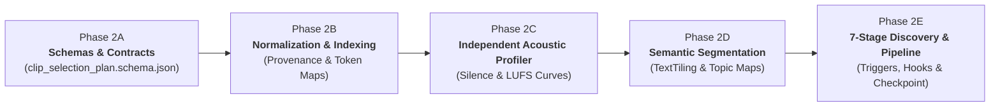

# M2 FINAL — IMPLEMENTATION ROADMAP, QUALITY GATES & VERIFICATION STRATEGY
**Project:** AI Video Lab (`C:\AI-Video-Lab`)  
**Pipeline:** `clip-factory` (v2.0)  
**Document:** `planning/14_M2_IMPLEMENTATION_ROADMAP_AND_VERIFICATION_STRATEGY.md`  
**Date:** November 17, 2026  
**Author:** Principal Software Architect, Senior Python Engineer & Production QA Lead  
**Status:** Implementation Roadmap & Quality Verification Blueprint (Implementation Authorization: NOT GRANTED)  

---

## 1. Executive Summary & Quality Invariants

This document establishes the corrected phased engineering roadmap, exact file-level scopes, component dependency order, and mathematical quality verification strategy for **Milestone 2: Conversation Intelligence, Semantic Moment Discovery & High-Quality Clip Selection**. `[PROPOSED]`

### 1.1 Non-Negotiable Quality Invariants
1. **Zero Hallucinated Dialogue:** Every `spoken_hook` must be verified by `validate_hook_provenance` as an exact verbatim token sequence in the raw source transcript evidence with valid character spans. Hallucinated dialogue is rejected with zero tolerance ($0.0\%$). `[PROPOSED]`
2. **Context Independence First:** No candidate may proceed to numerical ranking if it fails the Cold Viewer Standalone Audit. Scores cannot compensate for missing context. `[PROPOSED]`
3. **Honest Timestamp Provenance:** Timestamps are strictly classified as `SOURCE_SEGMENT`, `ESTIMATED_INTERPOLATED`, or `ACOUSTICALLY_VERIFIED`. Fixed universal padding is abolished. `[PROPOSED]`
4. **Architectural Preservation:** The upstream OpenMontage pipeline, tool registry, and checkpoint mechanisms are preserved. We produce canonical `script.json` alongside `clip_selection_plan.json` to maintain 100% downstream compatibility with Backlot and future M3 stages. `[VERIFIED]`
5. **Decoupled Architecture:** Acoustic analysis and editorial boundary selection are decoupled into distinct components. `[PROPOSED]`

---

## 2. Stage-Level Execution & Failure Recovery Matrix

To prevent model failures from silently corrupting editorial quality while keeping deterministic stages unblocked, stages are strictly classified: `[PROPOSED]`

| Stage / Component | Nature | Inputs | Outputs | Responsible Component | Required Model Capabilities | Failure Conditions | Recovery & Resume Contract | Human Intervention Required? |
| :--- | :--- | :--- | :--- | :--- | :--- | :--- | :--- | :--- |
| **Stage 2.1: Transcript Normalization** | **Deterministic** | `source/transcript.json` | `source/normalized_transcript.json` | `lib/transcript_normalizer.py` | None (Pure Python) | Malformed JSON, missing text | Clean Python exception; idempotent rerun | No |
| **Stage 2.2: Token-to-Source Mapping** | **Deterministic** | `NormalizedTranscript` | Reversible index & token map | `lib/transcript_normalizer.py` | None (Pure Python) | Character offset mismatch | Re-indexes from raw transcript tokens | No |
| **Stage 2.3: Acoustic Profiling** | **Deterministic** | `source/source_audio.wav` | `source/acoustic_profile.json` | `lib/acoustic_profiler.py` | None (FFmpeg `SilenceCutter` + `AudioEnergy`) | FFmpeg missing or unreadable audio | Retries FFmpeg command; fails closed if audio corrupted | No |
| **Stage 2.4: Vector Embedding Generation** | **Model-Dependent** | Sentence blocks ($k=3$) | Vector embedding matrix | `lib/embedding_client.py` | Dense vector embedding endpoint (`bge-m3` / `nomic` / `bge-small`) | Endpoint offline, dimension mismatch | **Fails closed:** Falls back to deterministic rule-based segmentation; records warning in decision log | No |
| **Stage 2.5: Topic Segmentation** | **Deterministic** | Embeddings + `AcousticProfile` | `artifacts/conversation_map.json` | `lib/semantic_segmenter.py` | None (NumPy vector math + TextTiling) | Zero valleys detected | Falls back to macro-block chunking | No |
| **Stage 2.6: Candidate Discovery** | **Model-Dependent** | `ConversationMap` + `NormalizedTranscript` | Preliminary candidate list | `lib/clip_discovery_engine.py` | Fast reasoning model (Claude 3.5 Sonnet / GPT-4o / Qwen 2.5) | Provider timeout or empty candidates | Retries with broadened trigger thresholds; never invents candidates | No |
| **Stage 2.7: Cold-Viewer Audit** | **Model-Dependent** | Preliminary candidates | Filtered candidates (Pass/Fail) | `lib/editorial_evaluator.py` | Deep linguistic reasoning model | Provider error or malformed JSON | **Strict Failure Guard:** Re-prompts with balanced JSON extractor; un-audited candidates are NEVER passed to ranking | No |
| **Stage 2.8: Hook Provenance Validation** | **Deterministic** | Proposed `spoken_hook` + raw source tokens | `HookValidationResult` | `lib/hook_validator.py` | None (Pure Python string & span search) | Token mismatch or fabricated words | **Zero Tolerance:** Fails candidate immediately; logs rejection in `rejected_candidates` | No |
| **Stage 2.9: Editorial Boundary Snapping** | **Hybrid** | Filtered candidate bounds + `AcousticProfile` | Snapped start/end bounds | `lib/editorial_boundary_selector.py` | Heuristics + FFmpeg pause data | No silence found | Sets `ESTIMATED_INTERPOLATED`, flags `NEEDS_HUMAN_REVIEW` | Yes (at checkpoint) |
| **Stage 2.10: Rubric Scoring & Deduplication** | **Hybrid** | Eligible candidates + Loudness curve | Ranked & deduplicated list | `lib/editorial_evaluator.py` + `lib/deduplicator.py` | Model rubric scores + Python IoU math | Redundancy collision | Applies 6-case deduplication taxonomy | No |
| **Stage 2.11: Dual Artifact Checkpoint** | **Deterministic** | Selected candidate list | `script.json`, `clip_selection_plan.json`, `checkpoint_script.json` | `tools/analysis/clip_selector.py` + `lib/checkpoint.py` | None (File I/O & `jsonschema`) | Schema invalidation | Prevents stage completion; halts at `in_progress` | **YES (Mandatory Human Approval Gate)** |

---

## 3. Corrected Phased Implementation Sequence

---

### Phase 2A — Schemas, Data Contracts & Typed Models

**1. Exact Objective:** Define the unambiguous, machine-enforceable data contract for conversation intelligence and candidate plans before writing any processing logic. `[PROPOSED]`

**2. Existing Code Reused:**
- `schemas/artifacts/__init__.py`: Schema registration and validation utilities (`validate_artifact`, `load_schema`). `[VERIFIED]`
- `schemas/artifacts/script.schema.json`: Format reference for canonical script sections. `[VERIFIED]`

**3. New Files Proposed:**
- `schemas/artifacts/clip_selection_plan.schema.json`: Formal Draft-2020-12 schema governing candidate clip definitions, boundary provenance, cold-viewer reasoning, and 10-dimension rubric scores.
- `lib/models/clip_plan.py`: Strongly-typed Python dataclasses matching the schema (`ClipSelectionPlan`, `CandidateClip`, `TimestampProvenance`, `RubricScores`).
- `lib/models/transcript.py`: Dataclasses for `TranscriptToken`, `NormalizedSentence`, and `ProvenanceClass`.

**4. Existing Files to Modify:**
- `schemas/artifacts/__init__.py`: Add `"clip_selection_plan"` to `ARTIFACT_NAMES` list to enable `validate_artifact("clip_selection_plan", data)`. `[VERIFIED]`

**5. Files Explicitly Protected:**
- `lib/source_media_review.py`: Must not be modified. `[VERIFIED]`
- `schemas/artifacts/script.schema.json`: Must not be modified. `[VERIFIED]`

**6. Dependencies:** Python standard library (`dataclasses`, `typing`, `enum`), `jsonschema` (pre-installed in `.venv`).

**7. Tests:**
- Unit tests: `tests/qa/test_m2_schemas.py` testing schema validation against valid instances and 12 intentionally malformed instances (missing provenance, negative duration, hallucinated hooks).

**8. Acceptance Criteria:**
- 100% test pass on `tests/qa/test_m2_schemas.py`.
- Schema compiles under Draft-2020-12 validators without warnings.

---

### Phase 2B — Transcript Normalization, Evidence Preservation & Reversible Indexing

**1. Exact Objective:** Ingest raw caption snippets from `TranscriptFetcher` (or Whisper transcripts), reconstruct grammatically sound sentences, build bidirectional token-to-timestamp indexes, and classify timing provenance without altering source evidence. `[PROPOSED]`

**2. Existing Code Reused:**
- `tools/analysis/transcript_fetcher.py`: Output data structure (`transcript`, `full_text`). `[VERIFIED]`

**3. New Files Proposed:**
- `lib/transcript_normalizer.py`: Core normalization engine implementing sentence reconstruction, disfluency tagging, and bidirectional token indexing.

**4. Tests:**
- Unit tests: `tests/qa/test_m2_transcript_normalizer.py` verifying sentence boundary reconstruction, token-to-timestamp lookup, disfluency preservation, and reversible traceability on real M1 transcripts and synthetic fixtures.

**5. Acceptance Criteria:**
- Reversible mapping: Every character in normalized text maps back to its exact source snippet ID.
- Timestamps without word timing are correctly classified as `SOURCE_SEGMENT` or `ESTIMATED_INTERPOLATED` with explicit uncertainty bounds.

---

### Phase 2C — Independent Acoustic & Loudness Profiling

**1. Exact Objective:** Perform acoustic silence detection and loudness dynamics analysis as a decoupled service, producing an objective `AcousticProfile` without making editorial decisions. `[PROPOSED]`

**2. Existing Code Reused:**
- `tools/video/silence_cutter.py`: Execute `SilenceCutter` in `mode: "mark"` to detect natural pauses ($-35\text{dB}$, duration $>0.25\text{s}$) without altering video media. `[VERIFIED]`
- `tools/analysis/audio_energy.py`: Reused for `ebur128` momentary loudness curves. `[VERIFIED]`

**3. New Files Proposed:**
- `lib/acoustic_profiler.py`: Decoupled acoustic analysis module.
- `lib/models/acoustic.py`: Dataclass `AcousticProfile` (silence intervals, speech intervals, momentary loudness curve).

**4. Tests:**
- Unit tests: `tests/qa/test_m2_acoustic_profiler.py` verifying pause detection, speech segment calculation, and LUFS dynamics extraction on test audio fixtures.

**5. Acceptance Criteria:**
- Detects silence windows with frame accuracy ($\pm 0.04\text{s}$).
- Zero editorial logic or text manipulation inside this module.

---

### Phase 2D — Conversation Structure & Semantic Topic Segmentation

**1. Exact Objective:** Segment the conversation into coherent semantic topics and narrative movements using a model-independent embedding client, modern Semantic TextTiling, and advisory acoustic pause alignment. `[PROPOSED]`

**2. New Files Proposed:**
- `lib/embedding_client.py`: Model-independent embedding client interface supporting `bge-small-en-v1.5`, `nomic-embed-text`, and `bge-m3` via local HTTP endpoint.
- `lib/semantic_segmenter.py`: Sliding-window block similarity calculation, TextTiling depth-scoring, and conversation topic mapping.
- `lib/models/conversation_map.py`: Dataclass representing `ConversationMap` and `TopicSegment`.

**3. Tests:**
- Unit tests: `tests/qa/test_m2_semantic_segmenter.py` with mock embedding responses; verifies topic valley detection, depth-score thresholding, and advisory acoustic pause snapping.
- WindowDiff evaluation on benchmark synthetic dialogues.

**4. Acceptance Criteria:**
- $WindowDiff \le 0.25$ against reference topic breaks on benchmark dialogues.
- Graceful fallback: falls back to deterministic rule-based segmentation if embedding service is down.

---

### Phase 2E — 7-Stage Clip Discovery, Editorial Intelligence & Dual Artifact Integration

**1. Exact Objective:** Implement candidate discovery, context expansion, cold-viewer validation, hook source traceability, editorial boundary selection, 10-dimension rubric scoring, multi-tier deduplication, dual artifact generation (`script.json` + `clip_selection_plan.json`), tool registration, and checkpoint human gate integration. `[PROPOSED]`

**2. Existing Code Reused:**
- `lib/checkpoint.py`: Write checkpoint with `status: "awaiting_human"` and validate canonical artifacts. `[VERIFIED]`
- `tools/cost_tracker.py`: Record token counts and $0.00 USD local spend in `cost_log.json`. `[VERIFIED]`
- `backlot/state.py` & `backlot/server.py`: Storyboard card rendering from `script.sections`. `[VERIFIED]`

**3. New Files Proposed:**
- `lib/clip_discovery_engine.py`: The 7-stage discovery orchestrator.
- `lib/hook_validator.py`: Implementation of `validate_hook_provenance`.
- `lib/editorial_boundary_selector.py`: Editorial boundary selection combining sentence semantics with advisory silence windows.
- `lib/editorial_evaluator.py`: Cold-viewer prompt execution and rubric score calculator via pluggable LLM provider.
- `lib/deduplicator.py`: 6-case multi-tier deduplication matrix.
- `tools/analysis/clip_selector.py`: OpenMontage registered `BaseTool` subclass exposing the discovery engine to the pipeline.

**4. Existing Files to Modify:**
- `pipeline_defs/clip-factory.yaml`: Update stage `script` to include `clip_selection_plan` in `produces` and `clip_selector` in `tools_available`. `[VERIFIED]`
- `skills/pipelines/clip-factory/script-director.md`: Update instructions for invoking `clip_selector`, evaluating candidate cards, verifying verbatim hooks, and generating dual artifacts (`script.json` and `clip_selection_plan.json`). `[VERIFIED]`

**5. Tests:**
- Unit tests: `tests/qa/test_m2_clip_discovery.py` testing trigger matching, cold-viewer pass/fail logic, verbatim hook validation (asserting $0.0\%$ hallucination), rubric score weighting, and deduplication matrix.
- End-to-end test: `tests/qa/test_m2_e2e_pipeline.py` verifying full stage execution, dual artifact generation, schema validation, and paused human gate.

**6. Acceptance Criteria:**
- $0.0\%$ Hallucinated Hook Rate (asserted by `validate_hook_provenance`).
- Dual artifacts pass validation via `validate_artifact`.
- `checkpoint_script.json` is created with `status: "awaiting_human"`.
- Pipeline pauses and does NOT advance to `scene_plan` without explicit human approval.

---

## 4. Mathematical Evaluation Metrics & Realistic Quality Thresholds

| Metric Name | Mathematical Definition | Minimum Acceptance Threshold | Verification Method |
| :--- | :--- | :--- | :--- |
| **Candidate Precision ($P_{clip}$)** | $\frac{\text{True High-Value Clips Selected}}{\text{Total Clips Selected by Engine}}$ | **$\ge 80.0\%$** | Evaluated against Golden Dataset human annotations. `[PROPOSED]` |
| **Candidate Recall ($R_{clip}$)** | $\frac{\text{Human Golden Moments Discovered}}{\text{Total Human Golden Moments in Source}}$ | **$\ge 75.0\%$** | Evaluated against Golden Dataset human annotations. `[PROPOSED]` |
| **Boundary Precision ($F1_{boundary}$)** | $F_1$ score of start/end cuts within $\pm 0.50\text{s}$ of natural sentence boundary. | **$\ge 95.0\%$** | Audio waveform & sentence boundary comparison. `[PROPOSED]` |
| **Topic Segmentation Error ($WindowDiff$)** | Standard linguistic segmentation error penalty ($k=3$ sentences). | **$WindowDiff \le 0.25$** | Comparison against human topic annotations. `[PROPOSED]` |
| **Cold-Viewer Coherence ($C_{cold}$)** | % of selected clips rated $\ge 4/5$ on Standalone Comprehension by independent review. | **$\ge 90.0\%$** | Blind review by evaluators who haven't seen source. `[PROPOSED]` |
| **Hallucinated Hook Rate ($H_{hook}$)** | $\frac{\text{Hooks failing validate_hook_provenance}}{\text{Total Extracted Hooks}}$ | **$0.0\%$ (Strict Zero Tolerance)** | Automated assertion test in Python. `[PROPOSED]` |
| **Temporal Deduplication ($IoU_{max}$)** | Maximum temporal overlap between any two selected clips. | **$\le 0.30$ (30% max overlap)** | Temporal overlap calculation across all selected pairs. `[PROPOSED]` |
| **Semantic Overlap ($Sim_{max}$)** | Maximum cosine similarity between clip narrative summaries. | **$\le 0.85$** | Dense vector similarity calculation. `[PROPOSED]` |
