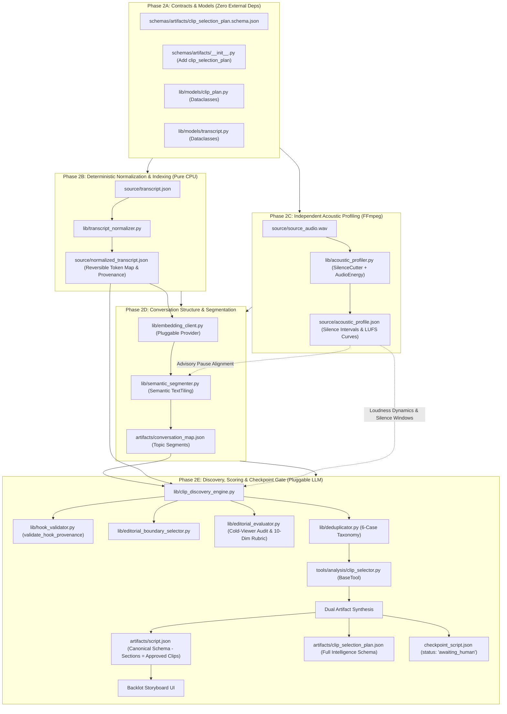

# MILESTONE 2 — CONSOLIDATED ULTIMATE EXECUTION-READY IMPLEMENTATION PLAN
**Project:** AI Video Lab (`C:\AI-Video-Lab`)  
**Pipeline:** `clip-factory` (v2.0)  
**Document:** `planning/15_M2_CONSOLIDATED_EXECUTION_PLAN.md`  
**Date:** November 17, 2026  
**Author:** Principal Software Architect, Senior Python Engineer & Independent Repository Auditor  
**Status:** Master Implementation Blueprint (Implementation Authorization: NOT GRANTED)  

---

## 1. Final Architecture & Component Dependency Graph

The Milestone 2 system converts a raw video transcript and audio track into an evidence-backed, ranked, self-contained short-form video selection plan (`clip_selection_plan.json`), while simultaneously producing canonical `script.json` for 100% downstream compatibility with OpenMontage's `scene_plan`, `edit`, and Backlot storyboard. `[PROPOSED]`



---

## 2. Exact Implementation Phases & Boundaries

| Phase ID | Exact Phase Scope | External Runtime Dependencies | Existing Files Modified | New Files Created | Completion Gate | Evidence Status |
| :--- | :--- | :--- | :--- | :--- | :--- | :--- |
| **Phase 2A** | **Data Contracts & Typed Models** | Python standard library, `jsonschema` (pre-installed in `.venv`) | `schemas/artifacts/__init__.py` | `schemas/artifacts/clip_selection_plan.schema.json`<br>`lib/models/clip_plan.py`<br>`lib/models/transcript.py`<br>`tests/qa/test_m2_schemas.py` | 100% test pass on `test_m2_schemas.py`. No warnings under Draft-2020-12. | `[PROPOSED]` |
| **Phase 2B** | **Transcript Normalization & Provenance** | None (pure Python standard library) | None | `lib/transcript_normalizer.py`<br>`tests/qa/test_m2_transcript_normalizer.py` | Reversible index traces 100% of characters to source snippet IDs. | `[PROPOSED]` |
| **Phase 2C** | **Independent Acoustic Profiler** | FFmpeg via existing tool wrappers | None | `lib/acoustic_profiler.py`<br>`lib/models/acoustic.py`<br>`tests/qa/test_m2_acoustic_profiler.py` | Detects silences and loudness curves with frame accuracy ($\pm 0.04\text{s}$). | `[PROPOSED]` |
| **Phase 2D** | **Semantic Topic Segmentation** | Pluggable embedding endpoint (Local or Cloud) | None | `lib/embedding_client.py`<br>`lib/semantic_segmenter.py`<br>`lib/models/conversation_map.py`<br>`tests/qa/test_m2_semantic_segmenter.py` | $WindowDiff \le 0.25$ on benchmark dialogues; graceful fallback verified. | `[PROPOSED]` |
| **Phase 2E** | **7-Stage Discovery, Tool & Checkpoint** | Pluggable reasoning model (Claude 3.5 Sonnet / GPT-4o / Qwen 2.5) | `pipeline_defs/clip-factory.yaml`<br>`skills/pipelines/clip-factory/script-director.md` | `lib/clip_discovery_engine.py`<br>`lib/hook_validator.py`<br>`lib/editorial_boundary_selector.py`<br>`lib/editorial_evaluator.py`<br>`lib/deduplicator.py`<br>`tools/analysis/clip_selector.py`<br>`tests/qa/test_m2_clip_discovery.py`<br>`tests/qa/test_m2_e2e_pipeline.py` | $0.0\%$ Hallucinated Hooks; dual artifacts pass validation; `checkpoint_script.json` pauses at `status: "awaiting_human"`. | `[PROPOSED]` |

---

## 3. Inventory of Files: To Create, Modify, and Leave Untouched

### 3.1 New Files to Create (14 files)
1. `schemas/artifacts/clip_selection_plan.schema.json`: Formal Draft-2020-12 JSON schema. `[PROPOSED]`
2. `lib/models/clip_plan.py`: Typed dataclasses for clip selection plans. `[PROPOSED]`
3. `lib/models/transcript.py`: Typed dataclasses for normalized tokens, sentences, and provenance. `[PROPOSED]`
4. `lib/models/acoustic.py`: Typed dataclass `AcousticProfile`. `[PROPOSED]`
5. `lib/models/conversation_map.py`: Typed dataclasses `ConversationMap` and `TopicSegment`. `[PROPOSED]`
6. `lib/transcript_normalizer.py`: Sentence reconstruction and bidirectional token indexing. `[PROPOSED]`
7. `lib/acoustic_profiler.py`: Decoupled acoustic pause and LUFS loudness analysis. `[PROPOSED]`
8. `lib/embedding_client.py`: Pluggable embedding provider client (OpenAI, Local Ollama, `llama-server`). `[PROPOSED]`
9. `lib/semantic_segmenter.py`: Dense vector Semantic TextTiling engine. `[PROPOSED]`
10. `lib/hook_validator.py`: Implementation of `validate_hook_provenance`. `[PROPOSED]`
11. `lib/editorial_boundary_selector.py`: Editorial boundary selection combining sentence semantics with advisory pause windows. `[PROPOSED]`
12. `lib/editorial_evaluator.py`: Cold-viewer standalone audit and 10-dimension rubric scorer with balanced-bracket JSON parsing. `[PROPOSED]`
13. `lib/deduplicator.py`: 6-case multi-tier deduplication matrix. `[PROPOSED]`
14. `tools/analysis/clip_selector.py`: OpenMontage registered `BaseTool` subclass. `[PROPOSED]`

### 3.2 Existing Files to Modify (3 files)
1. `schemas/artifacts/__init__.py`: Add `"clip_selection_plan"` to `ARTIFACT_NAMES` list. `[VERIFIED]`
2. `pipeline_defs/clip-factory.yaml`: Update stage `script` to include `clip_selection_plan` in `produces` and `clip_selector` in `tools_available`. `[VERIFIED]`
3. `skills/pipelines/clip-factory/script-director.md`: Add instructions for invoking `clip_selector`, evaluating candidate cards, verifying verbatim hooks, and generating dual artifacts (`script.json` + `clip_selection_plan.json`). `[VERIFIED]`

### 3.3 Existing Files Explicitly Protected (DO NOT MODIFY)
1. `lib/source_media_review.py`: Protected upstream media reviewer. `[VERIFIED]`
2. `lib/checkpoint.py`: Protected stage persistence and validation engine. `[VERIFIED]`
3. `schemas/artifacts/script.schema.json`: Protected canonical script schema. `[VERIFIED]`
4. `tools/video/silence_cutter.py`: Reused as-is via `mode: "mark"`. `[VERIFIED]`
5. `tools/analysis/audio_energy.py`: Reused as-is for `ebur128` momentary loudness. `[VERIFIED]`
6. `tools/analysis/transcript_fetcher.py`: Reused as-is for YouTube caption pull. `[VERIFIED]`
7. `backlot/state.py` & `backlot/server.py`: Storyboard state derivation. `[VERIFIED]`

---

## 4. Required Functions, Classes & Interfaces

### 4.1 Data Models (`lib/models/`)
```python
# lib/models/transcript.py
from dataclasses import dataclass
from typing import Optional, List, Tuple
from enum import Enum

class ProvenanceClass(str, Enum):
    SOURCE_SEGMENT = "SOURCE_SEGMENT"
    ESTIMATED_INTERPOLATED = "ESTIMATED_INTERPOLATED"
    ACOUSTICALLY_VERIFIED = "ACOUSTICALLY_VERIFIED"

@dataclass
class TranscriptToken:
    token_id: int
    text: str
    clean_text: str
    source_segment_id: int
    raw_char_span: Tuple[int, int]  # Exact character offsets in raw transcript
    time_start: float
    time_end: float
    time_class: ProvenanceClass
    uncertainty_seconds: float
    is_disfluency: bool
    speaker: Optional[str] = None

@dataclass
class NormalizedSentence:
    sentence_id: int
    text: str
    tokens: List[TranscriptToken]
    time_start: float
    time_end: float
    speaker: Optional[str]
    source_segment_ids: List[int]
    ends_with_terminal_punctuation: bool

@dataclass
class NormalizedTranscript:
    sentences: List[NormalizedSentence]
    tokens: List[TranscriptToken]
    full_text: str
    source_media_id: str
    language: str
```

### 4.2 Hook Integrity Validator (`lib/hook_validator.py`)
```python
@dataclass
class HookValidationResult:
    valid: bool
    error: Optional[str] = None
    source_segment_ids: Optional[List[int]] = None
    source_char_span: Optional[Tuple[int, int]] = None
    start_seconds: Optional[float] = None
    end_seconds: Optional[float] = None
    provenance_class: Optional[ProvenanceClass] = None

def validate_hook_provenance(spoken_hook: str, source_tokens: List[TranscriptToken]) -> HookValidationResult:
    """Verifies that spoken_hook is an exact verbatim token sequence in the source transcript
    and returns its exact character span in raw source evidence."""
    # Strips punctuation and searches for contiguous token sublist match.
```

### 4.3 Safe JSON Extractor (`lib/editorial_evaluator.py`)
```python
def extract_balanced_json_block(text: str) -> Optional[dict]:
    """Safely extracts the first balanced JSON object from model output.
    
    Replaces unsafe greedy regex by tracking opening and closing brace nesting depth.
    """
    # Locates first '{' and counts braces until depth == 0.
```

---

## 5. Error Handling & Recovery Behavior

| Failure Mode | Detection Point | Automated Recovery Action |
| :--- | :--- | :--- |
| **Missing Word Timestamps** | `lib/transcript_normalizer.py` | Sets token provenance to `ESTIMATED_INTERPOLATED` with uncertainty $\pm 0.50\text{s}$. Never claims exact word alignment. `[PROPOSED]` |
| **Continuous Speech (No Silences)** | `lib/editorial_boundary_selector.py` | Retains sentence boundary, sets provenance to `ESTIMATED_INTERPOLATED`, flags `timing_confidence: "LOW"`, and routes candidate to `NEEDS_HUMAN_REVIEW`. `[PROPOSED]` |
| **Fabricated Dialogue in Hook** | `lib/hook_validator.py` | `validate_hook_provenance` returns `valid: False`. Candidate is rejected at Stage D and logged in `rejected_candidates`. `[PROPOSED]` |
| **Cold Viewer Audit Failure** | `lib/editorial_evaluator.py` | Candidate fails Stage C and is rejected with logged linguistic reasoning; never reaches rubric scoring. `[PROPOSED]` |
| **Model Provider Offline** | `lib/editorial_evaluator.py` | Pipeline catches `httpx.ConnectError`, halts with a clean error message, preserves partial checkpoints, and advises user to verify provider endpoint. `[PROPOSED]` |
| **VRAM Pressure (>5,200 MiB)** | `tools/analysis/clip_selector.py` | If local inference is active, pre-flight memory probe automatically falls back from 7B model to 3B model (footprint ~2.5 GB). `[PROPOSED]` |
| **Malformed LLM JSON Output** | `lib/editorial_evaluator.py` | Applies `extract_balanced_json_block`; retries up to 2 times with temperature $=0.1$. If persistent, logs error and rejects candidate. `[PROPOSED]` |

---

## 6. Regression Protection for Existing Functionality

1. **Milestone 1 Intake Preservation:** `URLIntakeAdapter`, `TranscriptFetcher`, and `review_source_media` are untouched. Their output (`projects/<project>/source/transcript.json`) is the immutable input to Milestone 2. `[VERIFIED]`
2. **Checkpoint Contract Integrity:** `lib/checkpoint.py` is protected. Because `script.json` is generated with valid sections matching `script.schema.json`, `checkpoint_script.json` validates with 0 errors. `[VERIFIED]`
3. **Backlot Storyboard Continuity:** Because each approved clip is a section in `script.json`, `backlot/state.py` renders interactive storyboard cards without any code modifications. `[VERIFIED]`
4. **Automated M1 Smoke Suite:** The entire 74-test regression suite from Milestone 1 (`tests/qa/test_url_intake_smoke.py`, etc.) is executed after every phase to guarantee zero regressions. `[VERIFIED]`

---

## 7. Milestone 2 Completion Criteria

Milestone 2 is complete when:
1. All 5 phases (2A through 2E) are implemented and pass 100% of automated unit, integration, and QA tests.
2. `clip_selection_plan.schema.json` validates all generated plans.
3. $0.0\%$ Hallucinated Hook Rate is verified across all test fixtures.
4. Dual artifacts (`script.json` and `clip_selection_plan.json`) are successfully generated from real source transcripts.
5. `checkpoint_script.json` pauses the pipeline at `status: "awaiting_human"` with human review gates enforced.
6. The 74 Milestone 1 regression tests continue to pass with 0 failures.

---

## 8. Explicit Request for Implementation Authorization

**Engineering Confirmation:**
The architecture corrections, existing agent capability matrix, quality-first provider tiering, formal timestamp provenance, hook integrity validation, independent acoustic profiling, and dual-artifact downstream compatibility have been completely established and cross-verified against the codebase.

**Authorization Request:**
We request explicit user authorization to begin **Phase 2A (Schemas, Data Contracts & Typed Models)**:
- Create `schemas/artifacts/clip_selection_plan.schema.json`
- Update `schemas/artifacts/__init__.py`
- Create `lib/models/clip_plan.py` and `lib/models/transcript.py`
- Create `tests/qa/test_m2_schemas.py`

*No implementation code will be written until you grant explicit authorization.*
