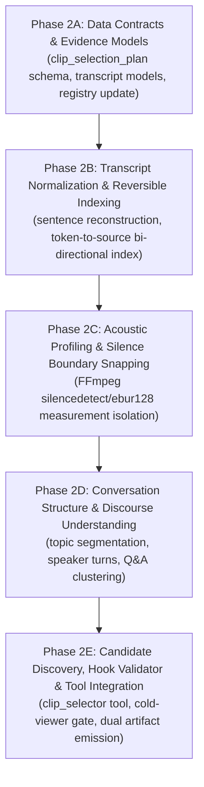

# M2 — Ultimate Sequential Engineering Execution Plan, File-Level Contracts & Acceptance Gates
**Document:** `planning/15_M2_FINAL_EXECUTION_PLAN_AND_ACCEPTANCE_GATES.md`  
**Repository:** `https://github.com/Unstocks/AI-video-Lab` (`C:\AI-Video-Lab`)  
**Primary Branch:** `main` tracking `origin/main`  
**Pipeline:** `clip-factory` (v2.0)  
**Target Milestone:** M2 — Conversation Intelligence, Semantic Moment Discovery & High-Quality Clip Selection  
**Document Status:** Master Sequential Implementation Blueprint  
**Execution Mode:** Independent Read-Only Forensic Architecture Audit  
**Implementation Authorization Status:** **NOT GRANTED**  
**Date:** November 17, 2026  
**Author:** Principal Software Architect, Senior Python Engineer & Independent Repository Auditor  

---

## 1. Executive Implementation Phasing & Sequence

Milestone 2 is executed in **five strictly sequential phases**. Each phase has isolated boundaries, explicit data contracts, and independent acceptance gates. Phase completion does not authorize the next phase.



---

## 2. Phase 2A — Data Contracts and Evidence Models (Implementation-Ready Spec)

### 2.1 Scope & Responsibilities
Phase 2A establishes the immutable data contracts, schema definitions, and evidence dataclasses before any computational logic is implemented.

- **Exact Files to Create:**
  1. `schemas/artifacts/clip_selection_plan.schema.json`
  2. `lib/models/clip_plan.py`
  3. `lib/models/transcript.py`
  4. `tests/schemas/test_clip_selection_plan_schema.py`
  5. `tests/unit/test_evidence_models.py`
- **Exact Files to Modify:**
  1. `schemas/artifacts/__init__.py` (Add `"clip_selection_plan"` to `ARTIFACT_NAMES` list)
- **Protected Files (Strictly Untouched):**
  - `schemas/artifacts/script.schema.json`, `schemas/artifacts/scene_plan.schema.json`, `lib/checkpoint.py`, `lib/source_media_review.py`.

### 2.2 Explicit Non-Goals for Phase 2A
Phase 2A will **NOT** implement:
- Any LLM API calls or agent prompt chains.
- Audio extraction, FFmpeg execution, or media processing.
- Transcript normalization or punctuation healing algorithms.
- Candidate discovery, scoring, or ranking logic.
- Changes to Backlot UI or human approval workflows.
- Modifications to M1 intake code or dependencies.

### 2.3 Detailed Class & Function Contracts
```python
# lib/models/transcript.py
from __future__ import annotations
from dataclasses import dataclass
from typing import Literal, Optional

TimingProvenanceTier = Literal[
    "CAPTION_SEGMENT_TIMING",
    "ASR_SEGMENT_TIMING",
    "ASR_WORD_ESTIMATED",
    "INTERPOLATED_CHARACTER_HEURISTIC",
    "FORCED_ALIGNMENT_PHONEME",
    "VAD_SPEECH_REGION",
    "SILENCE_PROXIMITY_SNAP",
    "HUMAN_ADJUSTED",
]

@dataclass(frozen=True)
class TimestampProvenance:
    tier: TimingProvenanceTier
    uncertainty_seconds: float
    source_reference: str
    snapped_from_seconds: Optional[float] = None

@dataclass(frozen=True)
class RawTranscriptSegment:
    segment_id: int
    start_seconds: float
    end_seconds: float
    text: str
    speaker: Optional[str] = None
    confidence: float = 1.0
    provenance: TimestampProvenance = None

@dataclass(frozen=True)
class SourceSpan:
    segment_id: int
    char_start: int
    char_end: int


# lib/models/clip_plan.py
from __future__ import annotations
from dataclasses import dataclass
from typing import Literal, Optional
from lib.models.transcript import SourceSpan, TimestampProvenance

CandidateLifecycleStatus = Literal[
    "DISCOVERED_CANDIDATE",
    "COLD_VIEWER_PASSED",
    "HOOK_VERIFIED",
    "SELECTED_FOR_REVIEW",
    "AWAITING_HUMAN",
    "HUMAN_APPROVED",
    "HUMAN_REJECTED",
    "DEFERRED",
]

@dataclass(frozen=True)
class SpokenHookEvidence:
    spoken_hook: str
    source_spans: list[SourceSpan]
    speaker: Optional[str]
    provenance: TimestampProvenance

@dataclass(frozen=True)
class ColdViewerAudit:
    passed: bool
    subject_established: bool
    characters_resolved: bool
    pronouns_resolved: bool
    has_standalone_point: bool
    has_narrative_closure: bool
    notes: str

@dataclass(frozen=True)
class CandidateClip:
    id: str
    title: str
    editorial_title: str
    editorial_framing: Optional[str]
    status: CandidateLifecycleStatus
    start_seconds: float
    end_seconds: float
    duration_seconds: float
    transcript_text: str
    hook: SpokenHookEvidence
    cold_viewer: ColdViewerAudit
    scoring: dict[str, float]
    rejection_reason: Optional[str] = None

@dataclass(frozen=True)
class ClipSelectionPlan:
    version: str
    project_id: str
    source_media_url: str
    generated_at: str
    candidates: list[CandidateClip]
```

### 2.4 Dependency Invariants
- **Zero New Dependencies:** Phase 2A uses `jsonschema>=4.20` and `pydantic>=2.0`, both of which are already declared in `requirements.txt` (`requirements.txt lines 3–4`) and installed in `.venv`.

### 2.5 Phase 2A Implementation Sequence
1. **Step 2A.1:** Create `schemas/artifacts/clip_selection_plan.schema.json` with strict draft 2020-12 validation rules.
2. **Step 2A.2:** Create `lib/models/transcript.py` and `lib/models/clip_plan.py` dataclasses.
3. **Step 2A.3:** Update `schemas/artifacts/__init__.py` to add `"clip_selection_plan"` to `ARTIFACT_NAMES`.
4. **Step 2A.4:** Create and execute unit tests in `tests/schemas/test_clip_selection_plan_schema.py` and `tests/unit/test_evidence_models.py`.

### 2.6 Phase 2A Acceptance Gates & Verification
- `validate_artifact("clip_selection_plan", payload)` passes valid instances and rejects malformed instances.
- Dataclass round-trip serialization preserves exact Unicode character spans and provenance tiers without loss.
- Zero regression in existing 20 artifact schemas verified via `tests/contracts/`.

### 2.7 Stop Conditions
Phase 2A execution must halt immediately if:
- Modifying `schemas/artifacts/__init__.py` breaks existing schema registry discovery.
- Dataclass serialization loses Unicode character offset precision.
- Any existing contract or unit test fails.

---

## 3. Subsequent Implementation Phases (Phases 2B through 2E)

### Phase 2B — Transcript Normalization and Reversible Indexing
- **Purpose:** Provide a reversible, token-accurate mapping between raw source transcript evidence and normalized editorial sentences.
- **Files to Create:** `lib/transcript_normalizer.py`, `tests/unit/test_transcript_normalizer.py`.
- **Contracts:** `TranscriptNormalizer.normalize(raw_segments) -> NormalizedTranscriptResult`, `ReversibleTokenIndex.lookup_source_span(norm_start, norm_end) -> list[SourceSpan]`.
- **Acceptance Criteria:** For any normalized sentence, extracting its mapped source character spans from raw text reproduces the exact spoken words. Unicode NFC normalization ensures zero character drift on Devanagari and accented characters.

### Phase 2C — Acoustic Profiling & Silence Boundary Snapping
- **Purpose:** Provide deterministic acoustic measurement isolating pause intervals and loudness dynamics from editorial narrative choices.
- **Files to Create:** `lib/acoustic_profiler.py`, `tests/unit/test_acoustic_profiler.py`.
- **Contracts:** Pure measurement wrapper around `SilenceCutter(mode="mark")` and `AudioEnergy(ebur128)`.
- **Acceptance Criteria:** Detects known silence gaps within $\pm 0.04\text{s}$ accuracy in synthetic test audio. Never forces an automatic cut unless the editorial thought is complete and pause is immediately adjacent ($\le 300\text{ms}$).

### Phase 2D — Conversation Structure & Discourse Understanding
- **Purpose:** Analyze conversation narrative topology (topic shifts, speaker turns, Q&A pairs) to avoid treating transcripts as flat token streams.
- **Files to Create:** `lib/conversation_structure.py`, `tests/unit/test_conversation_structure.py`.
- **Contracts:** `ConversationStructureAnalyzer.analyze(normalized_transcript) -> list[ConversationalBlock]`.
- **Acceptance Criteria:** Clusters speaker turns and identifies discourse boundaries across podcast sample transcripts without breaking sentence integrity.

### Phase 2E — Candidate Discovery, Editorial Evaluation & Tool Integration
- **Purpose:** Deliver complete clip discovery, cold-viewer evaluation, spoken hook verification, deduplication, and dual-artifact generation as a registered OpenMontage tool.
- **Files to Create:**
  1. `lib/hook_validator.py` (`validate_hook_provenance`)
  2. `lib/cold_viewer_auditor.py` (`ColdViewerAuditor`)
  3. `lib/deduplicator.py` (`ClipDeduplicator`)
  4. `tools/analysis/clip_selector.py` (`ClipSelector(BaseTool)`)
  5. Test suites in `tests/unit/` and `tests/integration/`
- **Files to Modify:** `pipeline_defs/clip-factory.yaml` (register `clip_selector`), `skills/pipelines/clip-factory/script-director.md`.
- **Acceptance Criteria:** Script Director executes `clip_selector` tool and writes valid dual artifacts (`script.json` + `clip_selection_plan.json`). Backlot renders storyboard cards without error. Checkpoint halts pipeline at `awaiting_human` gate.

---

## 4. Milestone 1 Hardening Backlog (Separately Prioritized)

| ID | Priority | Target File | Issue Description | Proposed Remediation |
| :--- | :--- | :--- | :--- | :--- |
| **M1-H01** | **CRITICAL** | `requirements.txt`, `setup.py` | `yt-dlp` and `youtube-transcript-api` missing from requirements. | Add `yt-dlp>=2024.08.06` and `youtube-transcript-api>=0.6.2` to requirements and setup.py. |
| **M1-H02** | **HIGH** | `lib/url_ingest.py` | Post-download duration check omitted if preflight duration was 0. | Re-check `duration_s > max_duration_seconds` post-probe; raise `MediaIngestionError` if exceeded. |
| **M1-H03** | **HIGH** | `lib/url_ingest.py` | Multi-file `shutil.move` is not transaction-safe; fails leave partial directories. | Stage all files in `.staging_<uuid>`; execute transactional rename/commit with rollback cleanup on error. |
| **M1-H04** | **MEDIUM** | `lib/url_ingest.py` | Native caption language hardcoded to `["en"]`. | Add `languages: list[str]` parameter with `["en", "hi", "es", "auto"]` fallback. |
| **M1-H05** | **LOW** | `tests/qa/test_url_intake_smoke.py` | `run_smoke_test()` lacks `test_*` naming; pytest discovers 0 tests. | Wrap in `def test_url_intake_smoke()` and mark with `@pytest.mark.network`. |

---

## 5. Downstream Consumer Compatibility Test Plan

```
Integration Test Verification:
1. Backlot Storyboard Integration:
   - Synthesize dual artifacts in a test project directory.
   - Execute backlot.state.derive_board_state().
   - Verify board["storyboard"] renders an entry for each approved clip with correct duration.
2. Scene Plan Schema Join:
   - Validate that scene_plan.schema.json joins cleanly on scene.script_section_id == script.sections[i].id.
3. Checkpoint Governance Gate:
   - Verify that write_checkpoint(stage="script", ...) commits status="awaiting_human" and human_approved=false.
```

---

## 6. Evaluation Framework & Golden Dataset Plan

- **10 Content Archetypes:** Technical deep-dive, two-host banter, guest interview, debate, how-to masterclass, personal story, Hinglish conversation, poor ASR quality, fast speech, quiet discussion.
- **10 Core Metrics:** Discovery precision, discovery recall, cold-viewer pass rate, hook verbatim accuracy (Target: 100%), boundary cut acceptability, timestamp calibration, duplicate suppression, batch diversity, human acceptance rate, downstream pipeline pass rate.

---

## 7. README Correction Specification

Update top-level `README.md` to ensure complete accuracy:
- **Milestone 1:** Clarify status as `IMPLEMENTED & ACCEPTED (Hardening Backlog Identified)`.
- **Milestone 2:** Clarify status as `ARCHITECTURE FROZEN & FORENSIC AUDIT COMPLETED (Implementation Pending Authorization)`.
- **SSRF Claim:** Replace "Strict SSRF protection" with "Preflight Hostname & Private IP Destination Filtering (Application Level)".
- **Timestamp Claim:** Replace "Sub-millisecond frame accuracy" with "8-Tier Provenance-Aware Boundary Snapping".

---

## 8. Final Implementation Authorization Request

In strict compliance with our personal lab governance:
- **No production code has been modified.**
- **No dependencies have been installed.**
- **No Git commits or pushes have been made.**

### Explicit Authorization Question:
> **"Do you authorize Phase 2A — Data Contracts and Evidence Models only?"**
