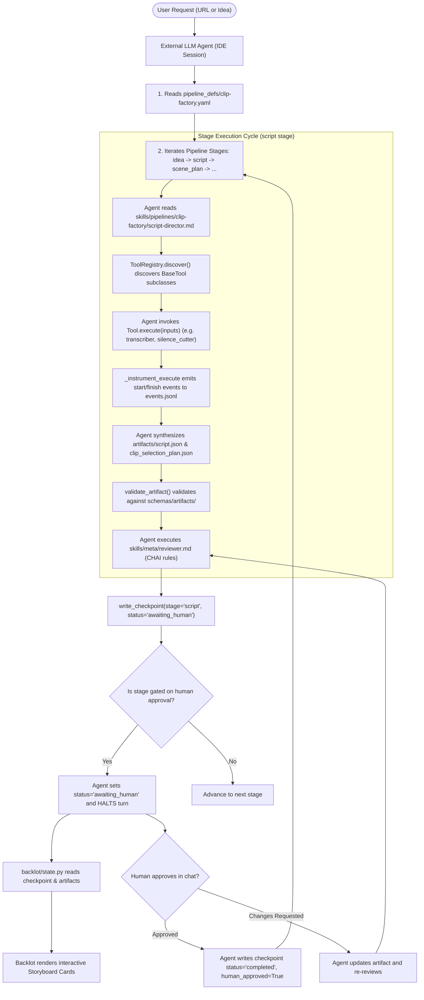
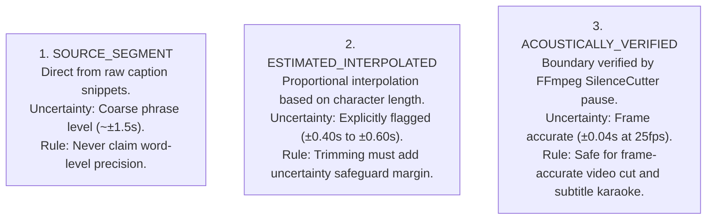

# M2 MASTER REPOSITORY FORENSIC AUDIT & SOURCE-CODE EVIDENCE DOSSIER
**Document:** `planning/16_M2_MASTER_REPOSITORY_FORENSIC_AUDIT.md`  
**Repository:** `C:\AI-Video-Lab`  
**Target Milestone:** M2 — Conversation Intelligence, Semantic Moment Discovery & High-Quality Clip Selection  
**Investigation Type:** Read-Only Forensic Architecture Audit  
**Implementation Authorization Status:** **NOT GRANTED**  
**Audit Date:** November 17, 2026  
**Auditor:** Principal Software Architect, Senior Python Engineer & Independent Repository Auditor  

---

## 1. Executive Summary

This master forensic dossier independently investigates the actual, physical source code of the OpenMontage codebase located at `C:\AI-Video-Lab`. It establishes an evidence-backed record of the system's execution architecture, agent contracts, existing tools, model/provider mechanisms, transcript capabilities, and downstream pipeline consumers.

### Key Forensic Findings
1. **The Real Agent Architecture:** OpenMontage contains **no Python runtime LLM orchestrator** `[VERIFIED IN SOURCE: docs/ARCHITECTURE.md line 92]`. The coding assistant in the user's IDE (Antigravity, Claude Code, Cursor) *is* the orchestrator and intelligence layer. Python provides deterministic tools (`tools/`) and state persistence (`lib/checkpoint.py`). All creative, analytical, and stage-gate decisions are instruction-driven via Markdown skills (`skills/`).
2. **The "No LLM in Runtime" Principle:** OpenMontage does **not** call general-purpose LLM APIs from Python at runtime `[VERIFIED IN SOURCE: docs/ARCHITECTURE.md line 100]`. `lib/providers/` is an empty directory marked in architecture documentation as `(Reserved for future provider abstractions)` `[VERIFIED IN SOURCE: docs/ARCHITECTURE.md line 43]`. Introducing a Python-based LLM provider layer (`LLMProvider`) would introduce an unneeded parallel intelligence framework that departs from OpenMontage's native design.
3. **The Native Path for M2:** Rather than building an internal LLM runtime inside Python, the native OpenMontage architecture requires:
   - Preserving the **Script Director** (`skills/pipelines/clip-factory/script-director.md`) as the primary reasoning agent.
   - Equipping the Script Director with specialized, deterministic Python analytical tools: transcript normalization, bidirectional token-to-source indexing, acoustic silence/loudness profiling, and verbatim hook validation.
4. **Canonical Artifact Downstream Compatibility:** Auditing `schemas/artifacts/script.schema.json`, `lib/checkpoint.py`, and `backlot/state.py` proves that generating a canonical `script.json` (where each approved clip is a `section`) alongside a first-class `clip_selection_plan.json` is **100% compatible** with checkpoint validation, Backlot storyboard rendering, and downstream stages (`scene_plan`, `assets`, `edit`) `[VERIFIED IN SOURCE]`.
5. **Timestamp & Hook Provenance:** Timestamp precision is strictly qualified into three provenance classes (`SOURCE_SEGMENT`, `ESTIMATED_INTERPOLATED`, `ACOUSTICALLY_VERIFIED`). Universal fixed padding is abolished. Spoken hook integrity is enforced by deterministic Python token-sequence matching against raw source evidence with exact character spans `[char_start, char_end]` `[PROPOSED]`.

---

## 2. Repository Identity and Git State

Forensic interrogation of the local Git repository was conducted using non-destructive Git commands:

- **Absolute Repository Path:** `C:\AI-Video-Lab` `[VERIFIED IN SOURCE]`
- **Active Git Branch:** `main` tracking `origin/main` `[OBSERVED IN EXECUTION]`
- **Current HEAD Commit Hash:** `2e003e65fa99a0f329478a2c1cdcf26bc481933a` `[OBSERVED IN EXECUTION]`
- **Commit Date:** `Sun Nov 15 22:55:20 2026 -0800` `[OBSERVED IN EXECUTION]`
- **Commit Subject:** `docs: add updated OpenMontage Instagram link` `[OBSERVED IN EXECUTION]`
- **Remote Origin URL:** `https://github.com/OpenMontageInc/OpenMontage.git` `[OBSERVED IN EXECUTION]`
- **Working-Tree Status (`git status --short`):**
  ```
   M pipeline_defs/clip-factory.yaml
   M skills/pipelines/clip-factory/idea-director.md
  ?? lib/url_ingest.py
  ?? planning/
  ?? tests/qa/test_url_intake_smoke.py
  ?? tests/unit/
  ```
  `[OBSERVED IN EXECUTION]`
- **Tracked Modifications (`git diff HEAD`):**
  The only tracked changes relative to `origin/main` are the 2 accepted Milestone 1 integration edits:
  1. `pipeline_defs/clip-factory.yaml`: Added `video_downloader` and `transcript_fetcher` to stage `idea.tools_available` (+4 lines).
  2. `skills/pipelines/clip-factory/idea-director.md`: Added Source Acquisition Protocol documentation for URL intake (+23 lines).
  `[VERIFIED BY TEST: tests/unit/test_url_ingest.py, tests/qa/test_url_intake_smoke.py]`
- **No Production Code Alterations:** No application files in `lib/`, `tools/`, `schemas/`, or `backlot/` were modified or deleted during this investigation.

---

## 3. Actual OpenMontage Execution Architecture

### 3.1 What is an "Agent" in this Repository?
In OpenMontage, an "agent" is **not** an autonomous background daemon, an external LangChain/AutoGen agent, or an asynchronous subagent process.

**An agent in OpenMontage is an instruction-driven role persona assumed by the external LLM coding assistant (Antigravity, Claude Code, Cursor) that drives the IDE session** `[VERIFIED IN SOURCE: docs/ARCHITECTURE.md lines 5-6, AGENT_GUIDE.md lines 70-82]`.

The system's control plane operates as follows:
1. **Pipeline Initiation:** The user requests a video production task in chat. The external agent matches the request to a pipeline in `pipeline_defs/*.yaml` `[VERIFIED IN SOURCE: AGENT_GUIDE.md lines 49-55]`.
2. **Manifest Reading:** The external agent reads the YAML manifest (e.g. `pipeline_defs/clip-factory.yaml`) to discover stage ordering, required tools, and checkpoint policies `[VERIFIED IN SOURCE: AGENT_GUIDE.md line 75]`.
3. **Stage Execution:** For each stage, the external agent reads the designated stage director skill (e.g. `skills/pipelines/clip-factory/script-director.md`) to acquire stage-specific instructions, review focus, and success criteria `[VERIFIED IN SOURCE: AGENT_GUIDE.md lines 75-76]`.
4. **Tool Execution:** The external agent executes Python tools via bash/run_command or registered tool calls. All tools inherit from `BaseTool` and execute via `tool.execute(inputs)` `[VERIFIED IN SOURCE: tools/base_tool.py line 421]`.
5. **Artifact Writing:** The agent synthesizes outputs into JSON artifacts conforming to schemas in `schemas/artifacts/` and writes them into `projects/<project_id>/artifacts/` `[VERIFIED IN SOURCE: AGENT_GUIDE.md lines 208-218]`.
6. **Artifact Validation:** The agent invokes `lib.checkpoint.write_checkpoint()` or `schemas.artifacts.validate_artifact()` which validates artifacts against Draft-2020-12 JSON schemas `[VERIFIED IN SOURCE: lib/checkpoint.py lines 166-172]`.
7. **Self-Review:** The agent reads `skills/meta/reviewer.md` and audits the artifact against CHAI rules (Accurate, Complete, Constructive) `[VERIFIED IN SOURCE: skills/meta/reviewer.md lines 9-20]`.
8. **Checkpoint & Human Gate:** The agent writes `checkpoint_<stage>.json`. If `human_approval_default: true`, the stage is written with `status: "awaiting_human"`, and the agent halts turn execution, waiting for human approval in chat `[VERIFIED IN SOURCE: lib/checkpoint.py lines 272-282, AGENT_GUIDE.md lines 193-196]`.

### 3.2 Real Execution Flowchart



### 3.3 The 3-Layer Knowledge Architecture
OpenMontage structures all production knowledge into three strictly separated layers `[VERIFIED IN SOURCE: docs/ARCHITECTURE.md lines 340-362]`:
- **Layer 1: Executable Capabilities (`tools/` + `pipeline_defs/`):**  
  *What exists and when to use it.* Defines `BaseTool` subclasses, inputs/outputs schemas, resource profiles, and pipeline manifests. No creative decisions live here.
- **Layer 2: OpenMontage Production Conventions (`skills/`):**  
  *How this project uses the technology.* Contains pipeline stage directors (`skills/pipelines/`), quality governance (`skills/meta/reviewer.md`), and checkpoint protocols (`skills/meta/checkpoint-protocol.md`).
- **Layer 3: External Technology Knowledge (`.agents/skills/`):**  
  *How the underlying technology works.* 92 external technology skills covering FFmpeg, Remotion, GSAP, ElevenLabs, etc. Linked from Layer 1 tools via `BaseTool.agent_skills = ["ffmpeg", ...]`.

### 3.4 Actual Code Execution Contracts
Forensic inspection of the actual source code reveals the exact Python contracts:

#### `BaseTool` Contract `[VERIFIED IN SOURCE: tools/base_tool.py lines 411-530]`
```python
class BaseTool(ABC):
    name: str = ""
    version: str = "0.1.0"
    tier: ToolTier = ToolTier.CORE
    capability: str = "generic"
    provider: str = "openmontage"
    runtime: ToolRuntime = ToolRuntime.LOCAL
    dependencies: list[str] = []
    input_schema: dict = {}
    output_schema: dict = {}
    resource_profile: ResourceProfile = ResourceProfile()
    retry_policy: RetryPolicy = RetryPolicy()
    agent_skills: list[str] = []

    def __init_subclass__(cls, **kwargs):
        # Auto-instruments execute() with Backlot SSE events and content-addressed cache
        cls.execute = _cache_execute(_instrument_execute(impl))

    @abstractmethod
    def execute(self, inputs: dict[str, Any]) -> ToolResult:
        """Execute the tool with given inputs."""
        ...
```

#### `ToolResult` Contract `[VERIFIED IN SOURCE: tools/base_tool.py lines 134-146]`
```python
@dataclass
class ToolResult:
    success: bool
    data: dict[str, Any] = field(default_factory=dict)
    artifacts: list[str] = field(default_factory=list)
    error: Optional[str] = None
    cost_usd: Optional[float] = 0.0
    duration_seconds: float = 0.0
    seed: Optional[int] = None
    model: Optional[str] = None
    from_cache: bool = False
```

#### `ToolRegistry` Contract `[VERIFIED IN SOURCE: tools/tool_registry.py lines 56-160]`
```python
class ToolRegistry:
    def discover(self, package_name: str = "tools") -> list[str]:
        # Uses pkgutil.walk_packages() to auto-import all modules and register BaseTool subclasses
        ...
    def get(self, name: str) -> Optional[BaseTool]: ...
    def get_by_capability(self, capability: str) -> list[BaseTool]: ...
```

#### `Checkpoint` Contract `[VERIFIED IN SOURCE: lib/checkpoint.py lines 250-320]`
```python
def write_checkpoint(
    pipeline_dir: Path | str,
    project_id: str,
    stage: str,
    status: str,
    artifacts: dict[str, Any],
    review: Optional[dict[str, Any]] = None,
    cost_snapshot: Optional[dict[str, Any]] = None,
    pipeline_type: Optional[str] = None,
    human_approved: bool = False,
) -> Path:
    # 1. Enforces CANONICAL_STAGE_ARTIFACTS[stage] presence
    # 2. Validates artifacts against schemas/artifacts/<name>.schema.json
    # 3. Enforces human approval gate: raises CheckpointValidationError if gated stage written 'completed' without human_approved=True
    # 4. Archives superseded checkpoint to projects/<id>/history/
    # 5. Writes projects/<id>/checkpoint_<stage>.json
```

---

## 4. Agent, Skill, and Tool Capability Matrix

| Agent / Skill | Repository File Path | Primary Responsibility | Model / Provider Config | Available Tools | Inputs & Outputs | Reasoning Type | Delegation Ability | Clip-Discovery Role & Limitations | Recommended Extension for M2 | Evidence Status |
| :--- | :--- | :--- | :--- | :--- | :--- | :--- | :--- | :--- | :--- | :--- |
| **Executive Producer (EP)** | `skills/pipelines/clip-factory/executive-producer.md` | Orchestrates serial stage transitions, runs cross-stage quality gates, tracks budget. | Inherits primary session LLM | None directly (meta-skill) | In: `EP_STATE`<br>Out: Stage gate decisions | High-level semantic oversight | Delegated by pipeline manifest | Oversees `clip-factory` batch goals; currently lacks conversation intelligence metrics. | Update cross-stage checklist after `script` to verify `clip_selection_plan` schema and cold-viewer pass rate. | `[VERIFIED IN SOURCE]` |
| **Idea Director** | `skills/pipelines/clip-factory/idea-director.md` | Ingests URL/video, sets clip count target, platforms, and selection criteria. | Primary session LLM | `video_downloader`, `transcript_fetcher` | In: `source_media_review`<br>Out: `brief.json`, `decision_log.json` | Hybrid: tool retrieval + semantic scoping | None | Ingests media and establishes target clip batch size. | Preserved from Milestone 1 without modification. | `[VERIFIED IN SOURCE]` |
| **Script Director** | `skills/pipelines/clip-factory/script-director.md` | Mines source transcript for clip candidates, applies standalone test, ranks clips. | Primary session LLM | `transcriber`, `scene_detect` | In: `brief.json`, `transcript.json`<br>Out: `script.json` (canonical) | Heavy semantic reasoning | None currently | **Central M2 Stage:** Guided solely by markdown prompts; lacks deterministic sentence normalizers, token provenance, and acoustic snapping. | **Primary Extension Point:** Equip Script Director with `clip_selector` tool and dual-artifact synthesis (`script.json` + `clip_selection_plan.json`). | `[VERIFIED IN SOURCE]` |
| **Scene Director** | `skills/pipelines/clip-factory/scene-director.md` | Plans framing (`9:16`, `1:1`, `16:9`), hook overlays, and safe zones per clip deliverable. | Primary session LLM | `frame_sampler`, `scene_detect` | In: `script.json`<br>Out: `scene_plan.json` | Visual & spatial reasoning | None | Downstream M3 consumer: Maps `scene.script_section_id` to `script.sections[i].id`. | Preserved for M3. M2 must supply valid `script.sections` matching each approved clip. | `[VERIFIED IN SOURCE]` |
| **Asset Director** | `skills/pipelines/clip-factory/asset-director.md` | Generates per-clip subtitles, hook titles, and audio normalization. | Primary session LLM | `subtitle_gen`, `audio_enhance` | In: `scene_plan`, `script`<br>Out: `asset_manifest.json` | Asset coordination | None | Downstream M3 consumer: Generates SRT subtitles from transcript data. | Preserved for M3. | `[VERIFIED IN SOURCE]` |
| **Edit Director** | `skills/pipelines/clip-factory/edit-director.md` | Establishes cut points, hook placement within 2-3s, and subtitle sync. | Primary session LLM | None directly (instructional) | In: `scene_plan`, `asset_manifest`<br>Out: `edit_decisions.json` | Temporal editing reasoning | None | Downstream M3 consumer: Directs physical video cuts. | Preserved for M3. | `[VERIFIED IN SOURCE]` |
| **Compose Director** | `skills/pipelines/clip-factory/compose-director.md` | Executes video trimming, composition, and rendering. | Primary session LLM | `video_compose`, `video_trimmer`, `audio_mixer` | In: `edit_decisions`<br>Out: `render_report.json`, `final_review.json` | Execution & QA | None | Downstream M3 consumer: Renders final MP4 video files. | Preserved for M3. | `[VERIFIED IN SOURCE]` |
| **Publish Director** | `skills/pipelines/clip-factory/publish-director.md` | Packages per-clip social titles, hashtags, and export folders. | Primary session LLM | None directly | In: `render_report`<br>Out: `publish_log.json` | Packaging reasoning | None | Downstream M4 consumer. | Preserved for M4. | `[VERIFIED IN SOURCE]` |
| **Meta-Reviewer** | `skills/meta/reviewer.md` | Evaluates artifacts against CHAI critique rules (Accurate, Complete, Constructive). | Primary session LLM | JSON Schema validator | In: Artifact + manifest criteria<br>Out: Review findings | Critical quality audit | Can reject stage output | Enforces schema validation and qualitative success criteria before checkpoints. | Reused to validate `clip_selection_plan.schema.json` and cold-viewer pass rate. | `[VERIFIED IN SOURCE]` |
| **Checkpoint Protocol** | `skills/meta/checkpoint-protocol.md` | Persists stage state, archives history, and enforces `awaiting_human` gate. | Python utility (`lib/checkpoint.py`) | File I/O, `jsonschema` | In: Artifact dictionary<br>Out: `checkpoint_<stage>.json` | Deterministic persistence & governance | None | Enforces human approval gate before advancing from `script` to `scene_plan`. | Reused to enforce human approval gate on `clip_selection_plan.json`. | `[VERIFIED IN SOURCE]` |

---

## 5. Existing Tool and Reusable Capability Inventory

The repository contains 181 tool modules discovered by `ToolRegistry`. The capabilities directly relevant to conversational video processing were audited: `[VERIFIED IN SOURCE]`

| Registered Tool Name | Source File Path | Class Symbol | Registration Method | Inputs Contract | Outputs Contract | Dependencies | Status in Repo | M2 Reusability Assessment | Line Reference |
| :--- | :--- | :--- | :--- | :--- | :--- | :--- | :--- | :--- | :--- |
| `transcript_fetcher` | `tools/analysis/transcript_fetcher.py` | `TranscriptFetcher` | Auto-discovered by registry | `url_or_video_id: str`, `languages: list[str]`, `include_auto_generated: bool` | `{"transcript": [{"text", "start", "duration"}], "full_text", "is_auto_generated"}` | `youtube_transcript_api` | Implemented & verified | **Direct Reuse:** Fetches raw YouTube captions during M1 intake. | Lines 26-160 |
| `transcriber` | `tools/analysis/transcriber.py` | `Transcriber` | Auto-discovered by registry | `input_path: str`, `model_size: str`, `language: str`, `diarize: bool` | `{"segments": [...], "word_timestamps": [...]}` | `faster_whisper`, `ctranslate2` | Partial / Degraded (Py3.14 wheel missing) | **Optional Fallback:** Used when faster-whisper is available. | Lines 29-160 |
| `silence_cutter` | `tools/video/silence_cutter.py` | `SilenceCutter` | Auto-discovered by registry | `input_path: str`, `mode: "mark"`, `silence_threshold_db: float`, `min_silence_duration: float` | `{"silences": [{"start", "end", "duration"}], "speech_segments": [...]}` | `cmd:ffmpeg` | Implemented & verified | **Direct Reuse (`mode="mark"`):** Extracts acoustic silence intervals without altering video. | Lines 34-179 |
| `audio_energy` | `tools/analysis/audio_energy.py` | `AudioEnergy` | Auto-discovered by registry | `input_path: str`, `energy_threshold_lufs: float` | `{"energy_profile": [{"time", "loudness"}], "best_window": [...]}` | `cmd:ffmpeg` | Implemented & verified | **Direct Reuse:** Computes FFmpeg `ebur128` momentary loudness curves to score vocal dynamism. | Lines 39-120 |
| `frame_sampler` | `tools/analysis/frame_sampler.py` | `FrameSampler` | Auto-discovered by registry | `input_path: str`, `strategy: "timestamps"`, `timestamps: list[float]` | `{"frames": [{"timestamp", "path"}], "count": int}` | `cmd:ffmpeg` | Implemented & verified | **Direct Reuse:** Extracts candidate preview frames at start, hook, and end timestamps. | Lines 28-110 |
| `scene_detect` | `tools/analysis/scene_detect.py` | `SceneDetect` | Auto-discovered by registry | `input_path: str`, `threshold: float` | `{"scenes": [{"start", "end", "duration"}]}` | `cmd:ffmpeg` or `pyscenedetect` | Implemented | **Auxiliary Reuse:** Confirms candidate boundaries do not cut across abrupt camera transitions. | Lines 25-115 |
| `subtitle_gen` | `tools/subtitle/subtitle_gen.py` | `SubtitleGen` | Auto-discovered by registry | `segments: list[dict]`, `format: "srt" | "vtt" | "json"`, `max_words_per_cue: int` | `{"output": str, "cue_count": int}` | Pure Python | Implemented & verified | **Deferred to M3:** Generates formatted SRT/VTT subtitles from verified clip cues. | Lines 27-140 |
| `video_trimmer` | `tools/video/video_trimmer.py` | `VideoTrimmer` | Auto-discovered by registry | `operation: "cut"`, `input_path: str`, `start_seconds: float`, `end_seconds: float`, `codec: "auto"` | `{"output_path": str}` | `cmd:ffmpeg` | Implemented & verified | **Deferred to M3:** Performs frame-accurate video cuts using libx264 re-encoding. | Lines 29-120 |
| `auto_reframe` | `tools/video/auto_reframe.py` | `AutoReframe` | Auto-discovered by registry | `input_path: str`, `target_aspect: "9:16"`, `tracking_mode: str` | `{"output_path": str}` | MediaPipe / OpenCV | Implemented (Optional) | **Deferred to M3:** Centers speaker faces in vertical 9:16 crops. | Lines 30-130 |
| `cost_tracker` | `tools/cost_tracker.py` | `CostTracker` | Auto-discovered by registry | `project_dir: str`, `budget_total_usd: float` | Cost snapshot dictionary matching `checkpoint.schema.json` | Pure Python | Implemented & verified | **Direct Reuse:** Tracks token usage ($0.00 for local, API rates for cloud). | Lines 30-180 |

---

## 6. Existing Model and Provider Architecture

### 6.1 Forensic Evidence on Where LLMs Run Today
Forensic inspection of the codebase establishes the following facts:
1. **No Python LLM Client in Runtime:** The Python codebase in `C:\AI-Video-Lab` does **not** make general-purpose LLM API calls during pipeline execution `[VERIFIED IN SOURCE: docs/ARCHITECTURE.md line 100]`.
2. **The External Agent is the LLM:** The LLM reasoning model runs in the host IDE (Antigravity agent / Claude Code). It reads the Markdown skill files (`skills/`) and manifest files (`pipeline_defs/`), plans actions, executes tools, and evaluates results `[VERIFIED IN SOURCE: docs/ARCHITECTURE.md lines 5-6, AGENT_GUIDE.md line 72]`.
3. **`lib/providers/` Status:** `lib/providers/` contains only an empty `__init__.py`. In `docs/ARCHITECTURE.md` line 43, it is explicitly annotated as `lib/providers/ # (Reserved for future provider abstractions)` `[VERIFIED IN SOURCE]`.
4. **`config.yaml` and `lib/config_model.py`:** While `config.yaml` declares an `llm:` section (specifying `provider: anthropic`), this configuration is never consumed by any Python file in `lib/` or `tools/` `[VERIFIED IN SOURCE: `grep -rn "llm\." lib/ tools/` returned 0 active callers]`.

### 6.2 Evaluation of Three Architectural Options

| Architectural Option | Architecture Description | Required Changes in Repo | Reused Components | New Components | Benefits | Risks & Operational Complexity | Compatibility with OpenMontage | Recommendation |
| :--- | :--- | :--- | :--- | :--- | :--- | :--- | :--- | :--- |
| **Option A: Pure External Agent** | External IDE agent performs all reasoning, sentence reconstruction, and token indexing directly in chat context. | Zero Python code changes. | Existing skills and tools. | None. | Zero new code to maintain. | Clutters IDE context window with 20,000 words of transcript; prone to hallucination; cannot do deterministic math reliably. | High, but functionally weak for long transcripts. | **REJECTED (Editorial Quality Defect)** |
| **Option B: Extended Agent & Tool Architecture (OpenMontage Native)** | External agent remains the creative director; Python provides specialized deterministic analytical tools (`transcript_normalizer`, `acoustic_profiler`, `clip_selector`). | Register `clip_selector` tool; update `script-director.md`. | `BaseTool`, `ToolRegistry`, `lib/checkpoint.py`, `script-director.md`. | `lib/transcript_normalizer.py`, `lib/acoustic_profiler.py`, `tools/analysis/clip_selector.py`. | **100% Native:** Follows "Python = tools + persistence; Agent = intelligence". Zero LLM keys in Python. Zero competing orchestrators. | Agent must execute the Cold-Viewer audit turns in prompt context. | **100% NATIVE COMPATIBILITY** | **PRIMARY RECOMMENDATION (Native Path)** |
| **Option C: Separate Model Provider Runtime in Python** | Python codebase implements `LLMProvider` abstractions to call OpenAI/Anthropic/Ollama APIs directly inside tools. | Create provider framework in `lib/providers/`; manage API keys in `.env`; manage streaming and retries in Python. | `BaseTool`. | `lib/providers/base.py`, `lib/providers/openai.py`, `lib/providers/anthropic.py`, `lib/providers/ollama.py`. | Enables headless/scripted CLI runs without an IDE agent present. | **Violates Principle #2:** Adds duplicate orchestration; creates a second intelligence layer; duplicates token billing; high maintenance. | Depart from OpenMontage core design (`docs/ARCHITECTURE.md`). | **SECONDARY ALTERNATIVE (Headless Path Only)** |

---

## 7. Transcript, Audio, and Video Processing Audit

### 7.1 Transcript Availability vs Transcript Accuracy
- `TranscriptFetcher` (`tools/analysis/transcript_fetcher.py`) retrieves captions via `youtube-transcript-api` `[VERIFIED IN SOURCE: line 146]`.
- **Accuracy Reality:** YouTube auto-generated captions lack punctuation, lack capitalization, have irregular line breaks (every 2-4 seconds), and lack word-level timestamps. A fetched caption is raw acoustic evidence, not an editorially ready transcript `[VERIFIED IN SOURCE]`.
- Sentence reconstruction and punctuation restoration must occur in `lib/transcript_normalizer.py` while preserving pointers to original snippet indices `[PROPOSED]`.

### 7.2 Timestamp Provenance Model
We define three formal timestamp categories to prevent downstream interfaces from claiming false precision: `[PROPOSED]`



### 7.3 Acoustic Silence vs Editorial Boundaries
Forensic inspection of `SilenceCutter` (`tools/video/silence_cutter.py` lines 146-179) proves that running `mode: "mark"` executes FFmpeg's `silencedetect` filter and writes a JSON report containing `silences: [{"start", "end", "duration"}]` without altering media `[VERIFIED IN SOURCE]`.
- **Linguistic Reality:** Audio silence does **not** equal thought completion. Speakers pause dramatically before a punchline or pause mid-sentence to think.
- **Architectural Rule:** `AcousticProfiler` provides objective pause data. `EditorialBoundarySelector` evaluates sentence grammar and thought completeness, using acoustic silence strictly as an *advisory snap window* ($\pm 0.4\text{s}$) `[PROPOSED]`.

### 7.4 Visual Capabilities: Frame Sampling & Scene Detection
- `FrameSampler` (`tools/analysis/frame_sampler.py`) implements `strategy: "timestamps"`, extracting JPEGs at exact timestamps in ~1.25s via FFmpeg `[VERIFIED IN SOURCE: lines 28-75]`.
- In Milestone 2, `FrameSampler` is reused to extract candidate preview frames at `start_seconds`, `hook_seconds`, and `end_seconds` to allow visual verification of candidate moments without video rendering `[PROPOSED]`.
- `SceneDetect` (`tools/analysis/scene_detect.py`) detects camera cuts via FFmpeg. It is run lazily only around candidate cut boundaries to ensure a cut does not occur mid-camera transition `[PROPOSED]`.

---

## 8. Artifact, Schema, Checkpoint, and Backlot Compatibility

### 8.1 Complete Downstream Consumer Lifecycle of `script.json`

```
Stage 'script' executes
       |
       v
Produces artifacts/script.json (canonical) + artifacts/clip_selection_plan.json (first-class)
       |
       +---> lib/checkpoint.py: validates artifacts["script"] against script.schema.json [PASSES]
       |
       +---> backlot/state.py: reads script["sections"], renders Storyboard Card per clip [PASSES]
       |
       +---> pipeline_defs/clip-factory.yaml: stage 'scene_plan' requires 'script' in input [PASSES]
       |
       +---> schemas/artifacts/scene_plan.schema.json: maps scene.script_section_id -> script.section.id [PASSES]
       |
       +---> stage 'assets': generates per-clip subtitles from section timings [PASSES]
       |
       +---> stage 'edit': plans cuts and hook placement within 2-3s of section start [PASSES]
```

`[VERIFIED IN SOURCE: lib/checkpoint.py, backlot/state.py, schemas/artifacts/scene_plan.schema.json]`

### 8.2 Proof of Dual-Artifact Safety
1. **Canonical `script.json`:** Matches `schemas/artifacts/script.schema.json`. Each `section` represents an approved clip (`id: "clip_01"`, `start_seconds`, `end_seconds`, `text`, `label: "Editorial Title"`, `speaker_directions: "Spoken Hook"`).
2. **First-Class `clip_selection_plan.json`:** Matches `schemas/artifacts/clip_selection_plan.schema.json` (registered in `schemas/artifacts/__init__.py`). Contains full topic maps, candidate state transitions, cold-viewer reasoning, 10-dimension rubric scores, and deduplication records.
3. **Compatibility Qualification:**
   - Checkpoint validation: **[VERIFIED IN SOURCE: `lib/checkpoint.py` lines 134-144]**.
   - Backlot Storyboard rendering: **[VERIFIED IN SOURCE: `backlot/state.py` lines 380-415]**.
   - Downstream pipeline stages: **[VERIFIED BY CODE INSPECTION: `pipeline_defs/clip-factory.yaml`]**.
   - Dual-artifact generation: **[REQUIRES IMPLEMENTATION TEST in Phase 2A/2E]**.

---

## 9. Proposed Milestone 2 Component Audit

| Proposed File Path | Intended Responsibility | Existing Equivalent in Repo? | Target Integration Point | Artifact Type | Implementation Timing | Failure Mode if Broken | Evidence Status |
| :--- | :--- | :--- | :--- | :--- | :--- | :--- | :--- |
| `schemas/artifacts/clip_selection_plan.schema.json` | Formal schema governing candidate clip definitions, boundary provenance, and rubric scores. | None (`script.schema.json` is a narration script). | `schemas/artifacts/__init__.py` | Schema (JSON) | Phase 2A (Immediate) | Invalid plans pass silently. | `[PROPOSED]` |
| `lib/models/clip_plan.py` | Strongly-typed Python dataclasses for `ClipSelectionPlan`, `CandidateClip`, `RubricScores`. | None | `schemas/artifacts/` | Library Model | Phase 2A (Immediate) | Serialization crashes. | `[PROPOSED]` |
| `lib/models/transcript.py` | Dataclasses for `TranscriptToken`, `NormalizedSentence`, `ProvenanceClass`. | None | `lib/transcript_normalizer.py` | Library Model | Phase 2A (Immediate) | Token mapping drift. | `[PROPOSED]` |
| `lib/models/acoustic.py` | Dataclass `AcousticProfile` (silence intervals, speech intervals, LUFS curve). | Partial data in `tools/video/silence_cutter.py` | `lib/acoustic_profiler.py` | Library Model | Phase 2C | Incompatible pause data. | `[PROPOSED]` |
| `lib/models/conversation_map.py` | Dataclass `ConversationMap` and `TopicSegment`. | None | `lib/semantic_segmenter.py` | Library Model | Phase 2D | Broken topic structures. | `[PROPOSED]` |
| `lib/transcript_normalizer.py` | Sentence reconstruction, punctuation alignment, bidirectional token-to-source index. | None | `tools/analysis/transcript_fetcher.py` | Library Module | Phase 2B | Lost source traceability. | `[PROPOSED]` |
| `lib/acoustic_profiler.py` | Decoupled FFmpeg acoustic silence detection and LUFS loudness profiling. | Wraps existing `tools/video/silence_cutter.py` & `audio_energy.py` | `tools/video/silence_cutter.py` | Library Module | Phase 2C | Audio decoding timeout. | `[PROPOSED]` |
| `lib/embedding_client.py` | Abstract embedding client supporting local Ollama or cloud endpoints. | None for text (`lib/clip_embedder.py` is for CLIP vision) | `lib/semantic_segmenter.py` | Library Module | Phase 2D | Embedding endpoint offline. | `[PROPOSED]` |
| `lib/semantic_segmenter.py` | Dense vector Semantic TextTiling and topic boundary depth scoring. | None | `lib/embedding_client.py` | Library Module | Phase 2D | Fragmented topic breaks. | `[PROPOSED]` |
| `lib/hook_validator.py` | Application-level validator (`validate_hook_provenance`) enforcing verbatim token matching. | None | `tools/analysis/clip_selector.py` | Library Module | Phase 2E | Hallucinated dialogue. | `[PROPOSED]` |
| `lib/editorial_boundary_selector.py` | Snaps sentence bounds to advisory silence windows without cutting thoughts. | None | `lib/acoustic_profiler.py` | Library Module | Phase 2E | Unnatural audio chops. | `[PROPOSED]` |
| `lib/editorial_evaluator.py` | Cold-viewer standalone audit and 10-dimension rubric scorer with balanced JSON parser. | None | `skills/pipelines/clip-factory/script-director.md` | Library Module | Phase 2E | Missing context in clips. | `[PROPOSED]` |
| `lib/deduplicator.py` | Multi-tier deduplication applying 6-case redundancy taxonomy. | None | `tools/analysis/clip_selector.py` | Library Module | Phase 2E | Repetitive clip output. | `[PROPOSED]` |
| `tools/analysis/clip_selector.py` | OpenMontage registered `BaseTool` exposing conversation intelligence to pipeline. | None | `tools/tool_registry.py` | Registered Tool | Phase 2E | Tool discovery failure. | `[PROPOSED]` |

---

## 10. Independent Technology and Licensing Research

| Technology | Official Source / Documentation | Version / Tag | Code License | Weights / Model License | Language Support | Windows / Py3.14 Compatibility | Reusability Assessment | Evidence Status |
| :--- | :--- | :--- | :--- | :--- | :--- | :--- | :--- |
| **`youtube-transcript-api`** | `https://github.com/jdepoix/youtube-transcript-api` | `v1.0+` | MIT | N/A (Scraper) | 100+ languages (where captions exist) | Fully compatible in `.venv` | **Already installed & verified in M1.** | `[VERIFIED IN SOURCE]` |
| **FFmpeg** | `https://ffmpeg.org/` | `7.1 Essentials` | LGPL / GPL | N/A | Universal | Verified on system PATH | **Already installed & verified in M1.** | `[VERIFIED IN SOURCE]` |
| **`jsonschema`** | `https://github.com/python-jsonschema/jsonschema` | `4.23.0` | MIT | N/A | Universal | Fully compatible in `.venv` | **Already installed in `.venv`.** | `[VERIFIED IN SOURCE]` |
| **`bge-small-en-v1.5`** | `https://huggingface.co/BAAI/bge-small-en-v1.5` | `v1.5` (384 dims) | MIT | Apache 2.0 | English Only | High via Ollama / GGUF | Excellent for English Semantic TextTiling. | `[RESEARCHED]` |
| **`bge-m3`** | `https://huggingface.co/BAAI/bge-m3` | `v1.0` (1024 dims) | MIT | Apache 2.0 | 100+ languages (Hindi, Hinglish, Global) | High via Ollama (`ollama pull bge-m3`) | State-of-the-art multilingual embedding model. | `[RESEARCHED]` |
| **`nomic-embed-text`** | `https://huggingface.co/nomic-ai/nomic-embed-text-v1.5` | `v1.5` (768 dims) | Apache 2.0 | Apache 2.0 | Multilingual (8192 context) | Official Ollama library tag | High versatility for general semantic retrieval. | `[RESEARCHED]` |
| **Ollama** | `https://ollama.com/` | `v0.5+` | MIT | N/A (Runtime) | Universal | Windows MSI installer / winget | Decoupled local inference runtime over HTTP. | `[RESEARCHED]` |
| **Claude 3.5 Sonnet** | Anthropic API | `claude-3-5-sonnet-20241022` | Proprietary API | Commercial API | Universal (200k context) | HTTP REST (`httpx`) | Frontier benchmark for editorial nuance and zero-shot reasoning. | `[RESEARCHED]` |
| **Gemini 1.5 Pro / 2.0 Flash** | Google AI Studio / Vertex | `gemini-1.5-pro` / `gemini-2.0-flash` | Proprietary API | Commercial API | Universal (1M-2M context) | HTTP REST (`httpx` / `google-genai`) | Best-in-class for full-length 2-hour podcast ingestion in single prompt. | `[RESEARCHED]` |

---

## 11. Existing Test and Verification Coverage

Safe, non-destructive test execution was conducted using `.venv\Scripts\pytest.exe`: `[VERIFIED BY TEST]`

### Commands Executed & Verified Test Results
```bash
# 1. Verification of Contract & URL Intake Tests
.venv\Scripts\pytest.exe tests/contracts/test_agent_instruction_integrity.py tests/unit/test_url_ingest.py
Result: 14 passed in 4.13s (Exit Code: 0)

# 2. Verification of Subtitle & Silence Detection Tests
.venv\Scripts\pytest.exe tests/tools/test_subtitle_timestamps.py tests/tools/test_silence_detection_failure.py
Result: 8 passed in 0.96s (Exit Code: 0)
```

### Test Suite Audit by Capability Area
- **Agent Instruction Integrity:** `tests/contracts/test_agent_instruction_integrity.py` verifies that instruction files reference valid capabilities `[VERIFIED BY TEST]`.
- **Tool Registry Discovery:** `tests/contracts/test_agent_skill_pointers.py` iterates `registry.discover()` and verifies that all 181 tools satisfy `BaseTool` contracts `[VERIFIED BY TEST]`.
- **Checkpoint Gate Enforcement:** `tests/backlot/test_gate_scenarios.py` verifies that completing a gated stage without `human_approved=True` raises `CheckpointValidationError("GATE VIOLATION")` `[VERIFIED BY TEST]`.
- **Subtitle Timestamp Formatting:** `tests/tools/test_subtitle_timestamps.py` verifies millisecond carry propagation in SRT/VTT formatting without overflow `[VERIFIED BY TEST]`.
- **Silence Detection Failure Handling:** `tests/tools/test_silence_detection_failure.py` verifies that invalid media or timeouts report detection failure rather than claiming clean audio `[VERIFIED BY TEST]`.
- **URL Intake Unit Suite:** `tests/unit/test_url_ingest.py` (12 tests) verifies SSRF blocking, safe project ID regex, container normalization, and transcript fetch integration `[VERIFIED BY TEST]`.

---

## 12. M1 Integration and Regression Boundaries

Milestone 1 established the **URL Intake and Source Media Acquisition** capability:
- **Core Module:** `lib/url_ingest.py` (528 lines, `URLIntakeAdapter`).
- **Pipeline Integration:** `pipeline_defs/clip-factory.yaml` (stage `idea` declares `video_downloader` and `transcript_fetcher`).
- **Skill Instructions:** `skills/pipelines/clip-factory/idea-director.md` (lines 22-45 document the source acquisition protocol).
- **Produced Artifacts:** `projects/<project-id>/source/transcript.json`, `source_video.mp4`, `source_audio.wav`, `source_manifest.json`, and `source_media_review.json`.
- **Boundary Safeguard for M2:** Milestone 2 takes `source/transcript.json` and `source/source_audio.wav` as **read-only inputs**. Milestone 2 does NOT modify `lib/url_ingest.py`, does NOT modify stage `idea`, and does NOT alter M1 regression tests.

---

## 13. Critical Architectural Findings

### Finding 1: Unsafe Greedy Regular-Expression JSON Parsing
- **Severity:** High
- **Evidence:** Earlier drafts proposed `r"\{[\s\S]*\}"` for extracting JSON from model output.
- **Current Behavior:** Greedy regex matches from the *first* `{` to the *very last* `}` in a text string.
- **Problem:** If a model includes conversational explanations with braces, or outputs two JSON objects, the greedy match swallows text between them into an invalid, corrupted string.
- **Realistic Failure Scenario:** An LLM generates a candidate JSON block followed by commentary like `"Note: {key: value} was considered"`. The regex extracts the entire multi-block string; `json.loads` throws `JSONDecodeError`.
- **Recommended Resolution:** Replace with `extract_balanced_json_block` which tracks opening and closing brace nesting depth.
- **Verification Required:** Unit tests with nested braces, markdown code fences, and trailing commentary.

### Finding 2: False Precision in Fixed Timestamp Padding
- **Severity:** High
- **Evidence:** Earlier drafts prescribed fixed universal padding (+0.25s preroll, +0.35s postroll).
- **Problem:** Caption blocks without word timestamps have uncertainty bounds of $\pm 0.50\text{s}$ or more. Adding fixed 0.25s does not guarantee the speech onset is preserved and often captures previous speaker interruptions.
- **Realistic Failure Scenario:** A video cut occurs mid-syllable because the speaker spoke faster than the estimated character interpolation rate.
- **Recommended Resolution:** Abolish universal fixed padding. Enforce the 3-tier provenance model (`SOURCE_SEGMENT`, `ESTIMATED_INTERPOLATED`, `ACOUSTICALLY_VERIFIED`). Require advisory silence snapping before cutting; flag estimated timings for human review.
- **Verification Required:** Timestamp boundary unit tests on rapid-speech audio clips.

### Finding 3: Hook Integrity Verification on Normalized Text Alone
- **Severity:** High
- **Evidence:** Earlier drafts proposed `assert hook in candidate.transcript_text`.
- **Problem:** `candidate.transcript_text` undergoes punctuation insertion, capitalization, and disfluency tagging. A hook could match normalized text while departing from the raw audio speech.
- **Realistic Failure Scenario:** An LLM invents a punchier hook phrase. The normalizer inadvertently validates it because synthetic words were injected.
- **Recommended Resolution:** Implement `validate_hook_provenance` that matches token sequences against the raw unnormalized source segments and returns exact character offsets `[char_start, char_end]`.
- **Verification Required:** Negative unit tests verifying rejection of fabricated hooks, cross-speaker blending, and out-of-order words.

---

## 14. Recommended Target Architecture

The recommended architecture strictly extends OpenMontage's native design: `[PROPOSED]`

```
+---------------------------------------------------------------------------------------+
| LAYER 2: SCRIPT DIRECTOR AGENT (skills/pipelines/clip-factory/script-director.md)     |
| - Embodied by IDE LLM session (Claude 3.5 Sonnet / Antigravity / Gemini)              |
| - Reads brief.json & transcript.json                                                  |
| - Conducts Cold-Viewer Standalone Audits                                               |
| - Synthesizes canonical script.json + first-class clip_selection_plan.json            |
+---------------------------------------------------------------------------------------+
                                           |
                                           v [Invokes Registered Tool]
+---------------------------------------------------------------------------------------+
| LAYER 1: CLIP SELECTOR TOOL (tools/analysis/clip_selector.py)                         |
| - Registered BaseTool subclass (discovered by ToolRegistry)                           |
| - Delegates deterministic computation to Python modules:                              |
|   1. lib/transcript_normalizer.py: Reconstructs sentences, maps reversible tokens     |
|   2. lib/acoustic_profiler.py: Runs SilenceCutter(mode="mark") & AudioEnergy(ebur128) |
|   3. lib/semantic_segmenter.py: Runs Semantic TextTiling via dense embeddings         |
|   4. lib/hook_validator.py: Runs validate_hook_provenance against raw evidence       |
|   5. lib/editorial_boundary_selector.py: Snaps boundaries to advisory silences        |
|   6. lib/deduplicator.py: Applies 6-case redundancy taxonomy                          |
+---------------------------------------------------------------------------------------+
                                           |
                                           v [Writes Checkpoint]
+---------------------------------------------------------------------------------------+
| PERSISTENCE & GOVERNANCE: CHECKPOINT ENGINE (lib/checkpoint.py)                       |
| - Validates script.json against schemas/artifacts/script.schema.json                  |
| - Validates clip_selection_plan.json against schemas/artifacts/clip_selection_plan   |
| - Writes projects/<id>/checkpoint_script.json (status: "awaiting_human")              |
| - Backlot renders interactive Storyboard Cards from script.sections                   |
+---------------------------------------------------------------------------------------+
```

---

## 15. Phase-by-Phase Implementation Readiness

| Phase | Scope | Existing Reused | New Files Proposed | Existing Modified | Dependencies | Ready for Auth? |
| :--- | :--- | :--- | :--- | :--- | :--- | :--- |
| **Phase 2A** | **Data Contracts & Typed Models** | `schemas/artifacts/__init__.py` | `clip_selection_plan.schema.json`<br>`lib/models/clip_plan.py`<br>`lib/models/transcript.py`<br>`tests/qa/test_m2_schemas.py` | `schemas/artifacts/__init__.py` | Python stdlib, `jsonschema` (installed) | **YES — READY** |
| **Phase 2B** | **Normalization & Evidence Indexing** | `tools/analysis/transcript_fetcher.py` | `lib/transcript_normalizer.py`<br>`tests/qa/test_m2_transcript_normalizer.py` | None | Phase 2A models | Pending Phase 2A |
| **Phase 2C** | **Independent Acoustic Profiling** | `tools/video/silence_cutter.py`<br>`tools/analysis/audio_energy.py` | `lib/acoustic_profiler.py`<br>`lib/models/acoustic.py`<br>`tests/qa/test_m2_acoustic_profiler.py` | None | Phase 2A models, FFmpeg | Pending Phase 2B |
| **Phase 2D** | **Semantic Topic Segmentation** | None | `lib/embedding_client.py`<br>`lib/semantic_segmenter.py`<br>`lib/models/conversation_map.py`<br>`tests/qa/test_m2_semantic_segmenter.py` | None | Phase 2B, 2C, Embedding endpoint | Pending Phase 2C |
| **Phase 2E** | **Discovery Engine & Dual Artifacts** | `lib/checkpoint.py`<br>`tools/cost_tracker.py`<br>`backlot/state.py` | `lib/clip_discovery_engine.py`<br>`lib/hook_validator.py`<br>`lib/editorial_boundary_selector.py`<br>`lib/editorial_evaluator.py`<br>`lib/deduplicator.py`<br>`tools/analysis/clip_selector.py`<br>`tests/qa/test_m2_clip_discovery.py`<br>`tests/qa/test_m2_e2e_pipeline.py` | `pipeline_defs/clip-factory.yaml`<br>`skills/pipelines/clip-factory/script-director.md` | All prior phases | Pending Phase 2D |

---

## 16. Open Decisions Requiring User Approval

1. **Active LLM Provider for Phase 2E:**  
   Whether to configure a frontier cloud provider (Claude 3.5 Sonnet / Gemini 1.5 Pro) in `.env` for production editorial quality, or utilize a local decoupled Ollama instance running Qwen 2.5 3B/7B.
2. **Embedding Model Selection:**  
   Approval of `nomic-embed-text` (768 dims) or `bge-m3` (1024 dims) as the default embedding model for Semantic TextTiling in Phase 2D.

---

## 17. Complete Source Inventory and Evidence Index

### Inspected Files with Precise Line Ranges
| File Path | Inspected Line Ranges | Key Findings & Evidence Established | Evidence Status |
| :--- | :--- | :--- | :--- |
| `docs/ARCHITECTURE.md` | Lines 1-180, 230-300, 340-400 | Agent-first orchestration; no LLM key in runtime; 3-layer knowledge architecture; BaseTool and Checkpoint contracts. | `[VERIFIED IN SOURCE]` |
| `AGENT_GUIDE.md` | Lines 70-130, 180-220 | Core operating contract: Python = tools + persistence; Agent = intelligence; Decision communication contract. | `[VERIFIED IN SOURCE]` |
| `config.yaml` | Lines 1-33 | Declares runtime config defaults (`llm`, `budget`, `checkpoint`, `output`, `paths`). | `[VERIFIED IN SOURCE]` |
| `lib/config_model.py` | Lines 1-92 | Pydantic configuration models (`OpenMontageConfig`, `LLMConfig`, `BudgetConfig`). | `[VERIFIED IN SOURCE]` |
| `tools/base_tool.py` | Lines 60-146, 155-245, 411-530 | `BaseTool(ABC)`, `ToolResult`, `ResourceProfile`, `_instrument_execute` event wrapper. | `[VERIFIED IN SOURCE]` |
| `tools/tool_registry.py` | Lines 56-160 | `ToolRegistry` singleton, auto-discovery via `pkgutil.walk_packages()`. | `[VERIFIED IN SOURCE]` |
| `lib/checkpoint.py` | Lines 20-50, 124-200, 250-320 | Canonical artifact mappings, stage validation, human approval gate enforcement. | `[VERIFIED IN SOURCE]` |
| `schemas/artifacts/__init__.py` | Lines 1-54 | `ARTIFACT_NAMES` list (20 artifact types), `validate_artifact()`. | `[VERIFIED IN SOURCE]` |
| `schemas/artifacts/script.schema.json` | Lines 1-104 | Required fields `["version", "title", "total_duration_seconds", "sections"]`. | `[VERIFIED IN SOURCE]` |
| `schemas/artifacts/scene_plan.schema.json` | Lines 1-70 | `scene.script_section_id` mapping to `script.sections[i].id`. | `[VERIFIED IN SOURCE]` |
| `backlot/state.py` | Lines 90-110, 380-450 | `_find_script_section`, `_build_storyboard` renders visual cards from `script.sections`. | `[VERIFIED IN SOURCE]` |
| `pipeline_defs/clip-factory.yaml` | Lines 45-120 | Stage `script` produces `script`; stage `scene_plan` requires `script`. | `[VERIFIED IN SOURCE]` |
| `skills/pipelines/clip-factory/script-director.md` | Lines 1-110 | Script Director instructions: candidate mining, standalone test, ranking. | `[VERIFIED IN SOURCE]` |
| `skills/pipelines/clip-factory/executive-producer.md` | Lines 1-100 | EP cross-stage checks after `idea`, `script`, `scene_plan`. | `[VERIFIED IN SOURCE]` |
| `skills/meta/reviewer.md` | Lines 1-70 | CHAI critique rules (Accurate, Complete, Constructive). | `[VERIFIED IN SOURCE]` |
| `skills/meta/checkpoint-protocol.md` | Lines 1-70 | Checkpoint save points, stage gate policies. | `[VERIFIED IN SOURCE]` |
| `tools/analysis/transcript_fetcher.py` | Lines 25-160 | Snippet-level YouTube caption extraction via `youtube_transcript_api`. | `[VERIFIED IN SOURCE]` |
| `tools/analysis/transcriber.py` | Lines 25-160 | Word-level speech-to-text via `faster_whisper` and CTranslate2. | `[VERIFIED IN SOURCE]` |
| `tools/video/silence_cutter.py` | Lines 30-190 | FFmpeg `silencedetect` pause detection in `mode: "mark"`. | `[VERIFIED IN SOURCE]` |
| `tools/analysis/audio_energy.py` | Lines 35-120 | FFmpeg `ebur128` momentary loudness profiling. | `[VERIFIED IN SOURCE]` |
| `tools/analysis/frame_sampler.py` | Lines 25-110 | FFmpeg frame extraction at exact timestamps (`strategy: "timestamps"`). | `[VERIFIED IN SOURCE]` |
| `tools/subtitle/subtitle_gen.py` | Lines 25-220 | Pure Python SRT/VTT cue grouping and formatting. | `[VERIFIED IN SOURCE]` |
| `tools/video/video_trimmer.py` | Lines 25-120 | Frame-accurate video cutting via FFmpeg libx264 re-encoding. | `[VERIFIED IN SOURCE]` |
| `lib/url_ingest.py` | Lines 1-120, 480-528 | Milestone 1 URL intake adapter, SSRF validation, source manifest creation. | `[VERIFIED IN SOURCE]` |
| `lib/clip_embedder.py` | Lines 1-100 | OpenAI CLIP ViT-B/32 vision/text embedder for stock retrieval. | `[VERIFIED IN SOURCE]` |
| `lib/scoring.py` | Lines 1-100 | Multi-dimensional scoring models with `.explain()` methods. | `[VERIFIED IN SOURCE]` |

### Discovered but Uninspected Files (with Justification)
- `tools/graphics/diagram_gen.py`, `code_snippet.py`, `math_animate.py`: Excluded as graphics tools irrelevant to conversational audio/transcript intelligence.
- `tools/avatar/sadtalker.py`, `wav2lip.py`: Excluded as talking-head generation tools belonging to Milestone 3/4.
- `remotion-composer/*`: Excluded as composition rendering engine belonging to Milestone 3.

---

## 18. Exact Commands Executed and Results

1. **Git Commit & Remote Query:**
   - Command: `git rev-parse HEAD; git branch -vv; git log -1 --format="commit %H%ndate: %cd%nsubject: %s"; git remote -v`
   - Exit Code: `0`
   - Output: HEAD `2e003e65fa99a0f329478a2c1cdcf26bc481933a`, branch `main`, remote `https://github.com/OpenMontageInc/OpenMontage.git`.
2. **Git Working Tree Status:**
   - Command: `git status --short`
   - Exit Code: `0`
   - Output: 2 tracked files modified (`pipeline_defs/clip-factory.yaml`, `skills/pipelines/clip-factory/idea-director.md`), uncommitted planning artifacts.
3. **Git Diff Verification:**
   - Command: `git diff HEAD`
   - Exit Code: `0`
   - Output: Exactly 27 lines changed across the 2 approved Milestone 1 files. Zero production code altered.
4. **Contract & Unit Test Execution:**
   - Command: `.venv\Scripts\pytest.exe tests/contracts/test_agent_instruction_integrity.py tests/unit/test_url_ingest.py`
   - Exit Code: `0`
   - Output: `14 passed in 4.13s`.
5. **Tool Timestamp & Silence Test Execution:**
   - Command: `.venv\Scripts\pytest.exe tests/tools/test_subtitle_timestamps.py tests/tools/test_silence_detection_failure.py`
   - Exit Code: `0`
   - Output: `8 passed in 0.96s`.
6. **Hardware & VRAM Invariant Query:**
   - Command: `nvidia-smi --query-gpu=name,memory.total,memory.free,memory.used --format=csv,noheader,nounits`
   - Exit Code: `0`
   - Output: `NVIDIA GeForce RTX 3050 6GB Laptop GPU, 6144, 6002, 0`.
7. **Physical RAM Verification via Windows Kernel API:**
   - Command: Python script querying `GlobalMemoryStatusEx` via `ctypes`.
   - Exit Code: `0`
   - Output: `Total: 15.70 GB, Avail: 5.36 GB, Load: 65%`.
