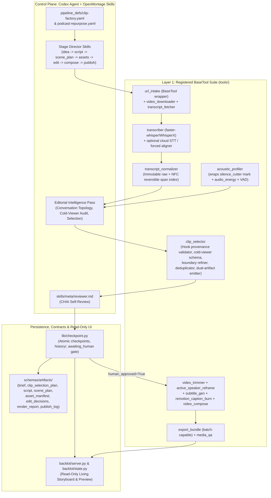

# AI VIDEO LAB — FUTURE SYSTEM ARCHITECTURE, AI INTELLIGENCE STRATEGY & MASTER IMPLEMENTATION ROADMAP

**Document Path:** `planning/21_AI_VIDEO_LAB_TARGET_ARCHITECTURE_AND_IMPLEMENTATION_ROADMAP.md`  
**Project:** AI Video Lab (Built on OpenMontage)  
**Repository:** `https://github.com/Unstocks/AI-video-Lab.git` (`C:\AI-Video-Lab`)  
**Baseline Verified HEAD:** `7cf6b52f0b279f50d193f6aab7c25be5f3b8f95f` (`main`)  
**Companion Intelligence Report:** `planning/20_AI_VIDEO_LAB_COMPLETE_REPOSITORY_AND_PRODUCT_INTELLIGENCE.md`  
**Date:** November 17, 2026

---

## 1. Architectural Strategy: Extending OpenMontage Natively

AI Video Lab does **not** discard or replace OpenMontage. It evolves OpenMontage's existing agent-first platform into a high-precision long-form conversation intelligence and vertical video studio while honoring OpenMontage's verified invariants:

1. **Preserve the Single Control Plane:** The IDE coding agent (OpenAI Codex going forward) remains the primary pipeline orchestrator — reading `pipeline_defs/*.yaml`, following Layer 2 director skills (`skills/pipelines/clip-factory/` and `podcast-repurpose/`), executing deterministic Python `BaseTool` modules via `ToolRegistry`, self-reviewing via `skills/meta/reviewer.md`, and enforcing human gates via `lib/checkpoint.py`.
2. **No Competing Autonomous Agent Framework:** Do NOT introduce LangChain, CrewAI, AutoGen, or a second Python orchestrator.
3. **Deterministic Python Tools for Evidence, Contracts & Media:** Anything requiring mathematical precision, provenance tracking, Unicode indexing, acoustic measurement, schema validation, trimming, reframing, subtitle timing, or rendering belongs in deterministic, tested Python `BaseTool` subclasses and `lib/` libraries.
4. **Decoupled Model-Substitutable Intelligence:** Editorial intelligence (macro conversation understanding, cold-viewer comprehension auditing, narrative closure reasoning) is decoupled from hardware constraints. In interactive IDE runs, Codex itself performs editorial reasoning using deterministic tool outputs; for future batch/headless evaluation or specialized multimodal passes, an optional, explicitly configured inference adapter seam (under reserved `lib/providers/`) can be introduced *only when authorized in Phase 6*, without altering core pipeline contracts.

---

## 2. Current vs. Target System Architecture

### 2.1 Current Architecture (Verified at `7cf6b52f`)
- **Stage 1 (`idea`):** `URLIntakeAdapter` (`lib/url_ingest.py`, not yet in `ToolRegistry`) -> `VideoDownloader` + `TranscriptFetcher` -> `source_manifest.json` -> `lib/source_media_review.py` -> `brief.json` + `decision_log.json` -> `checkpoint_idea.json` (`awaiting_human`).
- **Stages 2–7 (`script` -> `publish`):** Manifests and director skills exist (`clip-factory.yaml`, `podcast-repurpose.yaml`), and low-level media tools exist (`transcriber`, `silence_cutter`, `audio_energy`, `scene_detect`, `frame_sampler`, `auto_reframe`, `video_trimmer`, `subtitle_gen`, `remotion_caption_burn`, `video_compose`, `export_bundle`), **but zero conversation intelligence, provenance, cold-viewer auditing, deduplication, or active-speaker reframing code exists.**
- **Observability (`backlot/`):** Read-only FastAPI + SSE storyboard reading `checkpoint_*.json` and `artifacts/*.json`.

### 2.2 Target Architecture (Evolving OpenMontage)

---

## 3. Mapping the 25 Conceptual Steps onto OpenMontage's 7-Stage Pipeline

Rather than creating 25 stages or 25 agents, all 25 conceptual capabilities map cleanly onto OpenMontage's existing 7-stage `clip-factory` (v2.0) state machine:

| OpenMontage Stage | Conceptual Pipeline Steps Covered | Tools / Libraries Invoked | Canonical & Supplementary Artifacts | Human Gate (`clip-factory.yaml`) |
|---|---|---|---|---|
| **1. `idea`** | 1. Source Intake, 2. Source Validation, 3. Media Acquisition, 4. Source Inspection, 5. Transcript Acquisition (native captions or STT trigger) | `url_intake`, `video_downloader`, `transcript_fetcher`, `lib/source_media_review.py`, `audio_probe`, `frame_sampler` | `source_manifest.json` (in `source/`), `source_media_review`, `brief`, `decision_log` | **GATED (`true`)** |
| **2. `script`** | 5b. ASR/Alignment fallback, 6. Transcript Normalization, 7. Conversation Segmentation, 8. Semantic Understanding, 9. Candidate Discovery, 10. Context Reconstruction, 11. Cold-Viewer Evaluation, 12. Hook Verification, 13. Timestamp & Boundary Refinement, 14. Editorial Evaluation, 15. Candidate Ranking, 16. Deduplication, 17. Candidate Review, 18. Human Approval | `transcriber` (if no word-level transcript), `transcript_normalizer`, `acoustic_profiler` (`silence_cutter` `mark` + `audio_energy`), `scene_detect`, `clip_selector` | **`clip_selection_plan`** (full candidate dossier & evidence) + **`script`** (provisional at `awaiting_human`, finalized to approved clips at `completed`) | **GATED (`true`)** |
| **3. `scene_plan`** | 19a. Clip Framing & Layout Strategy (9:16 vs 1:1 vs 16:9, active-speaker plan, safe zones) | `frame_sampler`, `scene_detect`, `face_tracker` / ASD probe | `scene_plan` (`scene.script_section_id == clip.id`) | **GATED (`true`)** |
| **4. `assets`** | 21. Subtitle Generation (per-clip offset, word highlighting, ASR corrections), Hook/Title overlays, Audio normalization | `subtitle_gen`, `audio_enhance` | `asset_manifest` | **GATED (`true`)** |
| **5. `edit`** | 19b. Per-clip edit timelines, hook placement (0–3s), subtitle styling, render runtime lock (`remotion` or `ffmpeg`) | Pure agent planning + deterministic validation | `edit_decisions` | Un-gated (`false`) |
| **6. `compose`** | 19c. Source Trimming, 20. Vertical 9:16 Composition & Speaker-Aware Reframing, 22. Rendering, 23. Automated Playback/AV-Sync/Subtitle QA, 24. Backlot Preview | `video_trimmer`, `auto_reframe` (ASD-enhanced), `remotion_caption_burn`, `video_compose`, `audio_mixer`, `audio_probe`, `frame_sampler` | `render_report`, `final_review` | Un-gated (`false`) |
| **7. `publish`** | 25. Final MP4 Export Bundle & Per-Clip Metadata Packaging (for manual publishing) | `export_bundle` (batch multi-clip support) | `publish_log` | **GATED (`true`)** |

---

## 4. Authoritative Artifact Contracts & State/Approval Architecture

### 4.1 Resolving the `clip_selection_plan.json` vs. `script.json` Coexistence Contract
Forensic inspection of `lib/checkpoint.py:30-40, 134-143` revealed a binding constraint missed by earlier planning documents:
- `CANONICAL_STAGE_ARTIFACTS["script"] == "script"`.
- `write_checkpoint(stage="script", status="awaiting_human", artifacts=...)` **raises `CheckpointValidationError` if `"script"` is absent from `artifacts`**!
- Meanwhile, `backlot/state.py:409-413, 456` reads `artifacts["script"]["sections"]` to join with `scene_plan.scenes` and render Backlot storyboard cards.

Therefore, **both artifacts MUST coexist with explicit authority semantics**:

| Lifecycle Point | `clip_selection_plan.json` Role | `script.json` Role | Checkpoint State |
|---|---|---|---|
| **Pre-Approval (Review Ready)** | **Authoritative Editorial Dossier:** Contains raw evidence pointers, ALL discovered candidates (`SELECTED_FOR_REVIEW`, `DEFERRED`, `REJECTED`), cold-viewer audits, verbatim spoken hook spans, 8-tier timestamp provenance, acoustic evidence, and ranking rationale. | **Provisional Canonical Stage Artifact:** Populated from `SELECTED_FOR_REVIEW` candidates formatted as schema-valid `script.sections` (`id`, `label`, `text`, `start_seconds`, `end_seconds`), explicitly tagged `metadata.approval_status = "provisional"` and `metadata.clip_selection_plan_ref`. Satisfies `lib/checkpoint.py` and lets Backlot preview candidates. | `status="awaiting_human"`, `human_approved=False`, `human_approval_required=True` |
| **Post-Approval (User Approves / Edits Selection in Chat)** | Updated with human decisions (`HUMAN_APPROVED` / `HUMAN_REJECTED` / `HUMAN_ADJUSTED` boundaries) and reviewer timestamp. | **Authoritative Downstream Contract:** Regenerated **exclusively** from `HUMAN_APPROVED` clips, tagged `metadata.approval_status = "approved"`. Every downstream consumer (`scene_plan`, `assets`, `edit`, `compose`, `backlot`) reads `script.sections` without breaking existing schemas! | `status="completed"`, `human_approved=True` (previous `awaiting_human` auto-archived to `projects/<id>/history/`) |

### 4.2 Schema Versioning & Backward Compatibility
- All artifact schemas retain `"version": "1.0"` with additive minor evolution (`"1.1"` only if backward-compatible optional properties are added).
- `schemas/artifacts/clip_selection_plan.schema.json` is registered in `schemas/artifacts/__init__.py` (`ARTIFACT_NAMES`) and `backlot/state.py` (`ARTIFACT_FILES`, optional/non-breaking).
- `schemas/artifacts/script.schema.json` and `schemas/artifacts/scene_plan.schema.json` remain **100% backward-compatible** so all existing OpenMontage pipelines and older `projects/` directories remain readable.

### 4.3 Clean Separation of Technical Validation vs. Human-Review Lifecycle States
Never conflate technical checks with human authority. Track four orthogonal fields on every candidate:
1. **`validation_state`** (deterministic technical checks): `VALID` | `INVALID_TIMESTAMPS` | `INVALID_HOOK_PROVENANCE` | `SCHEMA_ERROR`.
2. **`eligibility_state`** (hard editorial gates): `ELIGIBLE` | `REJECTED_COLD_VIEWER` | `REJECTED_INCOMPLETE_THOUGHT` | `REJECTED_DURATION_OUT_OF_BOUNDS` | `REJECTED_AUDIO_QUALITY` | `DEFERRED_DUPLICATE`.
3. **`review_state`** (human-in-the-loop governance): `PENDING_REVIEW` | `SELECTED_FOR_REVIEW` | `AWAITING_HUMAN` | `HUMAN_APPROVED` | `HUMAN_REJECTED` | `HUMAN_REVISED`.
4. **`production_state`** (downstream execution): `NOT_STARTED` | `PLANNED` | `ASSETS_READY` | `RENDERED` | `QA_PASSED` | `QA_FAILED` | `EXPORTED`.

**Backlot Authority Invariant:** Backlot (`backlot/server.py`) remains strictly read-only observational unless an explicit, authenticated, tested approval API is designed and authorized in a future milestone. Today, human approval occurs strictly in chat via the checkpoint protocol.

---

## 5. Deep Technical Research: Building a Genuinely High-Quality AI Video Intelligence Engine

All research below is **unconstrained by current laptop hardware** — product editorial quality is the primary objective.

### 5.1 Conversation Intelligence (Deterministic vs. Model-Assisted vs. Human-Reviewed)

| Layer | Responsibility | Execution Mode | Engineering Approach |
|---|---|---|---|
| **Raw Evidence & Unicode Indexing** | Preserve raw captions/ASR verbatim, normalize to NFC, map normalized text <-> raw spans | **100% Deterministic Python** | Immutable `RawTranscriptSegment` list + `unicodedata.normalize("NFC", ...)` + half-open Python code-point spans `[char_start, char_end)` + bidirectional offset map. |
| **Acoustic & Visual Signals** | Measure pauses, loudness curve, VAD speech intervals, camera cuts, active speaker | **100% Deterministic / Local Specialist ML** | `SilenceCutter(mode="mark")`, `AudioEnergy`, Silero VAD, `SceneDetect`, `wav2vec2` forced alignment, ASD model (TalkNet/Light-ASD/LoCoNet). |
| **Macro Discourse Topology** | Identify episode chapters, topic shifts, speaker roles, Q&A pairs, storytelling arcs, debate exchanges | **Model-Assisted (Long-Context Frontier LLM + Optional Embedding Segmentation)** | Full-transcript macro pass (fitting 1–3 hour podcasts inside 1M-token context windows) producing structured topic blocks, speaker-turn graphs, and thematic anchors *before* proposing any single clip. |
| **Candidate Discovery & Context Reconstruction** | Mine standout insights/stories/arguments, trace unresolved pronouns/premises backward and payoffs forward | **Model-Assisted (Multi-Pass Reasoning LLM)** | Pass 1: Macro topology; Pass 2: High-recall seed moments (claims, counterintuitive insights, Q&A payoffs, emotional stories, humor); Pass 3: Context expansion & Cold-Viewer Audit. |
| **Provenance, Deduplication & Boundary Safety** | Verify verbatim spoken hooks, enforce temporal IoU & semantic deduplication, verify acoustic cut safety | **100% Deterministic Python + Optional Embedding Cosine Similarity** | `validate_hook_provenance()` (zero-tolerance verbatim check), IoU $> 0.35$ suppression, semantic similarity $> 0.85$ deduplication (`Qwen3-Embedding` / `BGE-M3`), advisory pause snapping. |
| **Final Clip Selection & Framing Approval** | Approve, reject, or tweak clip selection & boundaries | **Human-Reviewed (Mandatory Gate)** | `checkpoint_script.json` (`awaiting_human`) + human review in chat + Backlot visual preview. |

### 5.2 Candidate Discovery (Avoiding Simplistic Scoring)
- **Why naive clippers fail:** Selecting peaks in `AudioEnergy`, keyword triggers ("secret", "mistake"), or uniform sliding windows catches loud laughter without setup, mid-argument fragments, and repetitive talking points.
- **Multi-Pass Architecture:**
  1. **Whole-Conversation Map:** Summarize the episode's macro arc (speakers, core thesis, major topic transitions, recurring entities/acronyms).
  2. **Archetype-Driven Moment Mining:** Identify candidates across distinct editorial families (`contrarian_claim`, `surprising_insight`, `story_with_payoff`, `qa_exchange`, `tactical_explanation`, `emotional_or_humorous_moment`) rather than a single generic "virality" metric.
  3. **Context-Window Reconstruction:** For each seed moment, inspect surrounding turns ($\pm 90$ seconds) to detect whether a question, premise, or entity introduction precedes the seed or a punchline/qualification follows it.
  4. **Strict Anti-Padding Policy:** Never pad weak candidates to meet a target count. If a 60-minute video yields only 2 exceptional moments, return 2.

### 5.3 Cold-Viewer Comprehension (Hard Eligibility Gate)
Distinguish three levels explicitly:
- **Interesting:** Contains a strong line or insight *for someone already watching the episode*.
- **Understandable (Cold-Viewer Pass):** Someone scrolling Shorts/Reels who has never heard of the podcast can understand *who/what is being discussed, why it matters, and what the conclusion is* within the clip itself.
- **Independently Publishable:** Understandable AND has a compelling opening, clean boundaries, acceptable audio/visual quality, and no misleading truncation of essential caveats.

**5-Point Cold-Viewer Audit (Hard Gate):**
1. **Immediate Topic Grounding:** Is the subject clear within the first 3–5 seconds (or via an explicitly marked `editorial_framing` card)?
2. **Entity Resolution:** Are all mentioned people, companies, products, and jargon understandable in-clip?
3. **Pronoun/Anaphora Resolution:** Are opening/core pronouns (`he`, `she`, `they`, `it`, `that`, `this`) resolved inside the clip?
4. **Complete Premise -> Payoff:** Does the clip contain both the setup/question and the conclusion/payoff without cutting off critical qualifiers?
5. **Non-Fabrication Rule:** Missing context may ONLY be solved by (a) expanding boundaries to include real source dialogue (within duration guardrails, e.g., $\le 120\text{s}$), or (b) adding an explicitly labelled visual `editorial_framing` intro card — **NEVER by fabricating or splicing fake spoken dialogue.**

### 5.4 Authentic Spoken Hooks & Provenance Verification
Strictly separate three fields in every candidate contract:
1. **`spoken_hook`**: Exact verbatim words actually spoken by the source speaker (typically within the opening 2–5 seconds).
2. **`editorial_title`**: Human/AI-written headline for packaging/overlay (never presented as a spoken quote).
3. **`editorial_framing`**: Optional explicitly marked visual context banner/intro card (e.g., *"On why scaling laws plateau..."*).

**Deterministic Verification (`validate_hook_provenance`):**
- Raw transcript is stored immutably in NFC Unicode.
- Normalizer maintains reversible mapping between normalized sentences and raw `(segment_id, char_start, char_end)` half-open code-point intervals.
- `validate_hook_provenance` checks that stripping punctuation/case from `spoken_hook` matches a **contiguous, unaltered sequence of source tokens** from a **single speaker turn** (no silent mid-sentence word deletion, no cross-speaker stitching). Any failure rejects the candidate (`INVALID_HOOK_PROVENANCE`).

### 5.5 Honest Timestamp Provenance & Natural Boundaries
Never claim millisecond accuracy simply because a float has three decimal places. Separate four orthogonal dimensions:
1. **Speech Evidence** (VAD / ASR active speech intervals)
2. **Acoustic Evidence** (`SilenceCutter` pauses, `AudioEnergy` LUFS dynamics)
3. **Alignment Evidence** (caption snippet vs. Whisper cross-attention vs. CTC phoneme forced alignment)
4. **Editorial Boundary** (where the narrative thought naturally starts and concludes)

**8-Tier Timestamp Provenance Taxonomy:**

| Tier | Origin | Typical Uncertainty | Safe For |
|---|---|---|---|
| `CAPTION_SEGMENT_TIMING` | YouTube / VTT snippet edges | $\pm 0.30\text{s}–0.50\text{s}$ | Coarse discovery only; NOT cut-safe |
| `ASR_SEGMENT_TIMING` | Whisper segment boundaries | $\pm 0.20\text{s}$ | Candidate scoping |
| `ASR_WORD_ESTIMATED` | `faster-whisper` cross-attention word times | $\pm 0.15\text{s}–0.25\text{s}$ | Draft subtitles; review fast transitions |
| `INTERPOLATED_CHARACTER_HEURISTIC` | Proportional char-length interpolation | $\pm 0.40\text{s}–0.60\text{s}$ | Low-confidence fallback only; flagged |
| `FORCED_ALIGNMENT_PHONEME` | CTC forced alignment (`wav2vec2` / WhisperX) | $\pm 0.03\text{s}$ | Cut-safe word boundaries & karaoke sync |
| `VAD_SPEECH_REGION` | Neural VAD (Silero VAD) speech onset/offset | $\pm 0.05\text{s}$ | Preventing clipped first/last syllables |
| `SILENCE_PROXIMITY_SNAP` | Editorial end aligned to confirmed adjacent pause | $\pm 0.04\text{s}$ | Clean breath/pause cuts *when thought is complete* |
| `HUMAN_ADJUSTED` | Human editor override | Authoritative | Final override over automated timing |

**Boundary Rule (Abolition of Blind Silence Snapping):** Silence is *advisory evidence*, never an automatic cutter. A dramatic pause mid-sentence must NOT trigger a cut. Boundary snapping to an adjacent pause ($\le 300\text{ms}$ from terminal word) is permitted ONLY after semantic/syntactic thought completion is verified and VAD confirms no trailing syllable is clipped.

### 5.6 Defensible Editorial Evaluation Framework
Avoid opaque single "virality scores" presented as scientific truth. Separate:
1. **Hard Eligibility Gates (Binary Pass/Fail — Any Fail Rejects Candidate):**
   - `valid_hook_provenance` (100% verbatim source span)
   - `cold_viewer_pass` (5-point standalone audit)
   - `thought_completeness` (complete premise + payoff, no misleading qualifier removal)
   - `duration_within_bounds` (platform-configurable, e.g., 15s–90s default, hard cap 120s)
   - `minimum_audio_video_usability` (intelligible speech, non-corrupt stream)
2. **Transparent Ranking Preferences (Used ONLY to Order Eligible Candidates & Diversify Batch):**
   - `hook_pull` (opening curiosity/tension in first 3s)
   - `insight_or_story_value` (originality, emotional resonance, practical depth)
   - `narrative_progression` (clarity, pacing, satisfying ending)
   - `delivery_and_visual_fit` (vocal dynamism, clean framing suitability)
   - `batch_diversity_gain` (topic spread, speaker variety, clip family mix across episode timeline)
   - Every dimension carries an explicit **textual justification grounded in transcript spans**, not just a bare number.

### 5.7 Multimodal Intelligence (High-ROI Now vs. Deferred)
- **High-ROI Near-Term (Phase 4):**
  - **Active Speaker Detection (ASD)** for multi-person podcasts: `FaceTracker` currently picks only the single largest/highest-confidence face per frame (`tools/analysis/face_tracker.py:222,288`), which fails whenever a non-speaking host is closer to camera or reacts silently. Audio-visual ASD models — specifically **TalkNet** (cross-modal audio-visual attention baseline), **Light-ASD / LR-ASD** (lightweight consumer-hardware-friendly ASD), and **LoCoNet** (Long-Short Context Network capturing inter-speaker & intra-speaker context to eliminate jitter during nods/interruptions) — directly solve active-speaker framing.
  - **Camera-Cut Awareness (`SceneDetect`):** Prevents awkward reframing pans across hard camera cuts; resets crop smoothing at shot boundaries.
  - **Visual Suitability Check (`FrameSampler` + Vision pass):** Flags clips where the speaker references on-screen slides/charts/demos that would be destroyed by a naive 9:16 face crop (downgrading honestly to 1:1, 16:9, or split-screen layout).
- **Deferred (Phase 6):** Full-video multimodal candidate discovery (processing raw video frames + audio directly through multimodal frontier models like Gemini 4 / 3.8 Flash), facial-expression emotion scoring, and on-screen OCR slide understanding.

### 5.8 Vertical 9:16 Video Production Strategy
Extend OpenMontage's existing production stack (`video_trimmer`, `auto_reframe`, `subtitle_gen`, `remotion_caption_burn`, `video_compose`, `export_bundle`) rather than replacing it:
1. **H.264/AAC Editing Proxy When Needed:** Keep pristine master (`source_video.mp4`); generate `source_video_h264.mp4` (`libx264`, `yuv420p`, `+faststart`) when source is AV1/VP9 so Remotion and FFmpeg seeking are frame-accurate.
2. **Speaker-Aware 9:16 Reframing:** Extend `AutoReframe` to consume ASD active-speaker tracks + `SceneDetect` cut boundaries, supporting three layouts: (a) smooth single-speaker crop with deadband/damping, (b) clean cut-on-speaker-change for multi-cam/two-shot podcasts, and (c) stacked split-screen or blurred pillarbox for slides/two-person exchanges.
3. **Synchronized, Readable Subtitles:** Normalize timestamps to clip-relative `0.0s` (verified in `video_trimmer.py:135-149`); require word-level timestamps (forced alignment or ASR word times) before enabling `karaoke`/`word_by_word` highlighting; enforce mobile platform safe zones (avoiding TikTok/Reels/Shorts bottom captions/UI chrome and right-hand action rail); support multilingual Unicode/Devanagari/Hinglish fonts cleanly.
4. **Render Runtime Governance:** Lock `render_runtime="remotion"` (once `remotion-composer` is installed on a compatible LTS Node version) for kinetic word-level captions, or explicit `"ffmpeg"` for pure FFmpeg trim/reframe/ASS subtitle burn; never silently swap runtimes.

---

## 6. Current AI Model & Provider Strategy (Verified November 2026 Research)

> **Important Governance Notes:**
> 1. Do NOT use retired 2024 models (`claude-3-5-sonnet-20241022`, `gemini-1.5-pro-002`, `gpt-4o-2024-08-06`) that appeared in stale planning docs.
> 2. **Consumer Subscription vs. API Billing:** Per OpenAI official billing documentation, consumer ChatGPT Plus/Pro subscriptions and the OpenAI API platform use **separate billing systems** (even where Pro plans include promotional API credit grants, API-key programmatic usage bills separately on the API platform; Codex inside consumer environments uses plan limits while API-key workflows consume API credits).
> 3. **Model Substitutability:** Never hardcode a single vendor or model ID across the pipeline. Final model selection MUST be validated empirically on our own golden podcast evaluation set (§7), not marketing benchmarks.

### 6.1 Frontier Reasoning & Multimodal Cloud Models (Nov 2026 Official Lineups)

| Provider | Current Official Model IDs | Context / Max Output | Native Capabilities & Structured Output | Reference Public API Pricing (per 1M tokens) | Best Role in AI Video Lab |
|---|---|---|---|---|---|
| **OpenAI** | `gpt-6-astra` (flagship) `gpt-6.1-sol` (balanced) `gpt-6.1-terra` (visual/fast) `gpt-6-luna` (high-volume) | ~1.05M input / 128K output | Native **Structured Outputs** (strict JSON Schema adherence, no extra surcharge); prompt caching; 50% Batch API discount | `gpt-6-astra`: \$10 in / \$50 out `gpt-6.1-sol`: \$2 in / \$10 out `gpt-6.1-terra`: \$1 in / \$5 out `gpt-6-luna`: \$0.10 in / \$0.50 out | `gpt-6.1-sol` / `gpt-6-astra` for complex editorial judgment, cold-viewer auditing & strict `clip_selection_plan` schema extraction; `gpt-6-luna` for high-volume triage. |
| **Anthropic** | `claude-fable-5-2` (deep reasoning) `claude-opus-5-5` (flagship) `claude-sonnet-5-5` (workhorse) `claude-haiku-5-5` (fast) | 1M input / 128K output | Native tool use & structured JSON; prompt caching (up to 90% read discount, `0.05x` on Sonnet/Opus 5.5); 50% Batch API discount | `claude-fable-5-2`: \$8 in / \$40 out `claude-opus-5-5`: \$4 in / \$20 out `claude-sonnet-5-5`: \$2 in / \$10 out `claude-haiku-5-5`: \$0.10 in / \$0.50 out ($\le 100\text{K}$) | `claude-sonnet-5-5` / `claude-opus-5-5` for nuanced conversational reasoning, sarcasm/qualifier preservation, and editorial critique. |
| **Google Gemini** | `gemini-4-carbon` (flagship) `gemini-4-argon` (efficient frontier) `gemini-4-hydrogen` (daily/agentic) `gemini-3.8-flash` / `gemini-3.5-flash-lite` | 1M+ input | Native **text + audio + video + image** multimodal input; native JSON Schema (`response_schema`); Context Caching (~90% off); 50% Batch discount | Pro/Flagship tier: ~\$2 in / \$12+ out (higher >200K); Flash workhorse: ~\$0.75–\$1.50 in / \$3.75–\$7.50 out; Flash-Lite: \$0.10–\$0.30 in / \$0.40–\$2.50 out | **Best multimodal & full-episode option:** Can ingest raw podcast audio/video + long transcripts natively; strong multilingual/Hinglish support. |

*Sources: OpenAI API Documentation (`openai.com`), Anthropic Platform Pricing (`anthropic.com`, `claude.com`), Google Gemini API Models & Pricing (`ai.google.dev/gemini-api/docs/models`). Always re-verify exact endpoint IDs and pricing at integration time.*

### 6.2 Open-Weight Local LLMs & Multilingual Embeddings (Nov 2026)

| Category | Recommended Models | Strengths & Multilingual / Hinglish Fit | Local Serving |
|---|---|---|---|
| **Local / Self-Hosted LLMs** | **Qwen3 / Qwen3.5** series (7B–72B+ variants; 200+ languages/dialects in Qwen3.5) | Strong JSON adherence, long context, leading Hindi/Hinglish code-switching comprehension among open weights (Apache 2.0). | Ollama (optional offline fallback or workstation GPU) |
| **Multilingual Embeddings (Deduplication & Topic Segmentation)** | **Qwen3-Embedding** (`0.6B`, `4B`, `8B`, up to 32K context, 100+ languages) and **BAAI BGE-M3** (dense + sparse + multi-vector hybrid retrieval, 100+ languages) | Both map Romanized Hinglish, Devanagari Hindi, and English into aligned semantic space; runnable locally via `ollama run qwen3-embedding` or `ollama run bge-m3`. | Ollama or Python local runtime |

### 6.3 Speech-to-Text, Forced Alignment, Diarization & VAD Strategy

| Path | Stack | Strengths | Trade-offs |
|---|---|---|---|
| **Offline Local Modular Stack (Free, Private)** | **Silero VAD** -> **faster-whisper** (`large-v3` / `large-v3-turbo`) -> **WhisperX `wav2vec2` CTC Forced Alignment** -> **pyannote.audio** diarization | Zero API cost, private media stays local, ~$\pm 30\text{ms}$ word boundaries via `wav2vec2`, eliminates Whisper silence hallucinations via Silero VAD. | Requires compatible Python/CUDA/PyTorch env (Python 3.11/3.12 recommended over 3.14 on Windows), HuggingFace token for gated `pyannote` weights, struggles slightly on heavy speaker overlap. |
| **Managed Cloud STT (Highest Accuracy / Zero Ops)** | **Deepgram Nova-3** or **AssemblyAI (Universal series)** (plus existing OpenMontage `azure_stt`, `mistral_stt`, `dashscope_asr`) | Native word-level timestamps + reconciled speaker diarization + strong handling of rapid turn-taking/overlaps; minimal setup. | Usage-based cost per audio hour; sends source audio to third-party API (privacy consideration for private recordings). |

### 6.4 Recommended Hybrid Architecture
1. **Deterministic Python Tools:** Validation, Unicode span mapping, acoustic silence/loudness, deduplication math, media trimming, subtitle formatting, schema checks.
2. **Specialist Audio/Visual Models:** Silero VAD + WhisperX (`faster-whisper` + `wav2vec2` + `pyannote`) or managed cloud STT for word-accurate diarized transcripts; `Light-ASD` / `LoCoNet` for active speaker detection; `Qwen3-Embedding` / `BGE-M3` for semantic deduplication.
3. **Frontier Reasoning Model:** Codex (or pluggable frontier API in future headless runs) for macro conversation understanding, cold-viewer comprehension auditing, and narrative editorial judgment.
4. **Human Authority:** Mandatory human approval gate (`awaiting_human` -> `human_approved=True`) before downstream rendering.

---

## 7. Quality Standard & Human-Labelled Evaluation Methodology

Technical tests (unit/contract/schema) prove the code does not crash — they do **NOT** prove the clips are good. AI Video Lab requires a separate, disciplined **Editorial & Technical Evaluation Harness**.

### 7.1 Strictly Separate Four Categories of Evidence
- **Measured Results:** Numbers actually computed from executing code against real test clips (currently: **none exist yet** for M2 editorial quality).
- **Proposed Targets:** Aspirational thresholds we aim for (must never be reported as achieved without measured runs).
- **Experimental Hypotheses:** Ideas to A/B test (e.g., macro-pass + candidate-pass vs. single-pass long context).
- **Human Judgments:** Blind editorial ratings by the user/editor.

### 7.2 Golden Evaluation Dataset Strategy (Representative Content Archetypes)
Assemble a private local evaluation corpus (gitignored under `projects/_eval_corpus/` or external path, NEVER committed to Git) covering at least **7 core archetypes**:
1. **Technical Deep-Dive Podcast** (dense jargon, multi-step arguments, premises set up 2 minutes early).
2. **Solo Monologue / Essay** (single speaker, subtle transitions, rhetorical pauses).
3. **Structured Guest Interview (Q&A)** (host question required to make guest's answer cold-viewer understandable).
4. **Comedy & High-Pace Banter** (interruptions, timing-critical punchlines, crosstalk).
5. **Debate / Disagreement** (rapid speaker switching, essential counter-arguments/qualifiers).
6. **Narrative Storytelling** (long anecdotes with setup, tension, and emotional payoff).
7. **Multilingual & Hinglish Conversations** (Hindi-English code-switching in Latin + Devanagari script, non-English captions, combining marks, emoji).

For each episode, record human ground truth: 3–5 gold-standard publishable moments (exact start/end, why it works, minimum required setup) + 3–5 "trap" moments (high-energy or quotable lines that FAIL cold-viewer comprehension).

### 7.3 Evaluation Metrics (Technical + Editorial)

| Dimension | Metric | Proposed Target (Unverified) | How Measured |
|---|---|---|---|
| **Hook Integrity** | Verbatim spoken-hook provenance pass rate | **100.0% (Hard Gate)** | Deterministic `validate_hook_provenance()` |
| **Cold-Viewer Quality** | Standalone comprehension pass rate (human blind watch) | $\ge 90\%$ | Human viewer watches clip without episode context |
| **Context Honesty** | Misleading truncation / missing qualifier rate | **0%** | Human audit vs surrounding $\pm 60\text{s}$ source |
| **Boundary Naturalness** | Clipped-word or mid-thought cut rate | $\le 5\%$ | Audio/transcript playback check |
| **Timestamp Accuracy** | Median boundary error vs human-adjusted timestamps | $\le 150\text{ms}$ (with forced alignment) | Delta vs human ground-truth timestamps |
| **Deduplication** | Redundant/overlapping clip rate in review batch | **0%** | Temporal IoU & semantic duplicate audit |
| **Production Integrity** | Playable MP4, AV sync drift ($\le 40\text{ms}$), subtitle sync, safe-zone compliance | **100% pass** | `ffprobe` + frame sampling + playback check |
| **Editorial Usefulness** | Human acceptance rate (approved as-is or minor trim) | $\ge 70\%$ | Logged across real `clip-factory` runs |

---

## 8. Phased, Dependency-Aware Master Implementation Roadmap

Codex MUST execute strictly **one authorized phase at a time**, stopping for human verification at every exit gate.

*(Note: Phasing has been refined from earlier drafts based on repository forensic evidence — placing Phase 0 Baseline and Phase 1 M1 Hardening ahead of M2 integration, and separating Acoustic/Boundary Evidence [2C] from Candidate Discovery/Editorial Intelligence [2D] and Human Review/Canonical Script Integration [3].)*

### Phase 0 — Repository Baseline & Engineering Integrity (READ-ONLY FIRST)
1. **Objective:** Establish verified source-of-truth baseline, confirm local/CI environment delta, confirm working-tree preservation, and map all existing tests that pass vs. sandbox/dependency-blocked tests.
2. **Why Needed:** Prevents Codex from building on stale planning doc assumptions (wrong SHA, hallucinated symbols, outdated models, uncollected smoke tests).
3. **Reused Components:** Existing `tests/`, `tools/tool_registry.py`, `lib/checkpoint.py`, `Makefile`, `.github/workflows/ci.yml`.
4. **Files Created / Modified:** **NONE** (read-only audit; report discrepancies first).
5. **Dependencies:** None.
6. **Exit Conditions:** Verified Git state, tool availability report, test baseline matrix, and explicit human authorization for Phase 1 (or Phase 2A).
7. **Deferred Scope:** Any code edits, package installs, or doc rewrites until authorized.

### Phase 1 — M1 Intake Hardening & Packaging Integrity
1. **Objective:** Close all 9 verified M1 findings (M1-F01 through M1-F09) so URL intake is reproducible, secure within documented boundaries, multilingual, transaction-safe, and registered in `ToolRegistry`.
2. **Why Needed:** Clean installs currently break (`yt-dlp`/`youtube-transcript-api` undeclared), unknown durations bypass limits, sequential moves risk corrupt partial directories, non-English captions are ignored, and `URLIntakeAdapter` is invisible to `ToolRegistry`.
3. **Reused Components:** `lib/url_ingest.py`, `tools/analysis/video_downloader.py`, `tools/analysis/transcript_fetcher.py`, `lib/source_media_review.py`, `tools/base_tool.py`.
4. **Files to Create:** `tools/analysis/url_intake.py` (`URLIntake(BaseTool)` wrapper), `tests/unit/test_url_intake_hardening.py` (or extend `tests/unit/test_url_ingest.py`).
5. **Files to Modify:** `requirements.txt`, `setup.py`, `lib/url_ingest.py`, `tools/analysis/transcript_fetcher.py` (honor `include_auto_generated`), `tools/analysis/video_downloader.py` (enforce duration guard / extractor allowlist), `tests/qa/test_url_intake_smoke.py` (pytest-collectible `@pytest.mark.network`), `pipeline_defs/clip-factory.yaml` & `podcast-repurpose.yaml`, `skills/pipelines/clip-factory/idea-director.md`, `README.md`.
6. **Contracts & Data:** Preserve `source_manifest.json` v1.0 (additive optional fields: `master_video_path`, `proxy_video_path`, `caption_language`, `caption_is_auto_generated`); parameterize `pipeline_type` in `review_ingested_media()`.
7. **Dependencies:** Phase 0 baseline sign-off.
8. **Implementation Sequence:** (1) Manifest deps (`requirements.txt`/`setup.py`); (2) Post-probe duration guard + WAV codec check + transactional commit/rollback + stale file cleanup; (3) Multilingual caption discovery (`ytt.list()`) + `include_auto_generated`; (4) SSRF/extractor tightening + honest boundary docs; (5) `URLIntake(BaseTool)` wrapper + manifest update; (6) Pytest-collectible smoke test + failure-path unit tests.
9. **Failure Scenarios:** Missing/zero duration metadata, mid-move I/O lock on Windows, corrupt downloaded file, non-WAV raw audio, non-English/Hinglish captions, DNS lookup failure, redirect/unsupported host.
10. **Tests Required:** Unit tests for every failure scenario, contract test verifying `registry.get("url_intake")` discovery, regression run of `test_url_ingest.py`, pytest collection check on `test_url_intake_smoke.py` (`>=1` test collected, deselected cleanly with `-m "not network"`).
11. **Acceptance Criteria & Exit Gate:** All unit/contract tests pass; zero regressions; fresh-venv dependency audit confirms `requirements.txt` covers all M1 imports; human approves Phase 1 diff.
12. **Deferred Scope:** Full OS-level egress firewall; Vimeo native caption extraction beyond `yt-dlp`; M2 intelligence.

### Phase 2A — Evidence & Data Contracts
1. **Objective:** Define immutable raw transcript models, Unicode source-span models, 8-tier timestamp provenance, candidate clip lifecycle models, and the validated `clip_selection_plan.schema.json` contract.
2. **Why Needed:** Locks data integrity invariants before any algorithms or tools are written.
3. **Reused Components:** `schemas/artifacts/__init__.py`, `jsonschema`, `pydantic`, `lib/checkpoint.py` (untouched).
4. **Files to Create:** `schemas/artifacts/clip_selection_plan.schema.json`, `lib/models/__init__.py`, `lib/models/transcript.py`, `lib/models/clip_plan.py`, `tests/unit/test_evidence_models.py`, `tests/contracts/test_clip_selection_plan_schema.py`.
5. **Files to Modify:** `schemas/artifacts/__init__.py` (register `"clip_selection_plan"` in `ARTIFACT_NAMES`).
6. **Contracts:** Draft 2020-12 JSON schema with `additionalProperties: false`, orthogonal `validation_state` / `eligibility_state` / `review_state` / `production_state`, 8-tier `TimingProvenanceTier`, NFC half-open `[char_start, char_end)` `SourceSpan`, `SpokenHookEvidence` separated from `editorial_title` and `editorial_framing`, `ColdViewerAudit`, and semantic invariants (e.g., `end_seconds > start_seconds`, non-empty spans).
7. **Dependencies:** Phase 0 (zero new external dependencies).
8. **Failure Scenarios:** Inverted timestamps, unknown provenance tier, `HUMAN_APPROVED` set without review metadata, missing spoken hook spans, Unicode surrogate/combining-mark offset errors.
9. **Tests Required:** Schema valid/invalid fixtures, semantic validator tests, round-trip JSON serialization tests with English, Hindi Devanagari, Hinglish, combining characters, and emoji; existing 20-schema contract regression tests.
10. **Exit Gate:** `validate_artifact("clip_selection_plan", ...)` verified; 0 regressions in existing artifact schemas.
11. **Deferred Scope:** Normalization logic, acoustic analysis, candidate discovery, UI changes.

### Phase 2B — Transcript Intelligence & Reversible Normalization
1. **Objective:** Build immutable raw-transcript ingestion (handling YouTube `{text, start, duration}`, Whisper `{segments, words}`, and SRT/VTT), Unicode NFC normalization, sentence/turn reconstruction, reversible bidirectional character-offset indexing, and macro conversation structure representation.
2. **Why Needed:** Raw YouTube auto-captions lack punctuation/sentence boundaries and use `start+duration` instead of `start+end`; all downstream provenance checks depend on lossless mapping back to raw text.
3. **Reused Components:** `lib/models/transcript.py`, `tools/analysis/transcript_fetcher.py`, `tools/analysis/transcriber.py`.
4. **Files to Create:** `lib/transcript_normalizer.py`, `lib/conversation_structure.py`, `tools/analysis/transcript_normalizer_tool.py` (or combined into analysis tool package), `tests/unit/test_transcript_normalizer.py`, `tests/unit/test_conversation_structure.py`.
5. **Files to Modify:** None to core OpenMontage runtime.
6. **Dependencies:** Phase 2A.
7. **Failure Scenarios:** Empty transcript, overlapping or out-of-order segments, zero-duration snippets, Devanagari matras / NFC vs NFD mismatches, emoji, Hinglish mixed scripts, missing speaker labels, disfluencies.
8. **Tests Required:** Round-trip span slicing tests proving `raw_segment.text[span.char_start:span.char_end]` reproduces exact source substrings across English, Devanagari, Hinglish, combining accents, and emoji; malformed/empty transcript edge cases.
9. **Exit Gate:** 100% deterministic bidirectional span accuracy across multilingual test suite.
10. **Deferred Scope:** Neural punctuation models (optional enhancement), cloud LLM calls.

### Phase 2C — Acoustic Evidence & Natural Boundary Support
1. **Objective:** Build deterministic acoustic profiling (`lib/acoustic_profiler.py`) reusing `SilenceCutter(mode="mark")`, `AudioEnergy`, and optional Silero VAD / `wav2vec2` alignment signals to supply honest timestamp provenance and safe boundary candidates.
2. **Why Needed:** Separates signal measurement from editorial judgment; prevents clipping syllables or naively cutting mid-sentence pauses.
3. **Reused Components:** `tools/video/silence_cutter.py`, `tools/analysis/audio_energy.py`, `tools/analysis/scene_detect.py`, `lib/models/transcript.py`.
4. **Files to Create:** `lib/acoustic_profiler.py`, `tests/unit/test_acoustic_profiler.py`.
5. **Dependencies:** Phase 2A, Phase 2B.
6. **Failure Scenarios:** Audio with zero detected silences (note `SilenceCutter` early-return behavior at `silence_cutter.py:129-141`!), noisy room audio, dramatic mid-sentence pause, very quiet monotone speaker, missing FFmpeg.
7. **Tests Required:** Synthetic FFmpeg-generated audio with known tone/silence intervals verifying $\pm 50\text{ms}$ pause detection; zero-silence handling; rule test proving mid-sentence pauses are NOT auto-snapped without completion flag.
8. **Exit Gate:** Verified acoustic measurement + non-destructive boundary recommendation with accurate provenance tier labels.
9. **Deferred Scope:** Mandatory local GPU forced alignment (make `wav2vec2`/Silero VAD pluggable optional upgrades).

### Phase 2D — Candidate Discovery, Verification, Editorial Evaluation & Deduplication
1. **Objective:** Implement deterministic hook provenance verification (`lib/hook_validator.py`), cold-viewer audit validator (`lib/cold_viewer_auditor.py`), hard-gate + transparent editorial ranker (`lib/editorial_evaluator.py`), temporal/semantic deduplicator (`lib/deduplicator.py`), and the registered `ClipSelector(BaseTool)` (`tools/analysis/clip_selector.py`).
2. **Why Needed:** Gives the Script Director concrete, verifiable, zero-hallucination tools to validate, rank, deduplicate, and package clip candidates.
3. **Reused Components:** Phases 2A–2C, `BaseTool`, `ToolRegistry`.
4. **Files to Create:** `lib/hook_validator.py`, `lib/cold_viewer_auditor.py`, `lib/editorial_evaluator.py`, `lib/deduplicator.py`, `tools/analysis/clip_selector.py`, comprehensive unit & contract tests in `tests/unit/` and `tests/tools/`.
5. **Dependencies:** Phases 2A, 2B, 2C.
6. **Failure Scenarios:** Paraphrased/hallucinated spoken hook, middle-word deletion in hook, cross-speaker stitched hook, unresolved opening pronoun, overlapping candidates (IoU $> 0.35$), near-duplicate arguments, zero eligible candidates (must output 0 honestly instead of fabricating weak clips!).
7. **Tests Required:** Adversarial hook tests (paraphrase, omission, cross-speaker -> all rejected), cold-viewer gate tests, IoU + semantic dedup tests, empty-result graceful handling, `ToolRegistry` discovery test for `clip_selector`.
8. **Exit Gate:** 100% rejection of synthetic hallucinated hooks and cold-viewer failures; valid `clip_selection_plan.json` emission.
9. **Deferred Scope:** Autonomous headless LLM orchestration.

### Phase 3 — Human Review, Checkpoint Integration & Canonical Script Synthesis
1. **Objective:** Wire `clip_selector` and dual-artifact synthesis (`clip_selection_plan.json` + provisional/approved `script.json`) into `clip-factory` (and `podcast-repurpose`), enforcing `lib/checkpoint.py` `awaiting_human` gates and Backlot compatibility.
2. **Why Needed:** Connects M2 intelligence seamlessly into OpenMontage's governance and downstream `scene_plan` -> `compose` pipeline without breaking Backlot.
3. **Reused Components:** `lib/checkpoint.py`, `backlot/state.py`, `pipeline_defs/clip-factory.yaml`, `skills/pipelines/clip-factory/{script-director.md, executive-producer.md}`, `schemas/artifacts/script.schema.json`.
4. **Files to Modify:** `pipeline_defs/clip-factory.yaml` (add `clip_selector` & `transcript_normalizer` to `script.tools_available` and `clip_selection_plan` to `produces`), `skills/pipelines/clip-factory/script-director.md`, `skills/pipelines/clip-factory/executive-producer.md`, `backlot/state.py` (add optional `clip_selection_plan` to `ARTIFACT_FILES` without altering read-only contract).
5. **Files to Create:** `tests/integration/test_clip_factory_m2_handoff.py`.
6. **Dependencies:** Phases 1, 2A–2D.
7. **Failure Scenarios:** Attempting to mark `script` stage `completed` with `human_approved=False` (must raise `CheckpointValidationError`); human rejecting all clips; human adjusting timestamps (`HUMAN_ADJUSTED`); Backlot missing `script.sections`.
8. **Tests Required:** Integration test writing `awaiting_human` checkpoint (both `clip_selection_plan` + provisional `script`), verifying `get_next_stage()` stays on `script`, verifying `load_board_state()` succeeds, then applying human approval -> finalized `script.json` (`approved`) -> `scene_plan` join compatibility.
9. **Exit Gate:** Full M1 + M2 end-to-end integration verified on real podcast material with human gate preserved.
10. **Deferred Scope:** Interactive write-back UI in Backlot.

### Phase 4 — Clip Production, Vertical 9:16 Composition & Synchronized Subtitles
1. **Objective:** Deliver high-craft vertical 9:16 multi-clip production: frame-accurate trimming, H.264 editing proxy support, speaker-aware reframing (integrating `auto_reframe` + shot-cut reset + optional ASD backend), clip-relative word-level subtitles with mobile safe zones, and Remotion/FFmpeg composition.
2. **Why Needed:** Turns approved clip selections into watchable, polished vertical videos.
3. **Reused Components:** `tools/video/video_trimmer.py`, `tools/video/auto_reframe.py`, `tools/analysis/face_tracker.py`, `tools/analysis/scene_detect.py`, `tools/subtitle/subtitle_gen.py`, `tools/video/remotion_caption_burn.py`, `tools/video/video_compose.py`, `tools/audio/audio_enhance.py`, `tools/audio/audio_mixer.py`.
4. **Files to Modify:** `pipeline_defs/clip-factory.yaml` (wire `auto_reframe`, `face_tracker`, `remotion_caption_burn`), `skills/pipelines/clip-factory/{scene-director.md, asset-director.md, edit-director.md, compose-director.md}` (fix stale `scene-director.md:28` note), `tools/video/auto_reframe.py` (scene-cut reset + active-speaker track input + split-screen/pillarbox mode), `tools/subtitle/subtitle_gen.py` (clip-offset helper & safe-zone styling).
5. **Dependencies:** Phase 3 + local runtime verification (installing `remotion-composer` on LTS Node if Remotion kinetic captions are enabled, or explicit FFmpeg ASS path; optional `mediapipe`/`opencv-python`/ASD weights).
6. **Tests Required:** Synthetic 16:9 -> 9:16 vertical trim + reframe + subtitle burn integration tests verifying output dimensions (`1080x1920`), duration accuracy, audio presence, and zero-rebased subtitle timestamps.
7. **Exit Gate:** Playable 9:16 MP4 clips produced with synced subtitles and clean framing from an approved `script.json`.

### Phase 5 — Automated Media QA, Backlot Preview & Multi-Clip Export Delivery
1. **Objective:** Build deterministic post-render QA (`audio_probe` + AV sync/black-frame/duration/safe-zone verification -> `final_review.json`), verify Backlot preview of rendered clips, and extend `export_bundle` for multi-clip `clip-factory` export packages + `publish_log.json`.
2. **Why Needed:** Guarantees every exported MP4 is genuinely playable, synchronized, and packaged for manual upload.
3. **Reused Components:** `tools/publishers/export_bundle.py`, `tools/analysis/audio_probe.py`, `tools/analysis/frame_sampler.py`, `tools/analysis/composition_validator.py`, `backlot/`.
4. **Files to Modify:** `tools/publishers/export_bundle.py` (or multi-clip batch helper), `pipeline_defs/clip-factory.yaml` (add `export_bundle` to `publish.tools_available`), `skills/pipelines/clip-factory/publish-director.md`.
5. **Files to Create:** `tests/integration/test_clip_factory_export_qa.py`.
6. **Exit Gate:** End-to-end URL -> approved clips -> rendered 9:16 MP4s -> QA passed -> Backlot preview verified -> export folder ready for manual publishing.

### Phase 6 — Advanced Multimodal Intelligence & Evaluation Studio (Future Horizon)
1. **Objective:** Elevate editorial & visual intelligence via:
   - Audio-visual Active Speaker Detection (`Light-ASD` / `LoCoNet`) for multi-speaker podcasts.
   - Local/cloud CTC forced alignment (`WhisperX` + `wav2vec2`) & speaker diarization (`pyannote` / Deepgram Nova-3 / AssemblyAI).
   - Optional pluggable model provider interface under `lib/providers/` for headless evaluation benchmarks (strictly opt-in, preserving interactive Codex control plane).
   - Multimodal candidate discovery (direct audio/video tone, laughter, gestures, slide transitions via Gemini 4 / 3.8 Flash).
   - Automated golden-dataset regression evaluation harness tracking the 8 metrics in §7.3 across model/prompt upgrades.
2. **Dependencies:** Phases 1–5 proven on real podcasts.
